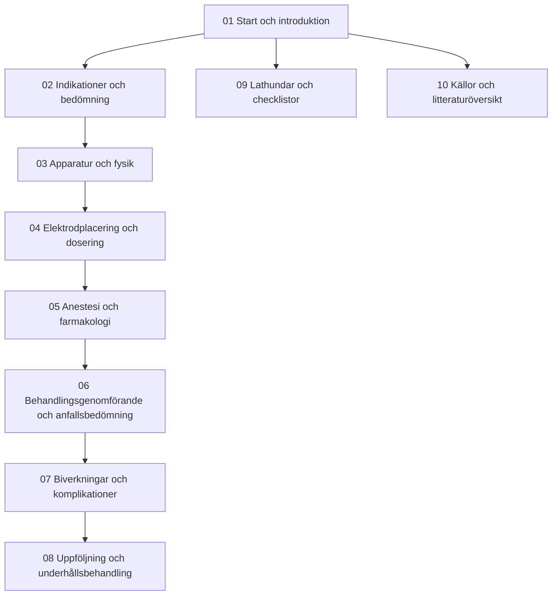

# Introduktion

Detta kompendium är framtaget för dig som arbetar som eller utbildas till **ECT-behandlare**. Det är ett praktiskt inriktat utbildnings- och referensmaterial, samtidigt som det samlar all den fördjupade medicinska och farmakologiska kunskap som är nödvändig för ordinerande och ansvariga läkare.

Materialet syntetiserar internationell standardlitteratur (American Psychiatric Association Task Force, Royal College of Psychiatrists *The ECT Handbook*, Mankad m.fl., *Clinical Manual of Electroconvulsive Therapy*, Conrad M. Swartz (red.)) samt den tekniska manualen för **MECTA spECTrum 5000Q** i **200 J-utförande** (kompendiets huvudapparat; 100 J beskrivs där reservapparat eller äldre källor behöver skiljas åt) - integrerat med svensk klinisk praxis, regionala sjukhusrutiner (Västra Götalandsregionen / Sahlgrenska SU / Mölndal / Östra sjukhuset), Svenska Psykiatriska Föreningens riktlinjer samt aktuell neurobiologisk forskning om E-fält och postiktal spridande kortikal depolarisering (*cortical spreading depolarization*; Nature Communications 2025).

> [!TIP] Rollen som ECT-behandlare
> Som ECT-behandlare bär du det operativa ansvaret vid behandlingsbordet: du stämmer av patientens dagsform och läkarens ordination, säkerställer korrekt elektrodplacering, kontrollerar apparatens parametrar och impedans, administrerar stimuleringen och bedömer anfallets kvalitet på EEG och motoriskt - allt i nära teamsamverkan med anestesipersonal och omvårdnadsteamet.

---

> [!IMPORTANT] Utbildningsmaterial
> Dosering, apparatprogram och lokala rutiner behöver godkännas i den egna verksamheten före klinisk användning.

## Hitta i kompendiet

Kompendiet är uppbyggt kring modulära kapitel länkade med interna länkar. Du kan läsa det linjärt eller slå upp specifika moment via kartan nedan eller i [[02 Innehåll|Innehåll]].

---

## Kom igång

1. **Kom igång i teamet:** [[03 Teamets roller|Teamets roller]]
2. **Apparaten du styr:** [[01 Översikt|Översikt]]
3. **De fyra rattarna och laddningen:** [[03 Parameterinställningar|Parameterinställningar]]
4. **Första behandlingen:** [[03 Titrering av kramptröskeln|Titrering av kramptröskeln]]
5. **Klinisk jour- och behandlingslathund:** [[01 Parameterinställningar|Parameterinställningar]]
6. **När anfallet uteblir:** [[05 Missat, kort eller förlängt anfall|Missat, kort eller förlängt anfall]]

---

## Mål

Efter att ha gått igenom detta kompendium och deltagit i den praktiska handledningen ska du:
- [ ] Behärska indikationer, kontraindikationer och preoperativ somatisk riskbedömning.
- [ ] Kunna ställa in och felsöka MECTA spECTrum 5000Q självständigt.
- [ ] Förstå principerna för elektrisk dosering (laddning i mC, titrering eller formelbaserad dosering).
- [ ] Välja rätt elektrodplacering (RUL d’Elia eller bitemporalt) utifrån klinisk bild och biverkningsprofil.
- [ ] Föra en säker dialog med anestesiologen avseende anestesidjup, kramptröskel och muskelrelaxation.
- [ ] Tolka iktalt motoriskt förlopp och iktalt EEG (symmetri, polyspikar, amplitud, abrupt avslutning, postiktal suppression).
- [ ] Hantera akuta komplikationer, postiktal oro och farmakologiska interaktioner.
- [ ] Registrera och följa upp utfallet enligt principerna i [[04 Kvalitetsregistret för ECT|Kvalitetsregistret för ECT]].

## Källunderlag

Se [[01 Källor och referenser|Källor och referenser]] för litteratur, apparatmanualer och styrdokument. Precisa hänvisningar finns i respektive kliniskt kapitel.
