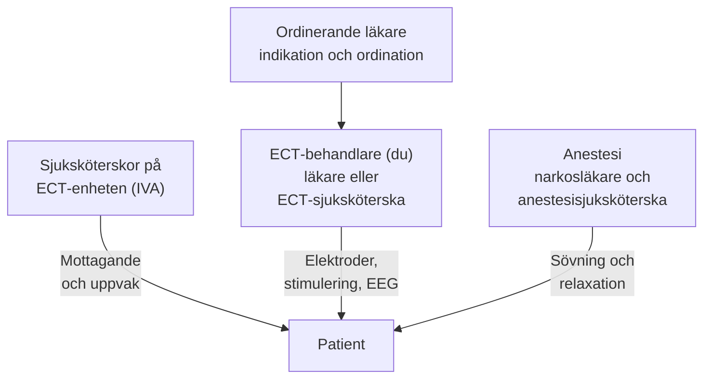

# Teamets roller

ECT (elektrokonvulsiv behandling) är en effektiv behandling vid bland annat svår depression och katatoni. Svarsfrekvens varierar med diagnos, patienturval, metod och utfallsdefinition. 

Detta kompendium är särskilt framtaget för dig som är eller utbildas till **ECT-behandlare** - oavsett om du är läkare eller specialutbildad sjuksköterska med delegering att utföra behandlingen. Samtidigt bevarar materialet all nödvändig medicinsk, farmakologisk och juridisk information för ordinerande och ansvariga psykiatrer.

Vid varje behandling finns en ECT-behandlare (läkare eller ECT-sjuksköterska). Patientmottagandet sköts av sjuksköterskorna på ECT-enheten, hos oss IVA. En framgångsrik och säker ECT-verksamhet bygger på ett väl samordnat multiprofessionellt samarbete:

---

## Roller och ansvar

### 1. ECT-behandlaren
- **Förkontroll:** Säkerställa att medicinskt godkännande och ordination föreligger från ansvarig läkare, att patienten är fastande, samt att samtycke eller LPT-beslut är giltigt.
- **Läkemedelsavstämning:** Kontrollera att ordinationer om läkemedelsändringar (bland annat bensodiazepiner och litium) har efterföljts på behandlingsmorgonen.
- **Hudförberedelse och elektroder:** Förbereda huden, sätta EEG-elektroderna och applicera de handhållna stimuleringselektroderna.
- **Tekniskt handhavande:** Kontrollera apparatens inställningar på **MECTA spECTrum 5000Q** (pulsbredd, frekvens, duration och strömstyrka), utföra statisk impedansmätning och säkerställa korrekt elektrodplacering (RUL d’Elia eller bitemporalt).
- **Stimulering och övervakning:** Administrera stimuleringen vid exakt rätt tidpunkt efter klartecken från anestesin (när full muskelrelaxation uppnåtts) samt övervaka anfallet i realtid med tvåkanals-EEG och observation av motoriken.
- **Akuta åtgärder vid bordet:** Fatta beslut om omedelbar restimulering vid missat eller kort anfall enligt gällande protokoll, samt larma och bistå anestesin vid förlängt anfall (> 1 minut enligt IVA:s rutin; APA: > 120 s) eller cirkulationspåverkan.
- **Dokumentation:** Föra behandlingsjournal (doser, tider, impedans, anfallskvalitet) och registrera data i [[04 Kvalitetsregistret för ECT|Kvalitetsregistret för ECT]].

### 2. Ansvarig läkare
- **Indikation och diagnostik:** Fastställa diagnos, indikation och prioriteringsgrad (vital/akut vs elektiv).
- **Somatisk utredning och riskbedömning:** Bedöma laboratorieprover, EKG, tandstatus och kognitivt utgångsläge, samt begära eventuella specialistkonsultationer (kardiologi, neurologi).
- **Juridik och tvångsvård:** Genomföra samtyckesprocessen eller inhämta formellt beslut om tvångsbehandling enligt § 17 LPT från chefsöverläkare (CÖL).
- **Läkemedelsjusteringar:** Ordinera utsättning, pausning eller dosreduktion av interagerande farmaka (litium, bensodiazepiner, antiepileptika, teofyllin m.fl.) samt eventuell premedicinering med flumazenil vid bordet.
- **Doseringsstrategi:** Välja elektrodplacering (RUL vs BT) och fastställa initial titreringsmetod eller formeldos, samt justera behandlingsplanen under seriens gång baserat på MADRS-S och CGI.

### 3. Anestesiteamet
- Preoperativ anestesibedömning (luftväg, ASA-klass, kardiopulmonell status).
- Induktion av kort generell anestesi med tillräckligt sömndjup med hypnotikum (t.ex. propofol eller tiopental).
- Muskelrelaxation med suxameton (Celocurin) och bedömning av tillräcklig muskelrelaxation.
- Fri luftväg, preoxygenering med 100 % syrgas, ventilation och hyperventilering (hypokapni).
- Övervakning och farmakologisk stabilisering av vitalparametrar (blodtryck, puls och syremättnad; EKG enligt ordination) under anfallet och under uppvakningen.

### 4. Sjuksköterskor på ECT-enheten (IVA)
- **Patientmottagande:** Ta emot patienten och skapa en trygg, lugn och värdig miljö; se [[01 Förberedelser och checklista|Förberedelser och checklista]].
- **Säkerhetskontroller:** Dubbelkontrollera ID-band, fasta och avlägsna tandproteser, smycken och hårnålar.
- **Omvårdnad efter behandlingen:** Övervaka patienten på uppvakningsenheten (vitalparametrar, orientering, fallprevention) och rapportera till vårdavdelningen.

---

## Praktiska råd

> [!TIP] Tre gyllene regler för ECT-behandlaren
> 1. **Kommunicera tydligt mellan rollerna:** Säg högt vad du gör. Vänta alltid på anestesipersonalens uttryckliga *"Varsågod att stimulera"*; först därefter applicerar du handelektroderna och kontrollerar impedansen: *"Statiska impedansen är 1000 Ω, stabil kontakt. Stimulerar!"*
> 2. **Håll inte för hårt - men håll tätt:** När handhållna stimuleringselektroder appliceras ska ett stadigt tryck användas mot huden, med en kompress fuktad i saltlösning eller med kontaktgel mellan elektrod och hud. Dålig kontakt ger hög impedans, risk för brännskada på huden och ojämn strömfördelning.
> 3. **Titta inte bara på klockan - titta på EEG:** Ett motoriskt anfall som varar 20 sekunder kan spegla ett utmärkt EEG-anfall på 45 sekunder hos en välrelaxerad patient. Lär dig känna igen de distinkta rytmiska spik-vågkomplexen och den abrupta postiktala suppressionen!
