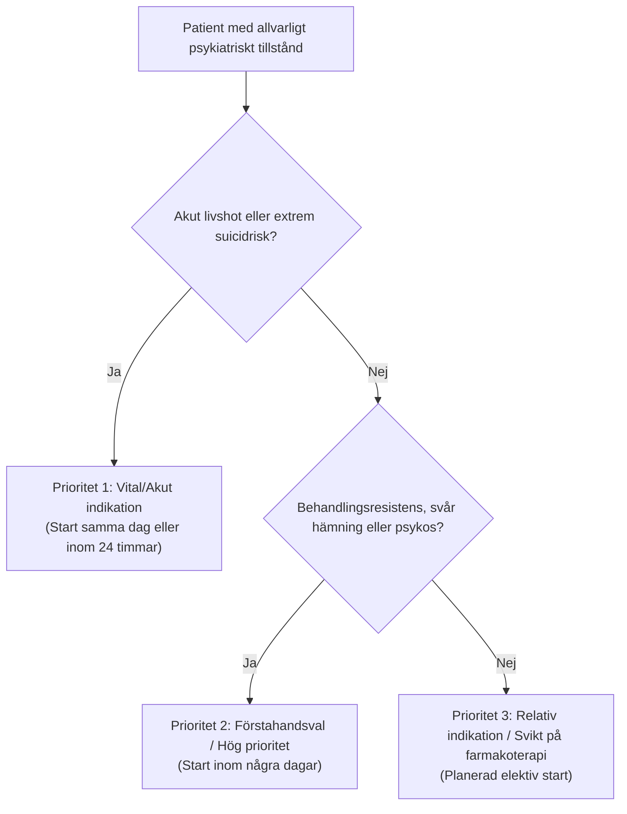

# Indikationer och prioritering

ECT har en mycket stark vetenskaplig evidensbas och är i internationella och svenska riktlinjer (Socialstyrelsen, Svenska Psykiatriska Föreningen, APA, Royal College of Psychiatrists) rankat som den mest effektiva akuta behandlingen vid svår egentlig depression.

---

## Prioriteringsgrupper

Nedan är en pedagogisk prioriteringsindelning, inte en fastställd nationell triageskala. Starttid avgörs av specialistbedömning, somatisk stabilisering och lokala resurser:

### 1. Vital indikation - start inom 24 timmar
Tillstånd där patientens liv är direkt hotat eller där snabb symtomlindring är absolut avgörande för överlevnad:
- **Letal katatoni / Malignt neuroleptikasyndrom (MNS):** Extrem hypertermi, rigiditet, autonom instabilitet. ECT är livräddande!
- **Svår katatoni med total vätske- och matvägran:** Risk för intorkning, rabdomyolys, elektrolytrubbning och aspiration.
- **Akut, svårbehandlad suicidalitet:** Patienter med hög suicidavsikt som aktivt försöker ta sitt liv och där farmakoterapi inte hinner verka.
- **Akut peripartumpsykos / Svår postpartumdepression:** Med risk för suicid eller infanticid.

### 2. Förstahandsval vid svår sjukdom
- **Svår egentlig depression med psykotiska symtom (psykotisk depression):** ECT är ett viktigt behandlingsalternativ med ofta god effekt; exakta utfall beror på patienturval och definition av respons/remission.
- **Svår melankolisk depression:** Uttalad psykomotorisk hämning, dygnsrytmvariation, matleda, viktnedgång, skuldkänslor.
- **Svår behandlingsresistent mani / Bipolärt blandtillstånd:** Särskilt vid delirisk mani (*delirious mania*) eller när patienten inte tål eller svarar på litium/antipsykotika.

### 3. Relativ indikation
- **Behandlingsresistent egentlig depression:** Svikt på minst två adekvata farmakologiska behandlingsförsök (olika klasser) och/eller psykoterapi.
- **Schizofreni / Schizoaffektivt syndrom med akuta exacerbationer:** Särskilt i kombination med antipsykotika (t.ex. klozapin) vid svårbehandlade hallucinationer, vanföreställningar eller katatona drag.
- **Parkinsons sjukdom:** ECT kan dramatiskt förbättra både motoriska "off"-perioder och associerad depression.

---

## Förväntad behandlingseffekt

ECT har god evidens vid svår egentlig depression, särskilt med psykotiska symtom, och är en viktig behandling vid katatoni. Effekt ses också vid vissa svåra maniska och psykotiska tillstånd. Behandlingsval och brådska beror på diagnos, medicinsk risk, tidigare svar och behov av snabb effekt.

Den tidigare tabellens exakta diagnosspecifika procenttal och behandlingsnummer kunde inte knytas till definierade populationer och utfall och har därför tagits bort. **Respons och remission är olika mått.** Ange studie/registerår, behandlingsmetod och utfallsdefinition när siffror återges; se [[02 Klinisk utvärdering|Klinisk utvärdering]].

---

## Faktorer som påverkar effekten

### Faktorer för god effekt
- Hög ålder (äldre patienter svarar ofta bättre och snabbare än yngre).
- Psykotiska drag (vanföreställningar om skuld, undergång, nihilism).
- Uttalad psykomotorisk hämning eller agitation.
- Akut/subakut debut av depressionsepisoden.
- Tidigare gott svar på ECT.

### Faktorer för sämre effekt
- Mycket långdragen episodduration (> 2 år utan remission).
- Samtidigt personlighetssyndrom kan i vissa studier vara associerat med sämre utfall, men utesluter inte effekt. Antagen ”sekundärvinst” är inte en validerad ECT-prediktor.
- Samtidigt pågående aktivt substansbruk.
- Somatiseringssyndrom / kroniskt smärtsyndrom.
- Svår behandlingsrefraktäritet där patienten sviktat på fler än 5-6 adekvata behandlingssteg inklusive MAO-hämmare (svarar sämre men fortfarande värt försök).
