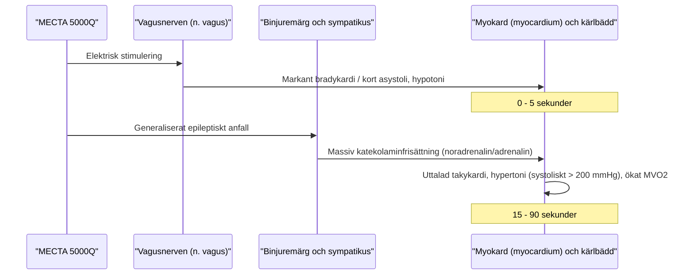

# Kontraindikationer och risker

Det finns **inga absoluta kontraindikationer** mot ECT i strikt medicinsk mening - metoden kan genomföras även vid extremt svåra somatiska tillstånd om indikationen är vital (t.ex. letal katatoni eller svår psykotisk depression med dehydrering). Däremot finns det en rad **högrisktillstånd och relativa kontraindikationer** som kräver noggrann preoperativ optimering och samråd med specialistläkare inom anestesi, kardiologi eller neurologi.

---

## Kardiovaskulära risktillstånd

Under ett ECT-anfall sker en tvåfasig autonom reaktion:
1. **Initial parasympatisk fas (stimulering via vagusnerven):** Varar några sekunder under och direkt efter stimuleringen. Ger bradykardi, asystoliperioder, hypotoni och ökad salivation.
2. **Sekundär kraftig sympatisk aktivering (katekolaminpåslag från binjuremärgen):** Under anfallets kloniska fas och postiktalt. Ger markant sinustakykardi (ofta 140-180 slag/min), blodtrycksstegring (systoliskt tryck kan stiga med 50-100 mmHg), samt ökad myokardiell syreförbrukning (MVO₂).

### Riskbedömning vid hjärtsjukdom
- **Nyligen genomgången hjärtinfarkt (< 3 månader):** Hög risk för reinfarkt eller ventrikelarytmi på grund av den sympatiska tryck- och pulsstegringen.
    - *Åtgärd:* Vid vital indikation kan ECT utföras i samråd med kardiolog, med farmakologisk dämpning av blodtryckstoppen (t.ex. labetalol eller esmolol iv) samt preoperativt ultraljud (eko) för att bedöma EF.
- **Instabil angina pectoris och dekompenserad hjärtsvikt (NYHA III-IV):**
    - *Åtgärd:* Optimera sviktbehandling (diuretika, ACE-hämmare). Narkosläkare förbereder vasodilaterande/blodtryckssänkande läkemedel vid bordet.
- **Aortaaneurysm / Cerebralt aneurysm:** Risk för ruptur vid kraftig blodtryckstopp.
    - *Åtgärd:* Mycket strikt blodtryckskontroll under hela proceduren med beta-1-selektiv blockad (esmolol) eller alfa-/betablockad (labetalol) före och under anfallet.
- **Svår aortastenos:** Fixerat minutvolymhinder. Tål varken uttalad takykardi, arytmi eller blodtrycksfall vid anestesiinduktion.
- **Pacemaker och implanterbar defibrillator (ICD):** ECT kan ofta ges med apparatspecifik plan. Bedöm pacemakerberoende, avkänning (*sensing*), behov av omprogrammering och tillfällig avstängning av ICD-behandling. Magnetrespons varierar. Se [[03 Cirkulation och arytmier|Cirkulation och arytmier]].

---

## Neurologiska risker

- **Förhöjt intrakraniellt tryck (ICP):**
    - Cerebralt blodflöde (CBF) och intrakraniellt tryck i skallhålan ökar flerfaldigt under ett anfall. Vid hjärntumör med masseffekt eller obstruktiv hydrocefalus finns risk för herniering (inklämning av hjärnstammen i stora nackhålet eller tentoriets öppning).
    - *Åtgärd:* Neurokirurgisk/neurologisk konsultation. Dexametason, mannitol eller hyperventilering kan övervägas vid tvingande indikation.
- **Nyligen genomgången ischemisk stroke eller intrakraniell blödning (< 1-3 månader):**
    - Risk för hemorragisk transformation eller sekundärblödning vid blodtrycksstegring.
- **Cerebral arteriovenös missbildning (AVM) / Obehandlat aneurysm:** Kräver strikt blodtrycksstyrning.
- **Epilepsi:** Patienter med känd epilepsi kan behandlas med ECT. Observera att antiepileptika kan höja kramptröskeln och kräva dosjustering.

---

## Övriga somatiska risker

| Tillstånd | Mekanism och risk | Åtgärd |
| :--- | :--- | :--- |
| **Feokromocytom** | Katekolaminfrisättning vid anfallet kan utlösa en dödlig hypertensiv kris. | Relativ kontraindikation; fullständig alfablockad före ECT. |
| **Näthinneavlossning** | Intraokulär tryckstegring under anfallet. | Oftalmologisk bedömning och fullgod relaxation. |
| **Svår osteoporos /** **Färska frakturer** | Kotkompression eller frakturdislokation vid kraftiga muskelkramper. | **Fullständig muskelrelaxation** med adekvat dos suxameton. |
| **Pseudokolinesterasbrist** | Suxameton bryts inte ned → långvarig apné. | Icke-depolariserande relaxantia (t.ex. rokuronium) med sugammadex för reversering. |
| **Gastroesofageal reflux /** **Hiatusbråck** | Regurgitation och kemisk aspirationspneumonit (**Mendelsons syndrom**) under maskventilation. | PPI kl. 06.00 (med 1 msk vatten), vid behov natriumcitrat före induktion, krikoidtryck eller endotrakeal intubation. |
