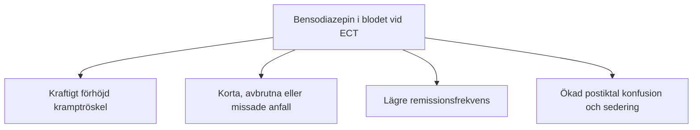

# Läkemedel och interaktioner

Inför en ECT-serie går ansvarig läkare systematiskt igenom patientens samtliga läkemedel, inklusive receptfria och växtbaserade preparat. Dosjusteringar, eventuella pauser och återinsättning ordineras individuellt. ECT-behandlaren kontrollerar att ordinationerna har följts inför varje behandling.

---

## Läkemedelsöversikt

Ingen generell pauslista ersätter bedömning av utsättningsrisk, njurfunktion, samsjuklighet och anestesiplan. Detaljerna finns i avsnitten nedan.

| Läkemedelsgrupp | Handläggning och viktig risk |
| :--- | :--- |
| **Bensodiazepiner och Z-läkemedel** | Kan försämra anfallsutlösning och förkorta anfall. Dosreduktion eller paus kan övervägas av läkare; undvik abrupt utsättning vid beroende. Vid katatoni kan lorazepam behöva fortsätta. |
| **Antiepileptika** | Valproat och karbamazepin kan hämma anfall; effekten av lamotrigin varierar. Ändra inte epilepsibehandling utan ansvarig läkares bedömning; en automatisk morgonpaus är olämplig. |
| **Litium** | Väg återfallsrisk mot risk för delirium, förlängd neuromuskulär blockad och, sällsynt, serotonergt syndrom. Kontrollera S-Li, njurfunktion och vätskestatus; låg koncentration, dosreduktion eller paus ordineras individuellt. |
| **SSRI/SNRI, TCA och antipsykotika** | Kan ofta fortsätta. Beakta QTc, blodtryck, antikolinerg belastning och interaktioner. Klozapin och bupropion kräver särskild bedömning av anfallsrisk. |
| **Antihypertensiva** | Ges som regel på vårdavdelningen före ECT, annars enligt den preoperativa narkosbedömningen i Melior. |
| **PPI/H2-blockerare** | Ges som regel på vårdavdelningen före ECT, annars enligt anestesiplanen. Syrahämning ersätter inte fasta eller luftvägsplan. |
| **Insulin** | Individuell plan efter diabetestyp, preparat, glukos och fastetid. **Basinsulin får inte helt utelämnas vid typ 1-diabetes.** Kontrollera glukos före och efter behandlingen. |
| **SGLT2-hämmare** | Risk för euglykemisk ketoacidos vid fasta. Utsättningen planeras i förväg enligt perioperativ rutin; enbart morgonpaus är otillräcklig. |
| **Övriga diabetesläkemedel, inklusive GLP-1-läkemedel** | Preparatspecifik plan för fasta och återinsättning; beakta aspirationsrisk. |
| **Antikoagulantia** | Kan ofta fortsätta efter bedömning av blödnings- och trombosrisk. Warfarin följs med PK-INR. |
| **Teofyllin/aminofyllin** | Kan öka risken för förlängda anfall. Överväg paus eller alternativ och optimera lungsjukdomen. |
| **Kolinesterashämmare** | Informera anestesin om möjlig förlängd suxametonblockad och bradykardi. |
| **Växtbaserade preparat** | Dokumentera allt intag och bedöm interaktioner och utsättning individuellt. |
---

## Behandlingsplan

- Ordinerad fasta i förhållande till anestesistart.
- Vilka doser som tas, reduceras eller pausas och när de återinsätts.
- Plan för diabetes, glukoskontroller och vid behov ketoner.
- Vem som kontaktas vid avvikelse eller nytillkommen sjukdom.

Undvik att kopiera en generell standardordination med fasta klockslag till patientjournalen.

---

## Bensodiazepiner och Z-läkemedel

Bensodiazepiner (t.ex. oxazepam, diazepam, lorazepam, klonazepam) och Z-läkemedel (zopiklon, zolpidem) är potenta positiva allosteriska modulatorer av GABA-A-receptorn. De är **kraftigt kramphämmande (antikonvulsiva)**!

### Handläggning
1. Bedöm dosreduktion eller planerad paus om anfallsutlösningen påverkas. Väg detta mot ångest, abstinensrisk och grundsjukdom; lorazepam kan behöva fortsätta vid katatoni.
2. Undvik abrupt utsättning vid beroende. Kvälls- och morgonpaus är inte en allmän regel.
3. **Flumazenil** kan övervägas av ansvarig specialist eller anestesiolog i utvalda fall. Effekten på anfallskvalitet är inte garanterad. Risk för akut abstinens, ångest och kramper måste vägas in och tidpunkten individualiseras.

---

## Antiepileptika och stämningsstabiliserare

Valproat och karbamazepin kan försvåra anfallsutlösning. Lamotrigins påverkan varierar och ska inte beskrivas som en säker, markant tröskelhöjning hos alla.

Dosreduktion eller ändrad doseringstid kan övervägas när det behövs. Vid samtidig epilepsi krävs särskild bedömning; pausa inte rutinmässigt antiepileptika utan ordination.

---

## Litium

Kombinationen av litium och ECT kräver stor försiktighet och noggrann övervakning.

### Risker och dosplanering
- Kombinationen kan öka risken för delirium, förlängd konfusion och förlängd neuromuskulär blockad. Mekanismen är inte klarlagd; ökat litiumupptag över blod-hjärnbarriären är en hypotes.
- **Serotonergt syndrom:** Litium har serotonerga effekter, och fallrapporter beskriver serotonergt syndrom vid kombinationen med ECT, särskilt hos känsliga patienter och tillsammans med andra serotonerga läkemedel (SSRI, SNRI). Var uppmärksam på klonus, hyperreflexi, tremor, svettning, feber och agitation efter behandlingen; se [[04 Andra biverkningar|Andra biverkningar]].
- Kontrollera S-Li, njurfunktion, vätskestatus och kognition. Ansvarig läkare väljer låg koncentration, dosreduktion eller paus utifrån nytta och risk. Paus av kvälls- och morgondos är inte en generell svensk regel.
- Den lokala rutinen [*Litiumbehandling av äldre*](https://mellanarkiv-offentlig.vgregion.se/alfresco/s/archive/stream/public/v1/source/available/sofia/su9806-1988473940-140/surrogate/Litiumbehandling%20av%20%C3%A4ldre.pdf), version 5.0 (giltig till 2028-06-02), gäller patienter äldre än 70 år. S-Li ska vara känt före ECT och hållas på lägsta möjliga terapeutiska nivå, omkring 0,4 mmol/L eller i vissa fall lägre, med kontroll cirka en gång per vecka under serien. Nyinsättning ska vänta tills serien avslutats. Om litium ska fortsätta efter ECT bör det inte sättas ut helt under serien. Efter avslutad serie kan tidigare dos återtas enligt ordination; S-Li kontrolleras efter fem halveringstider.
- Nytillkommen konfusion kräver skyndsam medicinsk bedömning, provtagning och ställningstagande till att pausa litium och ECT.

---

## Antidepressiva läkemedel

| Läkemedelsklass | Exempel | Rekommenderad handläggning vid ECT |
| :--- | :--- | :--- |
| **SSRI, SNRI** | Sertralin, escitalopram, venlafaxin, duloxetin | **Behålls ofta efter individuell bedömning.** Beakta blodtryck, QTc och den sällsynta risken för serotonerg toxicitet; effekten på biverkningar är inte likadan för alla preparat. |
| **TCA (tricykliska antidepressiva)** | Klomipramin, amitriptylin, nortriptylin | Kan behållas, men beakta **antikolinerg belastning** (risk för konfusion och takykardi) samt **förlängt QTc-intervall** på EKG. |
| **MAO-hämmare** | Moklobemid (MAO-A), tranylcypromin | Fortsatt behandling eller planerad utsättning bedöms gemensamt av ansvarig psykiater och anestesiolog utifrån preparat, interaktioner och återfallsrisk. Beslut och eventuell utsättningstid dokumenteras i den preoperativa narkosbedömningen. |
| **Bupropion (Voxra)** | Bupropion | Sänker kramptröskeln; förlängda anfall och status epilepticus har rapporterats. Överväg dosreduktion eller paus och planera övervakningen individuellt. |

---

## Antipsykotika

- **Klozapin (Leponex):**
    - Sänker kramptröskeln kraftigt. Kombinationen klozapin och ECT är **mycket effektiv vid behandlingsresistent schizofreni**, men kräver skärpt uppmärksamhet på **förlängda anfall (> 120 s)**! Reducera eventuellt klozapindosen något under indexserien.
- **Övriga (olanzapin, risperidon, haloperidol, aripiprazol):**
    - Kan ofta fortsätta efter individuell bedömning av QTc, cirkulation, sedation och interaktioner. Läkemedelsbehandling av delirium kräver separat bedömning.

---

## Somatiska läkemedel

Ordinarie antihypertensiv medicinering ges som regel på vårdavdelningen före ECT, annars enligt den preoperativa narkosbedömningen i Melior.

Ordinarie PPI ges på vårdavdelningen före ECT, annars enligt anestesiplanen. Syrahämning eliminerar inte aspirationsrisken och ersätter inte fasta eller luftvägsplan.

Diabetesläkemedel kräver en separat plan för fasta och upprepade anestesier:

- **Insulin:** Individuell plan efter diabetestyp, preparat, glukos och fastetid. **Basinsulin får inte helt utelämnas vid typ 1-diabetes.** Ingen generell halvering för alla. Kontrollera glukos före och efter behandlingen.
- **SGLT2-hämmare:** Risk för euglykemisk ketoacidos vid fasta. Planera utsättningen i förväg enligt aktuell perioperativ rutin, med skillnader mellan riktlinjer: SFAI 2026 anger minst 48 timmar inför kirurgi, Region Skåne 3 dygn. Enbart morgonpaus är otillräcklig; upprepade ECT-tillfällen kräver en sammanhängande plan. Återinsätt först efter medicinsk bedömning.
- **Övriga diabetesläkemedel, inklusive GLP-1-läkemedel:** Preparatspecifik plan för fasta och återinsättning. Beakta gastrointestinala symtom och aspirationsrisk; ingen gemensam regel för alla perorala medel.

**Antikoagulantia:** Kan ofta fortsätta efter individuell bedömning av blödnings- och trombosrisk. Warfarin följs med PK-INR enligt patientens ordination; INR används inte för att värdera DOAK-effekt.

---

## Teofyllin och teofyllamin

Teofyllinpreparat (Theo-Dur, Teofyllamin) används vid svår astma eller KOL.

- **Mekanism:** Teofyllin är en potent adenosinreceptorantagonist och fosfodiesterashämmare. Adenosin är en av hjärnans viktigaste endogena mekanismer för att avbryta ett epileptiskt anfall, så teofyllin hämmar hjärnans egen anfallsavslutning.
- **Risk:** Ökad risk för **förlängda anfall, refraktärt status epilepticus och hjärtarytmier**.
- **Handläggning:**
    - Sätt ut eller pausa teofyllin i god tid före ECT-start om patientens lungsjukdom tillåter.
    - Optimera i stället lungsjukdomen med inhalationssteroider, LABA och LAMA.
    - Om ECT måste ges akut trots pågående teofyllinbehandling: Narkosläkaren måste ha beredskap med förlängd ventilation och antikonvulsiva läkemedel (propofol, midazolam, levetiracetam) uppdragna vid bordet.

---

## Kolinesterashämmare

Patienter med begynnande kognitiv svikt, demens eller äldrepsykiatriska tillstånd behandlas ofta med kolinesterashämmare som **donepezil (Aricept)**, **rivastigmin (Exelon)** eller **galantamin (Reminyl)**.

> [!CAUTION] Allvarlig interaktion med suxameton (Celocurin)!
> Kolinesterashämmare kan interagera med suxameton och ge bradykardi. Enzymselektiviteten skiljer sig mellan preparaten; exempelvis hämmar rivastigmin även butyrylkolinesteras, medan donepezil är mer acetylkolinesterasselektivt. Möjliga konsekvenser är:
> 1. **Kraftigt förstärkt och förlängd** muskelrelaxerande effekt av suxameton (apné som varar betydligt längre än normalt, 3-5 minuter).
> 2. **Uttalad vagusstimulering:** Kraftigt ökad risk för svår bradykardi, AV-block och **asystoli** under det initiala parasympatiska skedet av stimuleringen!
> 
> **Handläggning:**
> - Informera **alltid** narkosläkaren i förväg om patienten står på kolinesterashämmare.
> - Narkosteamet behöver ofta reducera dosen suxameton eller ha beredskap med atropin eller glykopyrron (Robinul) iv före induktion.

---

## Naturläkemedel

Många patienter tar receptfria naturläkemedel och kosttillskott utan att betrakta dem som "riktiga läkemedel". Rutinerna vid Sahlgrenska universitetssjukhuset (SU/Mölndal) föreskriver noggrann anamnes och utsättning:

| Preparat | Verkningsmekanism och risk | Handläggning |
| :--- | :--- | :--- |
| ***Ginkgo biloba*** | Påverkar trombocytaggregation (blödningsrisk) samt GABAerg signalering (oförutsägbar kramptröskel). | **Sätt ut i god tid** inför ECT. |
| **Ginseng** | Centralstimulerande effekt, interaktioner med anestesimedel, blodtryckssvängningar. | **Sätt ut** inför ECT. |
| **Johannesört (*Hypericum perforatum*)** | Kraftig inducerare av CYP3A4 och P-glykoprotein; ökar risken för serotonergt syndrom och kan förändra metabolismen av anestesimedel. | **Sätt ut** inför ECT. |
| **Vänderot (*Valeriana*), kava (*Piper methysticum*)** | Påverkar GABA-A-receptorn; förstärker sedativa effekter och höjer kramptröskeln (risk för missade anfall). | **Sätt ut** inför ECT. |
