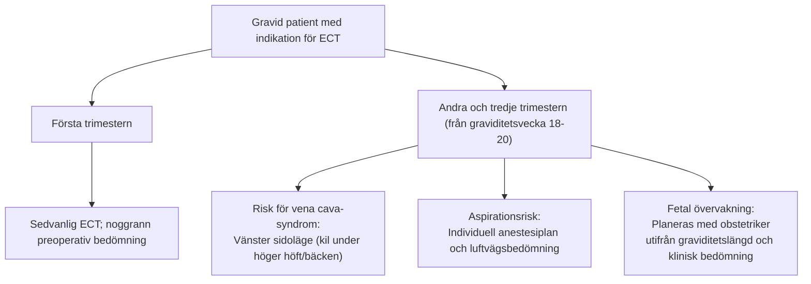

# Graviditet och äldre

Kliniska riktlinjer från Svenska Psykiatriska Föreningen (SPF) samt lokala sjukhusrutiner (Sahlgrenska Universitetssjukhuset, Östra sjukhuset och Mölndal) ger tydliga rekommendationer för patientgrupper med särskilda behov.

---

## Graviditet

ECT kan övervägas under graviditet vid svår depression, mani, psykos eller katatoni, särskilt när snabb effekt behövs. Nytta och risk bedöms individuellt med psykiater, anestesiolog och obstetriker. Behandlingen är inte riskfri eller ett generellt förstahandsval för alla dessa tillstånd.

### Anestesi vid graviditet
- Anpassa positionering med vänsterförskjutning av uterus när aortokaval kompression är relevant.
- Bedöm aspirationsrisk, fasta, eventuell profylax och behov av intubation individuellt. Graviditet innebär inte automatiskt att alla från andra trimestern har fördröjd ventrikeltömning eller ska ventrikelaspireras.
- Bedöm vätskestatus och behov av vätsketillförsel tillsammans med anestesiolog.
- Planera fosterövervakning efter graviditetslängd och obstetrisk bedömning. En ensam veckogräns kan inte ersätta denna plan.
- Den lokala [Östra-rutinen](https://mellanarkiv-offentlig.vgregion.se/alfresco/s/archive/stream/public/v1/source/available/SOFIA/SU9805-1593997-597/SURROGATE/ECT%20och%20ECT%20gravid%20kvinna.pdf), version 10.0, anger god preoxygenering, normalt CO₂ och att hyperventilering ska undvikas vid graviditet. Fosterstatuskontroll efter behandlingen görs om obstetriker ordinerat detta. Rutinen gäller Anestesi Operation IVA Östra och tillämpas tillsammans med individuell anestesi- och obstetrisk bedömning.

---

## Äldre

Äldre kan ha god effekt av ECT men har ofta högre somatisk och kognitiv sårbarhet. Välj teknik och uppföljning individuellt.

### Behandlingsplanering

- Beakta samsjuklighet, särskilt kardiella risker, och kognitiv funktion före behandlingsstart.
- Vid kognitiv sårbarhet kan högersidig unilateral stimulering (RUL d’Elia) övervägas framför bitemporal. Valet anpassas efter indikation, effekt och biverkningar; se [[01 Elektrodplacering|Elektrodplacering]].
- Kramptröskeln kan vara högre hos äldre. Anpassa doseringen efter individuell bedömning; se [[04 Empirisk titrering|Empirisk titrering]].

### Litium

Samtidig litiumbehandling kan öka risken för delirium och förlängd neuromuskulär blockad. Mekanismen är inte klarlagd. Den lokala rutinen [*Litiumbehandling av äldre*](https://mellanarkiv-offentlig.vgregion.se/alfresco/s/archive/stream/public/v1/source/available/sofia/su9806-1988473940-140/surrogate/Litiumbehandling%20av%20%C3%A4ldre.pdf), version 5.0, anger att S-Li ska vara känt före ECT och hållas på lägsta möjliga terapeutiska nivå, omkring 0,4 mmol/L eller i vissa fall lägre, med kontroll cirka en gång per vecka under serien. Nyinsättning ska vänta tills serien avslutats. Om litium ska fortsätta efter ECT bör det enligt rutinen inte sättas ut helt under serien. Rutinen anger ingen generell paus av kvälls- och morgondosen. Den gäller patienter äldre än 70 år och är giltig till 2028-06-02.

Paus, dosreduktion och återinsättning beslutas av ansvarig läkare. Se [[04 Läkemedel och interaktioner|Läkemedel och interaktioner]].
