# Översikt

**MECTA spECTrum 5000Q** är en av världens mest använda och driftsäkra apparater för elektrokonvulsiv behandling. Beteckningen **"Q"** står för **"Quad"**, vilket innebär att behandlaren har oberoende kontroll över fyra separata rattar för stimuleringens parametrar: **Pulsbredd**, **Frekvens**, **Duration** och **Strömstyrka**.

**Här avses 200 J-utförandet.** Modellen **5000** har en integrerad enhet för fysiologisk patientövervakning som möjliggör realtidsregistrering av EEG, EKG och optisk rörelsesensor (OMS) på en inbyggd LCD-pekskärm och pappersskrivare.

---

## Frontpanel och reglage

![[Figurer/MECTA spECTrum 5000Q frontpanel.png]]
*Figur 1: Frontpanelens layout på MECTA spECTrum 5000Q. Från vänster till höger: strömbrytare, stimuleringsknapp och stimuleringsutgång; LCD-pekskärm och de fyra parameterrattarna (Quad); isolerade ingångar för EEG/EKG samt OMS; och till höger förstärkningsrattar (Gain 1 och 2) samt termoskrivare (Chart Recorder).*

```mermaid
flowchart LR
    subgraph Vanster ["1. Stimuleringssektion"]
        direction TB
        A["POWER: Nätströmbrytare"]
        B["STIMULUS STATUS: Indikator-LED"]
        C["STIMULUS CONTROL: Stimuleringsknapp"]
        D["STIMULUS OUTPUT: Kontakt för behandlingskabel"]
    end

    subgraph Mitten ["2. Display och de fyra rattarna (Quad)"]
        direction TB
        E["LCD-pekskärm: Visar impedans, mC och kurvor"]
        F["PULSE WIDTH (ms): Pulsbredd"]
        G["FREQUENCY (Hz): Frekvens"]
        H["DURATION (s): Duration"]
        I["CURRENT (mA): Strömstyrka (500-900 mA i Full Spectrum)"]
    end

    subgraph Monitor ["3. Patientingångar"]
        direction TB
        K["PATIENT INPUT 1: EEG kanal 1 och 2"]
        L["PATIENT INPUT 2: EKG eller EMG"]
        M["OMS: Optisk rörelsesensor"]
    end

    subgraph Hoger ["4. Kurvskrivare"]
        direction TB
        N["GAIN 1 och GAIN 2: Förstärkning"]
        O["CHART RECORDER: ON/OFF och papperslucka"]
    end

    Vanster --- Mitten --- Monitor --- Hoger
```

### Reglagens funktion

| Sektion | Reglage / Märkning | Funktion | Klinisk kommentar för behandlaren |
| :--- | :--- | :--- | :--- |
| **Vänster** | **POWER** | Nätströmbrytare | Startar enheten. Kör självtest i ca 35 sekunder. |
| | **STIMULUS STATUS** | Beredskapsindikator (LED) | Lyser med beredskapssken enligt aktuell manual när testimpedansen är godkänd och apparaten är redo att ge stimulering. |
| | **STIMULUS CONTROL** | Stimuleringsknapp med skyddskrage | **Måste hållas intryckt** under hela stimuleringen (3 varningspip + pulstågets duration) tills tonen tystnar helt! |
| | **STIMULUS OUTPUT** | Uttag för stimuleringskabel | 6-polig säkerhetskontakt för de handhållna handtagen eller självhäftande stimuleringselektroderna. |
| **Mitten** | **LCD-pekskärm** | Interaktiv pekskärm | Visar statisk impedans, valda rattparametrar, beräknad laddning (Q i mC), dynamiska mätningar och realtidskurvor. |
| | **PULSE WIDTH** | Pulsbreddsratt (ms) | 0,3-1,0 ms i det uppdaterade Full Spectrum-programmet; snävare intervall i optimerade program. |
| | **FREQUENCY** | Frekvensratt (Hz) | Justerar antalet pulspar per sekund (20-120 Hz). |
| | **DURATION** | Durationsratt (s) | Justerar pulstågslängden (0,5-8,0 sekunder). |
| | **CURRENT** | Strömstyrkeratt (mA) | **500-900 mA** i Full Spectrum; fast **800 mA** i optimerade program. Strömmen är konstant under varje puls vid det valda värdet. |
| **Monitor** | **PATIENT INPUT 1** | Ingång för EEG-elektroder | Registreringselektroder (två aktiva elektroder i pannan och jord/referens under nyckelbenet) för realtidsregistrering av iktal aktivitet. |
| | **PATIENT INPUT 2** | Ingång för EKG / EMG | Registrerar hjärtrytm (vagal bradykardi → sympatisk takykardi) eller perifera muskelpotentialer. |
| | **OMS INPUT** | Optisk rörelsesensor | Anslutning för fotocellsgivaren som tejpas över tån eller fingret distalt om manschetten. |
| **Höger** | **GAIN 1 och GAIN 2** | Förstärkningsrattar | Justerar kurvamplituden för respektive EEG-kanal på display och pappersremsa. |
| | **CHART RECORDER** | Två- till fyrkanals termoskrivare | Startas och stoppas med `ON`/`OFF`. Matar ut pappersremsa i realtid med sidhuvud, kurvor och slutrapport. |

---

## Säkerhet och självtest

När MECTA 5000Q startas genomförs en omfattande automatisk självkontroll:
1. **Mikroprocessorsjälvtest (ca 35 sekunder):** Testar interna minneskretsar, strömkällor, reläer och säkerhetsbrytare.
2. **CLEAR-knapp:** När testet är godkänt visas knappen `CLEAR` på LCD-skärmen. Tryck på `CLEAR` för att komma till läget **TREATMENT READY**.
3. **Kontinuerligt impedanstest (*Patient Self-Test*):** Så snart stimuleringselektroderna appliceras mot patientens hud sänder MECTA ut en omärkbar högfrekvent mätström (mikroampere) och visar patientens **statiska impedans** kontinuerligt i displayen.

> [!WARNING] Viktig regel vid stimulering
> Om du släpper `STIMULUS CONTROL`-knappen för tidigt (innan hela pulståget levererats) avbryts behandlingen omedelbart av maskinens säkerhetsrelä och felmeddelandet **"PREMATURE RELEASE - TREATMENT TERMINATED"** visas! Håll alltid knappen stadigt intryckt tills apparaten tystnar helt.

## Programversion och doskapacitet

Kompendiet avser **spECTrum 5000Q, 200 J**. MECTA:s datablad för det uppdaterade 200 J-systemet anger maximal laddning **1152 mC** och energi upp till **202,8 J vid referensimpedansen 220 Ω**. Verklig levererad energi beror på ström och dynamisk impedans.

I **Full Spectrum Dosing** anges pulsbredd **0,3-1,0 ms**, frekvens **20-120 Hz**, duration **0,5-8,0 s** och ström **500-900 mA**. De optimerade programmen har snävare intervall och fast ström **800 mA**; se [[03 Parameterinställningar|Parameterinställningar]]. Alla maximivärden kan inte kombineras samtidigt.

### Om 100 J-reservapparat används

| Utförande | Maximal laddning enligt respektive underlag | Energi vid 800 mA och 220 Ω |
| :--- | :--- | :--- |
| 200 J: huvudapparat | 1152 mC | Cirka 202,8 J |
| 100 J: eventuell reservapparat | 576 mC | Cirka 101,4 J |

Värdena beskriver apparatkapacitet, inte rekommenderad behandlingsdos. Parametergränserna beror även på programrevision och valt program; maxladdningen kan inte nås med varje kombination av rattinställningar. Vid byte till reservapparat kontrolleras att den ordinerade laddningen och parameterkombinationen ryms inom dess gränser. En laddning över 576 mC kan inte levereras av 100 J-utförandet. Äldre 100 J-dokumentation i referensbiblioteket används för reservapparaten och som historisk referens, inte som kapacitetsuppgift för huvudapparaten.

---

## Referenser

1. American Psychiatric Association. *The Practice of Electroconvulsive Therapy*. 3 uppl.; copyright 2025. Kap. 4, ”Location, Equipment, and Supplies”, och kap. 14.1-14.2 om stimulusparametrar. Allmän bakgrund; MECTA-reglage, program och 200 J-gränser hämtas från tillverkarunderlagen nedan.
2. [MECTA Corporation. Optimized and Full Spectrum Dosing Parameter Sets. ECT Parameters / 200 Joule Systems. D-CS #0053 Rev A; 2011](https://ro.scribd.com/document/73906584/ECT-Dosing-Parameters).
3. [MECTA. Optimized spECTrum Instruction Manual. INT, 200 J; artikelnummer 9900-1012-16](https://mectaspectrum.com/clinician/clinical-ect-materials/). Frontpanel, tillval och programrevision jämförs med den installerade enheten.

---

## Relaterade länkar
- Beräkning av laddning och fysik: [[02 Laddning och energi|Laddning och energi]]
- De fyra rattarnas inställning: [[03 Parameterinställningar|Parameterinställningar]]
- Impedansmätning och gränser: [[04 Statisk och dynamisk impedans|Statisk och dynamisk impedans]]
- Felsökning och felkoder: [[05 Larm och felsökning|Larm och felsökning]]
- Praktisk handhavandeguide: [[02 Behandling steg för steg|Behandling steg för steg]]
- Konvertering från Thymatron System IV (vid övertagande från annan klinik): [[02 Appendix - Thymatron System IV|Appendix: Thymatron System IV]]
