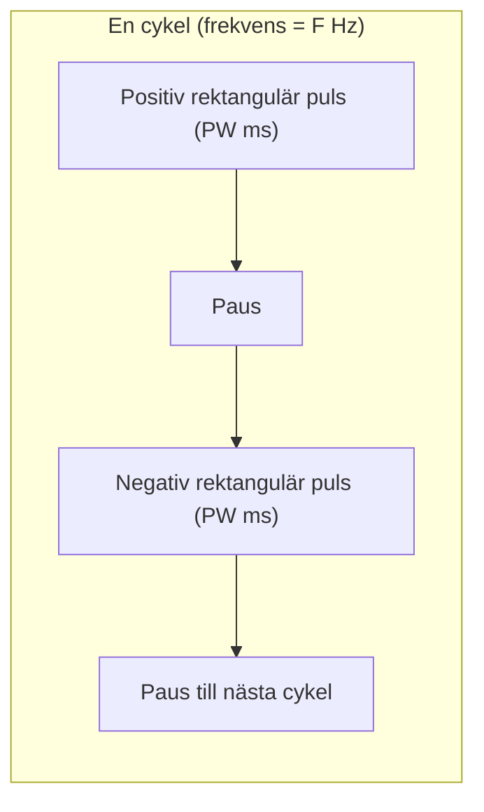

# Laddning och energi

För att förstå hur stimuleringen fungerar och hur du ordinerar behandlingen på MECTA spECTrum 5000Q behöver du behärska de grundläggande biofysiska begreppen: **vågform**, **konstant ström**, **laddning (Q)** och **energi (E)**.

---

## Rektangulära pulser

Äldre ECT-apparater använde sinusvåg. Rektangulära kortpulser kan utlösa anfall med mindre total laddning än sinusvåg och har en gynnsammare kognitiv biverkningsprofil. APA beskriver den snabba framkanten som effektiv för neuronal excitation; en långsamt stigande vågform kan ge ackommodation. Skillnaden kan inte förklaras enbart som ström under en nervcells refraktärperiod.

Moderna apparater som **MECTA spECTrum 5000Q** använder uteslutande **tvåfasiga rektangulära pulser** (*bidirectional square-wave pulses*):

- Varje **cykel** (Hz) består av **två pulser** (en positiv och en negativ fas).
- Varje enskild puls varar under pulsbredden (*pulse width*, **PW**), t.ex. 0,5 ms eller 1,0 ms.
- Pulsformen påverkar hur effektivt nervvävnaden exciteras. Ett generaliserat anfall kräver rekrytering och fortsatt aktivitet i nätverk; se [[04 Neurobiologiska mekanismer#Anfallsgenerering|Anfallsgenerering enligt Swartz]].

---

## Konstant ström

MECTA spECTrum är en **konstantströmsgenerator**. Det innebär att apparaten levererar en exakt förutbestämd strömstyrka (I), enligt ordination **500-900 mA** i Full Spectrum, inom apparatens spännings- och säkerhetsgränser. På Q-modellen beror tillgängliga strömvärden på valt parameterprogram.

Enligt Ohms lag:
$$U = I \times R$$

Om patientens dynamiska impedans är t.ex. 200 Ω kommer apparaten automatiskt att applicera en spänning på:
$$U = 0{,}8\ \text{A} \times 200\ \Omega = 160\ \text{Volt}$$

Om impedansen är högre (300 Ω) ökar spänningen automatiskt till:
$$U = 0{,}8\ \text{A} \times 300\ \Omega = 240\ \text{Volt}$$

Apparaten reglerar strömmen mellan stimuleringselektroderna. Strömmen fördelas mellan skalp, skallben, likvor och hjärnvävnad; 800 mA mellan elektroderna är inte ett mått på hur mycket som passerar en viss hjärnstruktur.

---

## Laddningsformeln

**Elektrisk laddning i millicoulomb (mC)** används som praktiskt sammanfattande dosmått i de aktuella kliniska handböckerna. Det beskriver inte hela den biologiska stimuleringen: samma mC med olika pulsbredd, ström, frekvens, pulstågslängd eller elektrodplacering behöver inte ge samma tröskel, effekt eller biverkningar.

På MECTA spECTrum 5000Q beräknas den levererade laddningen med följande formel:

$$Q = \frac{I}{1000} \times PW \times 2F \times D$$

Där:
- Q = Summan av pulsfasernas absoluta laddning i **millicoulomb (mC)**; inte nettoladdningen i ett laddningsbalanserat tvåfasigt pulståg
- I = Strömstyrka i **milliampere (mA)** (500-900 mA i Full Spectrum; exemplen nedan använder 800 mA)
- PW = Pulsbredd i **millisekunder (ms)** (t.ex. 0,5 ms eller 1,0 ms)
- F = Frekvens i **hertz (Hz)** (antal cykler per sekund; varje cykel innehåller 2 pulser, därav faktorn 2F)
- D = Pulstågets duration i **sekunder (s)**

### Räkneexempel

#### Exempel 1: Kortpuls (*brief pulse*)
- Ström (I) = 800 mA
- Pulsbredd (PW) = 1,0 ms
- Frekvens (F) = 40 Hz
- Duration (D) = 2,0 s

$$Q = \frac{800}{1000} \times 1{,}0 \times (2 \times 40) \times 2{,}0 = 0{,}8 \times 1{,}0 \times 80 \times 2{,}0 = 128\text{ mC}$$

#### Exempel 2: Låg startdos
- Ström (I) = 800 mA
- Pulsbredd (PW) = 1,0 ms
- Frekvens (F) = 20 Hz
- Duration (D) = 1,0 s

$$Q = 0{,}8 \times 1{,}0 \times (2 \times 20) \times 1{,}0 = 0{,}8 \times 40 \times 1{,}0 = 32\text{ mC}$$

#### Exempel 3: Laddning 576 mC
- Ström (I) = 800 mA
- Pulsbredd (PW) = 1,0 ms
- Frekvens (F) = 60 Hz
- Duration (D) = 6,0 s

$$Q = 0{,}8 \times 1{,}0 \times 120 \times 6{,}0 = 576\text{ mC}$$

Detta är ett räkneexempel, inte 200 J-apparatens maxladdning eller en föreslagen behandlingsdos.

---

## Laddning (mC) och energi (J)

Apparaten visar även beräknad energi i **joule (J)**. Energi och laddning är olika storheter:
$$E\,(\mathrm{J}) = Q\,(\mathrm{C}) \times U\,(\mathrm{V}) = I^2 R t_{\mathrm{på}}$$

Här är t (på) den sammanlagda tiden då pulserna faktiskt leder ström, inte hela pulstågets duration. Vid Q i mC divideras med 1000 före beräkning av joule.

- **Varför vi föredrar millicoulomb (mC) framför joule:**
  Energin i joule är direkt beroende av patientens dynamiska impedans (R). Två patienter som får exakt samma laddning i mC kan få olika energi i joule eftersom impedansen skiljer sig, bland annat med elektrodkontakt, hud och hår, elektrodplacering (högre vid unilateral) och kön (högre hos kvinnor). 
  **Millicoulomb beskriver laddningen i apparatens stimuleringskrets.** Samma mC vid olika pulsbredd, strömstyrka eller elektrodplacering innebär inte samma biologiska eller kliniska dos.

> [!NOTE] Apparatspecifik maxkapacitet
> Kompendiets huvudapparat är **MECTA spECTrum 5000Q, 200 J**, med maximal laddning **1152 mC** enligt det uppdaterade parameterprogrammets datablad. Vid 800 mA och referensimpedansen 220 Ω motsvarar detta cirka **202,8 J**. Den tillgängliga laddningen beror även på valt parameterprogram och parameterkombination.
>
> Om en **100 J-reservapparat** används gäller dess lägre kapacitet: **576 mC**, motsvarande cirka **101,4 J** vid samma ström och referensimpedans. Kontrollera apparatversion, program och visad laddning vid apparatbyte. Se [[01 Översikt|Översikt]].

---

## Referenser

1. Mankad MV, Beyer JL, Weiner RD, Krystal AD. *Clinical Manual of Electroconvulsive Therapy*. Arlington, VA: American Psychiatric Publishing; 2010. Kap. 4, ”Basics”, s. 47-57. Impedansens skillnader mellan kön och elektrodplaceringar, s. 53. Underlag för pulser, konstant ström och elektriska dosbegrepp.
2. American Psychiatric Association. *The Practice of Electroconvulsive Therapy*. 3 uppl.; copyright 2025. Kap. 14.1-14.2, ”Waveform Characteristics” och ”Stimulus Parameters”. Underlag för laddning och parameterkombinationer.
3. Swartz CM. Electricity and electroconvulsive therapy. I: Swartz CM, red. *Electroconvulsive and Neuromodulation Therapies*. Cambridge: Cambridge University Press; 2009. Kap. 1, s. 3-16. Elektrisk bakgrund till laddning och energi; anfallsgenereringen behandlas särskilt på s. 6-8.
4. [MECTA. Optimized spECTrum Instruction Manual. INT, 200 J; artikelnummer 9900-1012-16](https://mectaspectrum.com/clinician/clinical-ect-materials/).
5. Äldre referens för reservapparat och funktionsbeskrivningar: [MECTA Corporation. spECTrum Instruction Manual. 100 Joules; s. 16-22](https://mectaspectrum.com/clinician/clinical-ect-materials/).

Swartz modell för anfallsinduktion återges separat i [[04 Neurobiologiska mekanismer#Anfallsgenerering|Anfallsgenerering]].

---

## Relaterade länkar
- Rattarna på maskinen: [[03 Parameterinställningar|Parameterinställningar]]
- Mätning av impedans: [[04 Statisk och dynamisk impedans|Statisk och dynamisk impedans]]
- Titreringstabeller: [[04 Titreringstabeller|Titreringstabeller]]
- Snabbguide vid bordet: [[01 Parameterinställningar|Parameterinställningar]]
