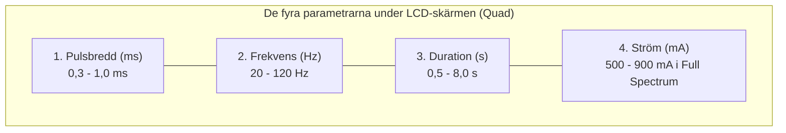
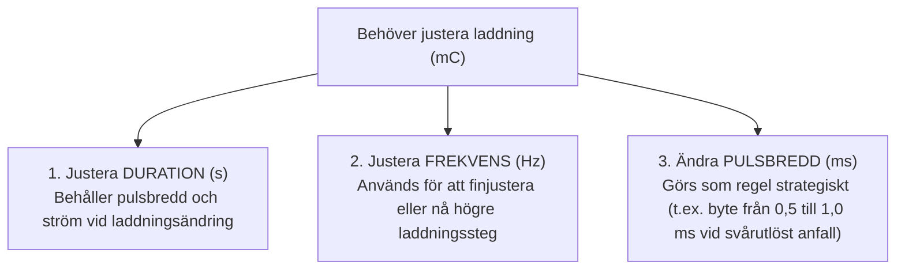

# Parameterinställningar

På **MECTA spECTrum 5000Q** regleras den elektriska dosen med **fyra separata vridreglage (rattar)** som sitter horisontellt placerade direkt under den centrala LCD-skärmen:

![[MECTA 5000Q de fyra rattarna.png]]
*Figur 1: De fyra separata vridreglagen (Quad) under LCD-skärmen på MECTA spECTrum 5000Q.*

**Kompendiet avser spECTrum 5000Q i 200 J-utförande.** Tabellen anger minimi- och maximivärden i **Full Spectrum Dosing** enligt MECTA:s datablad för det uppdaterade parameterprogrammet.

| Ratt / Märkning | Enhet | Min-max (Full Spectrum, 200 J) | Fysiologisk funktion |
| :--- | :---: | :---: | :--- |
| **PULSE WIDTH** | millisekunder (ms) | 0,3-1,0 ms | Pulsens bredd; påverkar kramptröskel, effekt och kognitiva biverkningar. |
| **FREQUENCY** | hertz (Hz) | 20-120 Hz | Antal tvåfasiga pulspar per sekund. |
| **DURATION** | sekunder (s) | 0,5-8,0 s | Pulstågslängd; används för att ändra laddningen (Q). |
| **CURRENT** | milliampere (mA) | 500-900 mA | Konstant strömamplitud under varje puls, vid det valda strömvärdet. |

**Optimerade program har snävare intervall:** 0,3-programmet medger 0,3-0,75 ms och 20-120 Hz; 0,5-programmet 0,5-0,75 ms och 20-120 Hz; 1,0-programmet 1,0 ms och 20-90 Hz. Samtliga har duration 0,5-8,0 s och fast ström 800 mA.

Gränserna är programberoende och alla maximivärden kan inte kombineras samtidigt. Äldre apparatrevisioner kan ha andra intervall. Kontrollera valt parameterprogram och visad laddning på enheten; 200 J-beteckningen ensam identifierar inte programrevisionen.

**Maxladdning är inte samma sak som max vid fast pulsbredd.** Med 0,3 ms, 800 mA, 120 Hz och 8,0 s blir den beräknade laddningen 460,8 mC. Apparatens totala kapacitet 1152 mC kan alltså inte nås med just den pulsbredden och strömmen. Detta är ett räkneexempel; ändrad pulsbredd kräver omprövad ordination. För 100 J-reservapparat gäller dessutom dess lägre kapacitetsgräns, se [[01 Översikt|Översikt]].

När du vrider på någon av dessa rattar uppdateras omedelbart den beräknade laddningen (**mC**) och energin (**J**) i realtid på pekskärmens nedre fält.

---

## 1. Pulsbredd (ms)

Pulsbredden anger hur många millisekunder varje enskild elektrisk puls varar.

### Kronaxi och reobas
- **Reobas:** Tröskelamplituden vid mycket lång puls i en styrka-durationsmodell.
- **Kronaxi:** Pulsdurationen som krävs vid dubbla reobasamplituden. Den beror på vilka nervstrukturer och vilken mätmetod som studeras och är inte identisk med membranets tidskonstant.
- Kortare pulsbredd kan minska kognitiva biverkningar, särskilt vid RUL, men påverkar också kramptröskel och effekt. Det går inte att ange att alla neuron når tröskeln efter 0,2 ms eller att återstoden av en 1 ms-puls är verkningslös.
- Ändrad pulsbredd kräver en ny bedömning av dos i förhållande till tröskeln. Samma mC över olika pulsbredder är inte biologiskt likvärdigt.

---

### Val av pulsbredd

- **0,3 ms (ultrakort puls, *ultrabrief*):** Kan sänka den laddning som krävs för anfallsutlösning och minska kognitiv påverkan vid RUL jämfört med längre kortpulser. Vissa studier visar samtidigt långsammare eller lägre antidepressiv effekt. Låg kramptröskel innebär inte att en tröskelnära dos räcker för behandlingseffekt.
- **0,5 ms (kortpuls, *brief pulse*):** Vanlig i de svenska registerstudierna nedan. Användningsfrekvensen fastställer inte att den är optimal för varje patient. Direkta jämförelser mellan 0,3 och 0,5 ms är mindre väl underbyggda än jämförelser mellan ultrakort puls och 1,0-1,5 ms.
- **1,0 ms (kortpuls, *brief pulse*):** En vanlig studerad kortpulsbredd. Den är inte automatiskt effektivare än 0,5 ms och kan inte väljas enbart utifrån patientens kön eller ålder. Dosering, elektrodplacering, kliniskt svar och kognition måste vägas samman.
- **Sinusvåg:** Historisk vågform med större kognitiv påverkan och utan visad terapeutisk fördel framför modern kortpulsstimulering. Den ska inte användas som modell för dagens inställningar.

Begreppen reobas och kronaxi beskriver elektrisk excitation under definierade förhållanden. De ger inte en universell pulsbredd för hela hjärnan eller en beräkning av ”bortkastad” laddning. Se även [[04 Neurobiologiska mekanismer#Anfallsgenerering|Anfallsgenerering]].

Källunderlag: [American Psychiatric Association. *The Practice of Electroconvulsive Therapy*. 3 uppl.; copyright 2025](https://doi.org/10.1176/appi.books.9780890427118), kap. 14.1-14.2; [Mankad MV, Beyer JL, Weiner RD, Krystal AD. *Clinical Manual of Electroconvulsive Therapy*. 2010](https://scholars.duke.edu/publication/1105703), kap. 4-5.

---

## 2. Frekvens (Hz)

Frekvensen anger antalet cykler (par av tvåfasiga pulser) som maskinen levererar per sekund.

### Pulsfrekvens och nervcellsrekrytering
- Frekvensen samverkar med pulsbredd, strömstyrka och pulstågslängd. Lägre frekvens och längre pulståg kan vara mer laddningseffektiva för anfallsutlösning än hög frekvens.
- Det finns inget generellt bevisat optimalt fönster på 30-70 Hz för alla patienter. Även frekvenser under 20 Hz används i vissa apparatprogram; de medför inte automatiskt missat anfall.
- Sambanden kan inte härledas enbart ur en enskild nervcells refraktärperiod. Följ det validerade doseringsprogrammet för den aktuella apparaten.
- Vid övriga parametrar oförändrade fördubblar en ökning från 30 till 60 Hz laddningen.

---

## 3. Duration (s)

Durationen anger den totala tid (i sekunder) som apparaten sänder ut det valda pulståget.

### Pulstågslängdens betydelse
- Ett generaliserat anfall kräver rekrytering av neuronala nätverk; nervcellerna bildar inte ett anatomiskt syncytium.
- Durationen kan användas för att ändra laddningen utan att ändra pulsbredd eller ström. En ökning från 2,0 till 3,0 s ger 50 % högre laddning om övriga parametrar är oförändrade.
- Kort pulståg kan räcka vid låg tröskel. Det finns ingen generell 1-sekundsgräns för ett effektivt anfall.
- I det uppdaterade 200 J-systemets Q-program är durationen 0,5-8,0 s. Möjliga kombinationer begränsas också av programmets laddnings- och energigränser.

---

## 4. Strömstyrka (mA)

Strömstyrkan reglerar den elektriska strömmens momentana toppamplitud under varje enskild puls.

### Ström och fältstyrka
- **Konstant ström** betyder att apparaten reglerar den valda pulsströmmen inom sina säkerhetsgränser. I Full Spectrum är den valbara strömmen 500-900 mA; i de optimerade programmen är den fixerad vid 800 mA.
- Ohms lag ger exempelvis $U = 0{,}8 \times 220 = 176$ V vid 800 mA och 220 Ω dynamisk impedans.
- En del av strömmen shuntas i skalpen. Andelen och det intrakraniella E-fältet varierar med anatomi och elektrodplacering; ett generellt påstående om 90-99 % shuntning är inte underbyggt här.
- 800 mA är ett vanligt protokollvärde, inte en global fysiologisk minimigräns. Thymatron använder exempelvis 900 mA. Andra strömnivåer har studerats, men ska inte införas genom fri omräkning av mC.
- Ändra strömstyrkan endast enligt läkarordination och ett apparatspecifikt protokoll.

---

## Ändra dosen

När du vill öka eller minska den elektriska laddningen (Q) vid behandlingsbordet har du tre verktyg när ordinationen anger fast ström 800 mA:

> [!TIP] Räkna på den ordinerade ändringen
> Vid oförändrade övriga parametrar ger 2,0 → 3,0 s exakt 50 % högre laddning. Ändring av duration och frekvens behöver inte vara biologiskt likvärdiga trots samma mC. Det finns varken en universell procentsats per tabellsteg eller en generell 4-5-sekundersgräns för när frekvensen ska ändras.

---

## Parametrar i svenska studier

### Brus m.fl. 2017: remission

[*Self-assessed remission rates after electroconvulsive therapy of depressive disorders*](https://pubmed.ncbi.nlm.nih.gov/28865389/), med Nordanskog och Nordenskjöld som medförfattare, omfattar 1671 patienter behandlade i Sverige 2011-2014. Tabellerna visar samtliga parametergrupper i artikelns tabell 1 och hur vanliga de var.

#### Pulsbredd

| Grupp eller inställning | Antal patienter | Andel |
| :--- | ---: | ---: |
| 0,25-0,47 ms | 317 | 19,0 % |
| 0,50 ms | 1143 | 68,4 % |
| 0,51-1,00 ms | 211 | 12,6 % |

#### Frekvens

| Grupp eller inställning | Antal patienter | Andel |
| :--- | ---: | ---: |
| 10-50 Hz | 667 | 39,9 % |
| 55-70 Hz | 545 | 32,6 % |
| 75-120 Hz | 459 | 27,5 % |

#### Duration

| Grupp eller inställning | Antal patienter | Andel |
| :--- | ---: | ---: |
| 0,8-6,8 s | 568 | 34,0 % |
| 6,9-7,9 s | 455 | 27,2 % |
| 8,0 s | 648 | 38,8 % |

#### Strömstyrka

| Grupp eller inställning | Antal patienter | Andel |
| :--- | ---: | ---: |
| 528-800 mA | 928 | 55,5 % |
| 850-890 mA | 213 | 12,7 % |
| 900-930 mA | 530 | 31,7 % |

#### Laddning

| Grupp eller inställning | Antal patienter | Andel |
| :--- | ---: | ---: |
| 75-288 mC | 579 | 34,6 % |
| 291-399 mC | 561 | 33,6 % |
| 400-1152 mC | 531 | 31,8 % |

Pulsbredden 0,50 ms är en separat inställning, använd hos 68,4 %. För andra grupper går det inte att avgöra vilket enskilt värde inom gruppen som var vanligast. Hz avser stimuleringens frekvens.

### Brus m.fl. 2017: subjektivt minne

[*Subjective Memory Immediately Following Electroconvulsive Therapy*](https://pubmed.ncbi.nlm.nih.gov/27930429/), med samma båda medförfattare, omfattar 1212 patienter från 41 svenska sjukhus 2011-2014. Artikelns tabell 3 avser de 1110 unilateralt behandlade patienterna och första behandlingens inställningar.

#### Pulsbredd

| Grupp eller inställning | Antal patienter | Andel |
| :--- | ---: | ---: |
| 0,25-0,47 ms | 234 | 21,1 % |
| 0,50-1,00 ms | 876 | 78,9 % |

#### Frekvens

| Grupp eller inställning | Antal patienter | Andel |
| :--- | ---: | ---: |
| 20-65 Hz | 619 | 55,8 % |
| 70-120 Hz | 491 | 44,2 % |

#### Duration

| Grupp eller inställning | Antal patienter | Andel |
| :--- | ---: | ---: |
| 2,0-7,4 s | 520 | 46,8 % |
| 7,5-8,0 s | 590 | 53,2 % |

#### Strömstyrka

| Grupp eller inställning | Antal patienter | Andel |
| :--- | ---: | ---: |
| 600-800 mA | 579 | 52,2 % |
| 850-930 mA | 531 | 47,8 % |

Antalen i tabellerna för båda studierna är summerade över artikelns utfallsgrupper; andelarna är beräknade från dessa antal. Varje parameter har samma nämnare inom sin studie. Samma patienter återkommer på flera rader, så antalen ska inte summeras över olika parametrar. Gruppernas gränser och bredd skiljer sig mellan studierna.

### Ålder och kön

Ålder och kön redovisas i studierna. Remissionsmaterialet omfattar 1021 kvinnor och 650 män, med åldersgrupper från 18-30 till 81-95 år. Minnesstudiens unilaterala undergrupp omfattar 663 kvinnor och 447 män, indelade i 18-39, 40-64 och minst 65 år. De aktuella parametertabellerna redovisar däremot inte parameterfördelningen korsad med ålder och kön. De kan därför inte ge en dostabell för exempelvis kvinnor 40-50 år.

### Ytterligare svenskt material

[Sigström m.fl. 2020, tabell 1](https://pubmed.ncbi.nlm.nih.gov/32148217/), med Nordenskjöld som medförfattare, omfattar 277 patienter vid åtta svenska sjukhus. Pulsbredd registrerades hos 272 patienter:

#### Pulsbredd

| Grupp eller inställning | Antal patienter | Andel |
| :--- | ---: | ---: |
| 0,25-0,47 ms | 54 | 19,9 % |
| 0,50-1,00 ms | 218 | 80,1 % |

Pulsbredd saknades för fem patienter. Tabellen anger inte motsvarande grupper för frekvens, duration och strömstyrka.

### Tolkning för den lokala verksamheten

Studierna beskriver klinisk praxis med både MECTA och Thymatron. Parametergrupperna är inte en ordination för ert 200 J-system och ska inte kombineras till en ”typordination”. Registermaterialen kan överlappa.

Er ålders- och könsbaserade dostabell beskrivs separat i [[02 Dostabell|Dostabell]], med hänvisning till rutinen och [kalkylatorns dostabell](https://ect.matty.se/?lang=sv). Den anger laddning i mC, inte en unik kombination av de fyra rattarna.

---

## Referenser

1. American Psychiatric Association. *The Practice of Electroconvulsive Therapy*. 3 uppl.; copyright 2025. Kap. 14.1-14.2 om vågform, pulsbredd, frekvens, duration och ström samt kap. 14.7.4 om dosändring under serien.
2. Mankad MV, Beyer JL, Weiner RD, Krystal AD. *Clinical Manual of Electroconvulsive Therapy*. Arlington, VA: American Psychiatric Publishing; 2010. Kap. 4-5, s. 47-78. Underlag för parametrarnas funktion och klinisk dosering. De svenska studietabellerna bygger på de enskilda artiklar som anges vid respektive tabell.
3. [MECTA Corporation. Optimized and Full Spectrum Dosing Parameter Sets. ECT Parameters / 200 Joule Systems. D-CS #0053 Rev A; 2011](https://ro.scribd.com/document/73906584/ECT-Dosing-Parameters).
4. [MECTA. Optimized spECTrum Instruction Manual. INT, 200 J; artikelnummer 9900-1012-16](https://mectaspectrum.com/clinician/clinical-ect-materials/).
5. [Peterchev AV, et al. J ECT. 2010;26:159-174](https://pubmed.ncbi.nlm.nih.gov/20805726/).

---

## Relaterade länkar
- Beräkningsekvationen: [[02 Laddning och energi|Laddning och energi]]
- MECTA titreringstabeller: [[04 Titreringstabeller|Titreringstabeller]]
- Felsökning av maskinen: [[05 Larm och felsökning|Larm och felsökning]]
- Lathund vid behandlingsbordet: [[01 Parameterinställningar|Parameterinställningar]]
