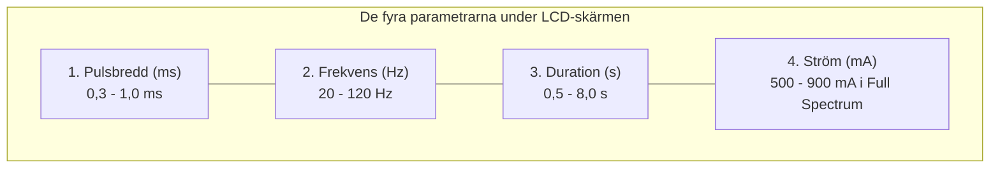
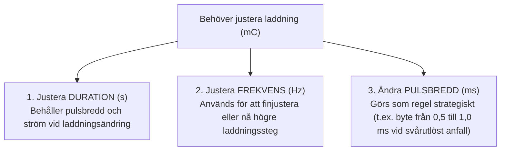

# Parameterinställningar

På **MECTA spECTrum 5000Q** regleras den elektriska dosen med **fyra separata vridreglage (rattar)** som sitter horisontellt placerade direkt under den centrala LCD-skärmen:

![[MECTA 5000Q de fyra rattarna.webp|MECTA 5000Q de fyra rattarna]]
*Figur 1: De fyra separata vridreglagen under LCD-skärmen på MECTA spECTrum 5000Q.*

**Kompendiet avser spECTrum 5000Q i 200 J-utförande.** Tabellen anger minimi- och maximivärden i **Full Spectrum Dosing** enligt MECTA:s datablad för det uppdaterade parameterprogrammet.

| Ratt / Märkning | Enhet | Min-max (Full Spectrum, 200 J) | Fysiologisk funktion |
| :--- | :---: | :---: | :--- |
| **PULSE WIDTH** | millisekunder (ms) | 0,3-1,0 ms | Pulsens bredd; påverkar kramptröskel, effekt och kognitiva biverkningar. |
| **FREQUENCY** | hertz (Hz) | 20-120 Hz | Antal tvåfasiga pulspar per sekund. |
| **DURATION** | sekunder (s) | 0,5-8,0 s | Pulstågslängd; används för att ändra laddningen (Q). |
| **CURRENT** | milliampere (mA) | 500-900 mA | Konstant strömamplitud under varje puls, vid det valda strömvärdet. |

**Optimerade program har snävare intervall:** 0,3-programmet medger 0,3-0,75 ms och 20-120 Hz; 0,5-programmet 0,5-0,75 ms och 20-120 Hz; 1,0-programmet 1,0 ms och 20-90 Hz. Samtliga har duration 0,5-8,0 s och fast ström 800 mA.

Gränserna är programberoende och alla maximivärden kan inte kombineras samtidigt. Äldre apparatrevisioner kan ha andra intervall. Kontrollera valt parameterprogram och visad laddning på enheten; 200 J-beteckningen ensam identifierar inte programrevisionen.

**Maxladdning är inte samma sak som max vid fast pulsbredd.** Med 0,3 ms, 800 mA, 120 Hz och 8,0 s blir den beräknade laddningen 460,8 mC. Apparatens totala kapacitet 1152 mC kan alltså inte nås med just den pulsbredden och strömmen. Detta är ett räkneexempel; ändrad pulsbredd kräver omprövad ordination. För 100 J-reservapparat gäller dessutom dess lägre kapacitetsgräns, se [[01 Översikt|Översikt]].

När du vrider på någon av dessa rattar uppdateras omedelbart den beräknade laddningen (**mC**) och energin (**J**) i realtid på pekskärmens nedre fält.

---

## 1. Pulsbredd (ms)

Pulsbredden anger hur många millisekunder varje enskild elektrisk puls varar.

### Reobas och kronaxi

Reobas och kronaxi beskriver hur lätt en nervcell eller ett axon retas av en elektrisk puls. Tillsammans förklarar de varför pulsbredden spelar roll, och varför korta pulser kan reta nervceller med mindre laddning än långa.

- **Reobas** ($I_{rh}$): den lägsta strömstyrka som retar nervcellen när pulsen är tillräckligt lång (i teorin oändligt lång). Anges i milliampere.
- **Kronaxi** ($\tau_c$): den pulsbredd som krävs när strömmen är dubbla reobasen. Anges i millisekunder. Den beror på vilka nervstrukturer och vilken mätmetod som studeras och är inte identisk med membranets tidskonstant.

#### Styrka-durationskurvan

Sambandet mellan pulsbredd och tröskelström beskrivs ofta med Lapicques och Weiss ekvation:

$$I_{tr}(t) = I_{rh}\left(1 + \frac{\tau_c}{t}\right)$$

där $I_{tr}$ är tröskelströmmen, $I_{rh}$ reobasen, $\tau_c$ kronaxin och $t$ pulsbredden. När pulsbredden är lika med kronaxin är tröskelströmmen dubbla reobasen. Ju kortare puls, desto högre ström krävs.

Laddningen per puls vid tröskeln blir $Q_{tr}(t) = I_{tr}(t) \cdot t = I_{rh}(t + \tau_c)$. Den minskar alltså ju kortare pulsen är. Energin per puls vid oförändrat motstånd är däremot minst när pulsbredden är lika med kronaxin. Kronaxin är därför en kompromiss mellan strömbehov och laddning, inte en exakt optimal pulsbredd.

#### Kronaxi vid ECT

Ett elektriskt fält utifrån retar främst axon, inte cellkroppar. Peterchev m.fl. anger kronaxin vid transkraniell stimulering till omkring 0,1-0,2 ms, vilket motsvarar axonens kronaxi. Ju längre pulsen är i förhållande till kronaxin, desto mer laddning och energi går åt för att nå tröskeln. Författarna ser inget skäl att gå under omkring 0,2 ms.

| Stimulering | Pulsbredd |
| :--- | :--- |
| Ultrakort puls (*ultrabrief*), används inte hos oss | under 0,5 ms, vanligen 0,25-0,3 ms |
| Kortpuls (*brief pulse*), hos oss | 0,5-1,0 ms |

#### Räkneexempel

Exemplet utgår från en tänkt reobas på 400 mA och en kronaxi på 0,2 ms. Det är inte uppmätta patientvärden, och det gäller en enskild idealiserad puls med konstant ström, inte hela behandlingsdosen.

| Pulsbredd | Tröskelström | Gånger reobasen | Laddning per puls vid tröskeln |
| ---: | ---: | ---: | ---: |
| 0,25 ms | 720 mA | 1,8 | 180 µC |
| 0,3 ms | 667 mA | 1,67 | 200 µC |
| 0,5 ms | 560 mA | 1,4 | 280 µC |
| 1,0 ms | 480 mA | 1,2 | 480 µC |

- Kortare puls kräver högre ström men mindre laddning per puls.
- Längre puls kräver mer laddning för att nå tröskeln.
- Vid en given strömstyrka når en för kort puls inte tröskeln. Med exemplets värden och 800 mA krävs minst 0,2 ms.
- Det går inte att ange att alla nervceller når tröskeln efter 0,2 ms eller att återstoden av en 1 ms-puls är verkningslös.

#### Avståndet från elektroden

Det elektriska fältet avtar med avståndet från elektroderna. En nervcell längre bort får därför ett svagare fält vid samma ström och behöver högre ström vid elektroden för att nå tröskeln. Kurvan förskjuts uppåt: reobasen, räknad som ström vid elektroden, blir högre. I figuren har kurvorna samma kronaxi för enkelhetens skull.

![[Styrka-durationskurva och avstånd.svg|Styrka-durationskurvor på tre avstånd från elektroden]]
*Figur 2: Schematiska styrka-durationskurvor för nervceller på tre avstånd från elektroden, med samma kronaxi. Den streckade linjen visar en given strömstyrka. Ringarna markerar den kortaste pulsbredd som räcker för att nå tröskeln. Värdena är relativa och inte uppmätta.*

- **Nära elektroden** räcker strömstyrkan även för mycket korta pulser.
- **Längre bort** krävs en längre puls innan tröskeln nås.
- **Långt från elektroden** krävs ännu längre puls, och bortom ett visst avstånd räcker strömstyrkan inte alls, oavsett pulsbredd. Det är reobasen som sätter den gränsen.
- En högre strömstyrka flyttar linjen uppåt och ökar därmed den volym hjärnvävnad som stimuleras. En längre puls når också något längre bort, men till priset av mer laddning.

Ranck sammanfattade hur tröskelströmmen ökar med avståndet från en liten elektrod i centrala nervsystemet, och att myeliniserade axon har kronaxier kring 0,05-0,1 ms medan grå substans ofta ger 0,2-0,7 ms. Vid ECT är elektroderna stora och sitter på skalpen, och strömmen sprids genom hud, skallben och likvor, så avståndssambandet är flackare och beror på anatomin. Fältets fördelning i hjärnan modelleras därför med MR-baserade modeller; se [[04 Neurobiologiska mekanismer#E-fält och anatomisk modellering|E-fält och anatomisk modellering]].

#### Kramptröskeln är något annat

Reobas och kronaxi gäller retning av enskilda nervelement med en enskild puls. Kramptröskeln gäller hela pulståget som krävs för att utlösa ett generaliserat anfall i hjärnans nätverk. Strömstyrkan ställs in enligt ordination, och laddningen styrs av pulsbredd, frekvens och duration. Reobas och kronaxi förklarar alltså hur effektiv stimuleringen är, men bestämmer inte den kliniskt lämpliga dosen.

- Kortare pulsbredd kan minska kognitiva biverkningar, särskilt vid RUL, men påverkar också kramptröskel och effekt. Effekten av ultrakort puls kräver tillräcklig övertröskeldos och rätt elektrodplacering, och den kan inte förklaras enbart av kronaxin.
- Ändrad pulsbredd kräver en ny bedömning av dos i förhållande till tröskeln. Samma mC över olika pulsbredder är inte biologiskt likvärdigt.

**Tre frågor att hålla isär:**
- **Reobas:** Hur stark måste strömmen vara?
- **Kronaxi:** Hur lång måste en puls med dubbla den strömmen vara?
- **Kramptröskel:** Vilket pulståg krävs för att utlösa ett generaliserat anfall?

---

### Val av pulsbredd

- **0,3 ms (ultrakort puls, *ultrabrief*):** Kan sänka den laddning som krävs för anfallsutlösning och minska kognitiv påverkan vid RUL jämfört med längre kortpulser. Vissa studier visar samtidigt långsammare eller lägre antidepressiv effekt. Låg kramptröskel innebär inte att en tröskelnära dos räcker för behandlingseffekt. **Ultrakort puls används inte hos oss.** Den är inte ett historiskt protokoll: forskningen om den pågår, se nedan.
- **0,5 ms (kortpuls, *brief pulse*):** Vanlig i de svenska registerstudierna nedan. Användningsfrekvensen fastställer inte att den är optimal för varje patient. Direkta jämförelser mellan 0,3 och 0,5 ms är mindre väl underbyggda än jämförelser mellan ultrakort puls och 1,0-1,5 ms.
- **1,0 ms (kortpuls, *brief pulse*):** En vanlig studerad kortpulsbredd. Den är inte automatiskt effektivare än 0,5 ms och kan inte väljas enbart utifrån patientens kön eller ålder. Dosering, elektrodplacering, kliniskt svar och kognition måste vägas samman.
- **Pågående forskning om ultrakort puls:** En systematisk översikt och metaanalys 2026 av 30 studier fann att högdos RUL med ultrakort puls gav remission hos 32 % och att 28 % bytte till kortpuls på grund av otillräcklig effekt; författarna bedömer att ultrakort puls inte når kortpulsens resultat. En randomiserad studie 2025 jämförde 0,15 och 0,30 ms vid RUL: den kortare pulsen sänkte tröskeln ytterligare utan skillnad i effekt eller kognition. I de nordamerikanska studierna av magnetisk krampterapi (MST) är RUL med ultrakort puls jämförelsebehandling.
- **Pågående forskning om pulsbredd i Sverige:** Den svenska registerstudien [*Optimal elektrisk stimulering vid elektrokonvulsiv terapi (ECT)*](https://ect.rcnorr.se/forskning/optimal-elektrisk-stimulering-vid-elektrokonvulsiv-terapi-ect/) randomiserar patienter med unipolär eller bipolär depression till 0,5 eller 1,0 ms och följer remission, minnesstörning, livskvalitet och återinsjuknande i sex månader. Bakgrunden är registeranalyser som indikerar att omkring 10 % fler patienter kan bli symtomfria med 1,0 ms än med 0,5 ms, med liten skillnad i upplevd minnesstörning några dagar efter behandlingen. 800 patienter inkluderades från november 2019 till augusti 2025; resultaten är ännu inte publicerade.
- **Sinusvåg:** Historisk vågform med större kognitiv påverkan och utan visad terapeutisk fördel framför modern kortpulsstimulering. Den ska inte användas som modell för dagens inställningar.

Begreppen reobas och kronaxi beskriver elektrisk excitation under definierade förhållanden. De ger inte en universell pulsbredd för hela hjärnan eller en beräkning av ”bortkastad” laddning. Se även [[04 Neurobiologiska mekanismer#Anfallsgenerering|Anfallsgenerering]].

Källunderlag: [American Psychiatric Association. *The Practice of Electroconvulsive Therapy*. 3 uppl.; copyright 2025](https://doi.org/10.1176/appi.books.9780890427118), kap. 14.1-14.2; [Mankad MV, Beyer JL, Weiner RD, Krystal AD. *Clinical Manual of Electroconvulsive Therapy*. 2010](https://scholars.duke.edu/publication/1105703), kap. 4-5.

---

## 2. Frekvens (Hz)

Frekvensen anger antalet cykler (par av tvåfasiga pulser) som maskinen levererar per sekund.

### Pulsfrekvens och nervcellsrekrytering
- Frekvensen samverkar med pulsbredd, strömstyrka och pulstågslängd. Lägre frekvens och längre pulståg kan vara mer laddningseffektiva för anfallsutlösning än hög frekvens.
- Det finns inget generellt bevisat optimalt fönster på 30-70 Hz för alla patienter. Även frekvenser under 20 Hz används i vissa apparatprogram; de medför inte automatiskt missat anfall.
- Sambanden kan inte härledas enbart ur en enskild nervcells refraktärperiod. Följ det validerade doseringsprogrammet för den aktuella apparaten.
- Vid övriga parametrar oförändrade fördubblar en ökning från 30 till 60 Hz laddningen.

---

## 3. Duration (s)

Durationen anger den totala tid (i sekunder) som apparaten sänder ut det valda pulståget.

### Pulstågslängdens betydelse
- Ett generaliserat anfall kräver rekrytering av neuronala nätverk; nervcellerna bildar inte ett anatomiskt syncytium.
- Durationen kan användas för att ändra laddningen utan att ändra pulsbredd eller ström. En ökning från 2,0 till 3,0 s ger 50 % högre laddning om övriga parametrar är oförändrade.
- Kort pulståg kan räcka vid låg tröskel. Det finns ingen generell 1-sekundsgräns för ett effektivt anfall.
- I det uppdaterade 200 J-systemets Q-program är durationen 0,5-8,0 s. Möjliga kombinationer begränsas också av programmets laddnings- och energigränser.

---

## 4. Strömstyrka (mA)

Strömstyrkan reglerar den elektriska strömmens momentana toppamplitud under varje enskild puls.

### Ström och fältstyrka
- **Konstant ström** betyder att apparaten reglerar den valda pulsströmmen inom sina säkerhetsgränser. I Full Spectrum är den valbara strömmen 500-900 mA; i de optimerade programmen är den fixerad vid 800 mA.
- Ohms lag ger exempelvis $U = 0{,}8 \times 220 = 176$ V vid 800 mA och 220 Ω dynamisk impedans.
- Största delen av strömmen leds genom hud och skalp; enligt Swartz når omkring 1 % hjärnan, eftersom skallbenets impedans är ungefär 100 gånger högre än hudens. Andelen och det elektriska fältet i hjärnan varierar med skallbenets tjocklek, huvudets anatomi och elektrodplaceringen; se [[04 Statisk och dynamisk impedans|Statisk och dynamisk impedans]].
- 800 mA är ett vanligt protokollvärde, inte en global fysiologisk minimigräns. Andra strömnivåer har studerats, men ska inte införas genom fri omräkning av mC.
- Ändra strömstyrkan endast enligt läkarordination och ett apparatspecifikt protokoll.

### Strömstyrka, ålder, kön och anatomi
- **Strömstyrkan ordineras:** Den är inte fast, utan ställs in enligt ordination inom apparatens intervall (500-900 mA i Full Spectrum). Dosen anpassas i första hand med laddningen (pulsbredd, frekvens och duration) efter titrering eller dostabell. Varken APA, *The ECT Handbook*, Mankad m.fl. eller SPF:s riktlinjer anger att strömstyrkan ska väljas efter ålder, kön eller kroppsvikt.
- **Ålder och kön påverkar kramptröskeln:** Tröskeln stiger med åldern och är ofta högre hos män. Det hanteras med laddningen, inte med strömstyrkan.
- **Impedansen förklarar inte könsskillnaden:** Impedansen är högre hos kvinnor än hos män och högre vid unilateral placering, trots att kvinnor har lägre tröskel. SPF anger att impedansen ökar med åldern; det stöds inte av de övriga källorna.
- **Anatomin avgör hur mycket som når hjärnan:** Andelen ström som når hjärnan beror på skallbenets tjocklek, huvudets storlek och hjärnvolymen, inte på kroppsvikten. Vid samma strömstyrka varierar därför det elektriska fältet i hjärnan mellan patienter.
- **Lägre strömstyrka har en avvägning:** I en randomiserad studie med RUL och 600, 700 eller 800 mA gav 700 och 800 mA bättre antidepressiv effekt än 600 mA, medan verbalt flöde försämrades vid 800 mA; det primära minnesmåttet skilde sig inte. Individuellt anpassad strömstyrka studeras men är ännu inte klinisk rutin.

---

## Ändra dosen

När du vill öka eller minska den elektriska laddningen (Q) vid behandlingsbordet har du i första hand tre verktyg; strömstyrkan ändras bara enligt ordination:

> [!TIP] Räkna på den ordinerade ändringen
> Vid oförändrade övriga parametrar ger 2,0 → 3,0 s exakt 50 % högre laddning. Ändring av duration och frekvens behöver inte vara biologiskt likvärdiga trots samma mC. Det finns varken en universell procentsats per tabellsteg eller en generell 4-5-sekundersgräns för när frekvensen ska ändras.

---

## Parametrar i svenska studier

### Brus m.fl. 2017: remission

[*Self-assessed remission rates after electroconvulsive therapy of depressive disorders*](https://pubmed.ncbi.nlm.nih.gov/28865389/), med Nordanskog och Nordenskjöld som medförfattare, omfattar 1671 patienter behandlade i Sverige 2011-2014. Tabellerna visar samtliga parametergrupper i artikelns tabell 1 och hur vanliga de var.

#### Pulsbredd

| Grupp eller inställning | Antal patienter | Andel |
| :--- | ---: | ---: |
| 0,25-0,47 ms | 317 | 19,0 % |
| 0,50 ms | 1143 | 68,4 % |
| 0,51-1,00 ms | 211 | 12,6 % |

#### Frekvens

| Grupp eller inställning | Antal patienter | Andel |
| :--- | ---: | ---: |
| 10-50 Hz | 667 | 39,9 % |
| 55-70 Hz | 545 | 32,6 % |
| 75-120 Hz | 459 | 27,5 % |

#### Duration

| Grupp eller inställning | Antal patienter | Andel |
| :--- | ---: | ---: |
| 0,8-6,8 s | 568 | 34,0 % |
| 6,9-7,9 s | 455 | 27,2 % |
| 8,0 s | 648 | 38,8 % |

#### Strömstyrka

| Grupp eller inställning | Antal patienter | Andel |
| :--- | ---: | ---: |
| 528-800 mA | 928 | 55,5 % |
| 850-890 mA | 213 | 12,7 % |
| 900-930 mA | 530 | 31,7 % |

#### Laddning

| Grupp eller inställning | Antal patienter | Andel |
| :--- | ---: | ---: |
| 75-288 mC | 579 | 34,6 % |
| 291-399 mC | 561 | 33,6 % |
| 400-1152 mC | 531 | 31,8 % |

Pulsbredden 0,50 ms är en separat inställning, använd hos 68,4 %. För andra grupper går det inte att avgöra vilket enskilt värde inom gruppen som var vanligast. Hz avser stimuleringens frekvens.

### Brus m.fl. 2017: subjektivt minne

[*Subjective Memory Immediately Following Electroconvulsive Therapy*](https://pubmed.ncbi.nlm.nih.gov/27930429/), med samma båda medförfattare, omfattar 1212 patienter från 41 svenska sjukhus 2011-2014. Artikelns tabell 3 avser de 1110 unilateralt behandlade patienterna och första behandlingens inställningar.

#### Pulsbredd

| Grupp eller inställning | Antal patienter | Andel |
| :--- | ---: | ---: |
| 0,25-0,47 ms | 234 | 21,1 % |
| 0,50-1,00 ms | 876 | 78,9 % |

#### Frekvens

| Grupp eller inställning | Antal patienter | Andel |
| :--- | ---: | ---: |
| 20-65 Hz | 619 | 55,8 % |
| 70-120 Hz | 491 | 44,2 % |

#### Duration

| Grupp eller inställning | Antal patienter | Andel |
| :--- | ---: | ---: |
| 2,0-7,4 s | 520 | 46,8 % |
| 7,5-8,0 s | 590 | 53,2 % |

#### Strömstyrka

| Grupp eller inställning | Antal patienter | Andel |
| :--- | ---: | ---: |
| 600-800 mA | 579 | 52,2 % |
| 850-930 mA | 531 | 47,8 % |

Antalen i tabellerna för båda studierna är summerade över artikelns utfallsgrupper; andelarna är beräknade från dessa antal. Varje parameter har samma nämnare inom sin studie. Samma patienter återkommer på flera rader, så antalen ska inte summeras över olika parametrar. Gruppernas gränser och bredd skiljer sig mellan studierna.

### Ålder och kön

Ålder och kön redovisas i studierna. Remissionsmaterialet omfattar 1021 kvinnor och 650 män, med åldersgrupper från 18-30 till 81-95 år. Minnesstudiens unilaterala undergrupp omfattar 663 kvinnor och 447 män, indelade i 18-39, 40-64 och minst 65 år. De aktuella parametertabellerna redovisar däremot inte parameterfördelningen korsad med ålder och kön. De kan därför inte ge en dostabell för exempelvis kvinnor 40-50 år.

### Ytterligare svenskt material

[Sigström m.fl. 2020, tabell 1](https://pubmed.ncbi.nlm.nih.gov/32148217/), med Nordenskjöld som medförfattare, omfattar 277 patienter vid åtta svenska sjukhus. Pulsbredd registrerades hos 272 patienter:

#### Pulsbredd

| Grupp eller inställning | Antal patienter | Andel |
| :--- | ---: | ---: |
| 0,25-0,47 ms | 54 | 19,9 % |
| 0,50-1,00 ms | 218 | 80,1 % |

Pulsbredd saknades för fem patienter. Tabellen anger inte motsvarande grupper för frekvens, duration och strömstyrka.

### Tolkning för den lokala verksamheten

Studierna beskriver klinisk praxis med både MECTA och Thymatron. Parametergrupperna är inte en ordination för ert 200 J-system och ska inte kombineras till en ”typordination”. Registermaterialen kan överlappa.

Er ålders- och könsbaserade dostabell beskrivs separat i [[02 Dostabell|Dostabell]], med hänvisning till rutinen och [kalkylatorns dostabell](https://ect.matty.se/?lang=sv). Den anger laddning i mC, inte en unik kombination av de fyra rattarna.

---

## Referenser

1. American Psychiatric Association. *The Practice of Electroconvulsive Therapy*. 3 uppl.; copyright 2025. Kap. 14.1-14.2 om vågform, pulsbredd, frekvens, duration och ström samt kap. 14.7.4 om dosändring under serien.
2. Mankad MV, Beyer JL, Weiner RD, Krystal AD. *Clinical Manual of Electroconvulsive Therapy*. Arlington, VA: American Psychiatric Publishing; 2010. Kap. 4-5, s. 47-78. Underlag för parametrarnas funktion och klinisk dosering. De svenska studietabellerna bygger på de enskilda artiklar som anges vid respektive tabell.
3. [MECTA Corporation. Optimized and Full Spectrum Dosing Parameter Sets. ECT Parameters / 200 Joule Systems. D-CS #0053 Rev A; 2011](https://ro.scribd.com/document/73906584/ECT-Dosing-Parameters).
4. [MECTA. Optimized spECTrum Instruction Manual. INT, 200 J; artikelnummer 9900-1012-16](https://mectaspectrum.com/clinician/clinical-ect-materials/).
5. Peterchev AV, Rosa MA, Deng ZD, Prudic J, Lisanby SH. Electroconvulsive therapy stimulus parameters: rethinking dosage. *J ECT*. 2010;26(3):159-174. Strömstyrkan hålls vanligen fast och hög men kan bli ett sätt att anpassa stimuleringen individuellt. Avsnitt III.2.d om pulsbredd: kronaxi omkring 0,1-0,2 ms vid transkraniell stimulering, och kortare pulser är mer effektiva i laddning och energi. [PubMed](https://pubmed.ncbi.nlm.nih.gov/20805726/).
6. Mankad MV, Beyer JL, Weiner RD, Krystal AD. *Clinical Manual of Electroconvulsive Therapy*. 2010. S. 53 (impedansen högre hos kvinnor och vid unilateral placering, efter Coffey m.fl. 1995) och tabell 5-1, s. 62 (hög ålder och manligt kön höjer kramptröskeln).
7. American Psychiatric Association. *The Practice of Electroconvulsive Therapy*. 3 uppl.; copyright 2025. Kramptröskeln stiger med åldern och påverkas av kön; formler med patientfaktorer förklarar högst cirka 40 % av variationen i initial tröskel.
8. Svenska Psykiatriska Föreningen. *ECT: kliniska riktlinjer*. Stockholm: Gothia Fortbildning; 2014. S. 51: män har ofta högre kramptröskel än kvinnor; högre ålder anges ge högre impedans.
9. Swartz CM. Electricity and electroconvulsive therapy. I: Swartz CM, red. *Electroconvulsive and Neuromodulation Therapies*. Cambridge: Cambridge University Press; 2009. Kap. 1, s. 5: omkring 1 % av strömmen når hjärnan.
10. Fridgeirsson EA, Deng ZD, Denys D, van Waarde JA, van Wingen GA. Electric field strength induced by electroconvulsive therapy is associated with clinical outcome. *Neuroimage Clin*. 2021;30:102581. [PubMed](https://pubmed.ncbi.nlm.nih.gov/33588322/).
11. Deng ZD, Argyelan M, Miller J, et al. Electroconvulsive therapy, electric field, neuroplasticity, and clinical outcomes. *Mol Psychiatry*. 2022;27(3):1676-1682. Fältet i hjärnan påverkas av skallbenets tjocklek, huvudets diameter och hjärnvolymen. [PubMed](https://pubmed.ncbi.nlm.nih.gov/34853404/).
12. Abbott CC, Quinn D, Miller J, et al. Electroconvulsive therapy pulse amplitude and clinical outcomes. *Am J Geriatr Psychiatry*. 2021;29(2):166-178. [PubMed](https://pubmed.ncbi.nlm.nih.gov/32651051/).

13. [Kvalitetsregister ECT. *Optimal elektrisk stimulering vid elektrokonvulsiv terapi (ECT)*. Registercentrum Norr; läst 2026-10-21](https://ect.rcnorr.se/forskning/optimal-elektrisk-stimulering-vid-elektrokonvulsiv-terapi-ect/). Randomiserad registerstudie av 0,5 mot 1,0 ms pulsbredd, 800 patienter, inklusion november 2019 till augusti 2025.
14. Jelovac A, McLoughlin DM. Ultrabrief pulse electroconvulsive therapy for depression: a systematic review and meta-analysis. *Mol Psychiatry*. 2026;31(2):1132-1141. [PubMed](https://pubmed.ncbi.nlm.nih.gov/41206419/). 30 studier; remission 32,2 % och byte till kortpuls hos 28,1 % vid högdos RUL med ultrakort puls.
15. Žaludová Heidingerová J, Albrecht J, Anders M, et al. Comparison of ultra-ultrabrief and ultrabrief pulse widths in right unilateral electroconvulsive therapy: a randomized trial. *Brain Stimul*. 2025;18(3):838-847. [PubMed](https://pubmed.ncbi.nlm.nih.gov/39988121/). 0,15 mot 0,30 ms: lägre tröskel, ingen skillnad i effekt eller kognition.
16. Blumberger DM, McClintock SM, Thorpe KE, et al. Confirmatory efficacy and safety trial of magnetic seizure therapy versus right unilateral ultra-brief electroconvulsive therapy in depression (CREST-MST). *Lancet Psychiatry*. 2026;13(5):376-386. [PubMed](https://pubmed.ncbi.nlm.nih.gov/41997695/). RUL med ultrakort puls som jämförelsebehandling.
17. Lapicque L. Recherches quantitatives sur l'excitation électrique des nerfs traitée comme une polarisation. *J Physiol Pathol Gen*. 1907;9:620-635. Styrka-durationssambandet och begreppet kronaxi.
18. Weiss G. Sur la possibilité de rendre comparables entre eux les appareils servant à l'excitation électrique. *Arch Ital Biol*. 1901;35:413-446. Det linjära sambandet mellan laddning och pulsbredd vid tröskeln.
19. Ranck JB Jr. Which elements are excited in electrical stimulation of mammalian central nervous system: a review. *Brain Res*. 1975;98(3):417-440. [PubMed: 1102064](https://pubmed.ncbi.nlm.nih.gov/1102064/). Tröskelström och avstånd från elektroden; kronaxi för myeliniserade axon och grå substans.

---

## Relaterade länkar
- Beräkningsekvationen: [[02 Laddning och energi|Laddning och energi]]
- MECTA titreringstabeller: [[04 Titreringstabeller|Titreringstabeller]]
- Felsökning av maskinen: [[05 Larm och felsökning|Larm och felsökning]]
- Lathund vid behandlingsbordet: [[01 Parameterinställningar|Parameterinställningar]]
