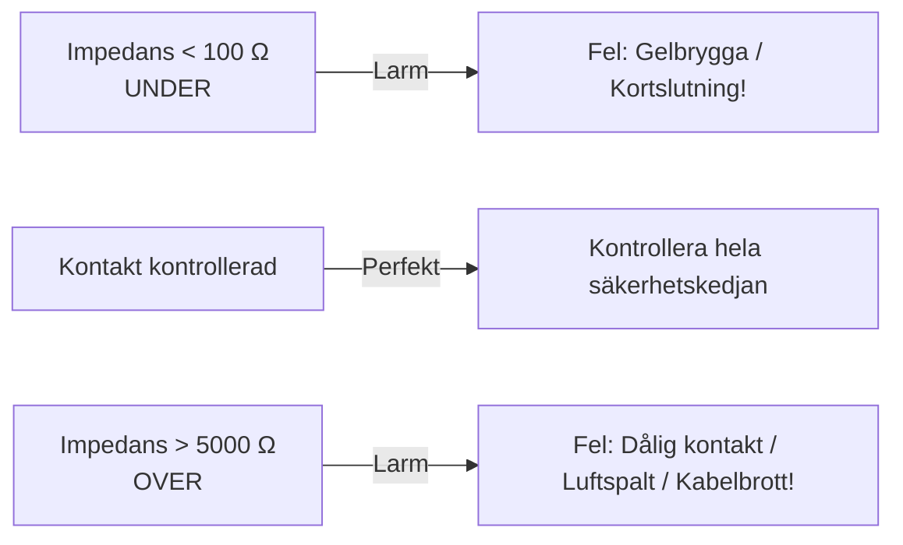

# Statisk och dynamisk impedans

Impedans är det samlade elektriska motståndet (resistans och kapacitans) som den elektriska strömmen möter när den passerar genom hud, underhudsfett, skallben, hjärnhinnor, likvor och hjärnvävnad.

På **MECTA spECTrum 5000Q** arbetar vi med två helt skilda typer av impedans: **statisk testimpedans** och **dynamisk behandlingsimpedans**.

---

## Jämförelse av impedansmått

| Egenskap | Statisk impedans (testimpedans) | Dynamisk impedans (behandlingsimpedans) |
| :--- | :--- | :--- |
| **När mäts den?** | **Före** stimulering (kontinuerligt i realtid så fort elektroderna rör huden). | **Under** själva stimuleringen (medan behandlingspulserna levereras). |
| **Hur mäts den?** | Med en mycket svag, högfrekvent mätström som patienten inte känner av. | Vid full behandlingsström (**800 mA**). |
| **Intervall och tolkning** | **100-5000 Ω är apparatens spärrfönster, inte ett optimalt målintervall.** Den lokala manualen varnar även för oväntat låga värden, särskilt under 200 Ω, och dålig kontakt vid höga värden. | **100 - 300 Ω** (typiskt ca 150 - 220 Ω). |
| **Klinisk funktion** | Kontrollera att elektroderna har god kontakt och att ingen gelbrygga finns. | Verifiera hur mycket spänning som krävdes för att driva 800 mA genom vävnaden. |
| **Avläsning** | Visas kontinuerligt som siffervärde och stapel på LCD-skärmen. | Visas på skärmen efter stimulering och skrivs ut på pappersremsan. |

---

## 1. Statisk impedans

Så snart behandlingskabeln ansluts och stimuleringselektroderna appliceras mot patientens rengjorda hud visar LCD-displayen den statiska impedansen.

### "OVER": impedans över 5000 Ω
- **Orsaker:**
    - Hår ligger emellan elektrod och hud.
    - För lite kontaktgel.
    - Huden är fet eller svettig (otillräckligt avfettad eller torkad).
    - Behandlaren trycker för löst med handelektroderna.
    - Kabelbrott eller glappkontakt i elektrodkabeln.
- **Åtgärd:** Lyft elektroderna, torka huden torr, applicera ny konduktiv gel, sära på hårstrån och tryck med ett fast, distinkt handtryck. Maskinen blockerar stimulering så länge impedansen är "OVER".

### "UNDER": impedans under 100 Ω
- **Orsak:** Det finns för mycket gel som har runnit ihop mellan de två stimuleringselektroderna (**gelbrygga**, *salt bridge*).
- **Fara:** Strömmen kommer att ta den enklaste vägen med minst motstånd - det vill säga genom gelen ovanpå skalpen direkt från elektrod A till elektrod B - utan att passera genom skallbenet och hjärnan! Detta resulterar i uteblivet anfall och risk för brännskada i hårbotten!
- **Åtgärd:** Ta bort elektroderna omedelbart. Torka rent skalpen noggrant med torrt papper/sprit mellan elektrodplatserna. Applicera en måttlig mängd gel som håller sig strikt under elektrodplattorna.

---

## 2. Dynamisk impedans

När behandlingen utlöses och 800 mA pulserar genom vävnaden sker en så kallad **elektroporation** och kapacitiv nedbrytning i hudens *stratum corneum*. Detta medför att vävnadens motstånd faller kraftigt - från kanske 400 Ω statiskt ner till **160-220 Ω dynamiskt**.

### Tolka dynamisk impedans
1. **För hög dynamisk impedans (> 350-400 Ω):**
    - Indikerar suboptimal kontakt under pågående pulståg (t.ex. att behandlaren lättade på handtrycket under stimuleringen).
    - Kan kräva så hög spänning från maskinen (exempelvis 320 V vid 800 mA och 400 Ω) att spänningstaket nås, vilket utlöser larmet **"TREATMENT TERMINATED - VOLTAGE ERROR"**.
2. **Plötsligt sjunkande dynamisk impedans:**
    - Kan ses om gelen sprids under kraftigt tryck eller om svett/fukt bildas.
3. **Reproducerbarhet:**
    - En patient har ofta en relativt konstant dynamisk impedans mellan behandlingarna (± 20 Ω). En plötslig avvikelse ska föranleda kontroll av hudkontakt, placering, kablage och mätförhållanden; den bevisar inte ett visst fel.

---

## Hudförberedelse enligt apparatmanualen

1. Förbered kontaktzonerna enligt manual och elektrodleverantörens anvisning. Den lokala MECTA-manualen beskriver elektrolytlösning i kontaktzonen och konduktiv gel på elektroden, eventuellt lätt abrasion med avsedd produkt.
2. Håll huden mellan elektrodställena fri från gel och rinnande vätska. God kontakt under elektroderna ska inte skapa en ledande brygga mellan dem.
3. Om alkoholbaserad rengöring används ska huden vara helt torr före syrgasnära stimulering. Alkohol är inte ett opolärt lösningsmedel; brandrisken och produktanvisningen är de relevanta skälen till torkning.
4. Kontrollera stabil kontakt och impedans. Ett värde inom apparatens spärrfönster bevisar inte att en gelbrygga saknas. Avvikande lågt värde behöver också utredas.
5. Håll handelektroderna stabilt under hela stimuleringen.

---

## Referenser

1. American Psychiatric Association. *The Practice of Electroconvulsive Therapy*. 3 uppl.; copyright 2025. Kap. 14.5-14.6, ”Stimulus Electrode Site Preparation” och ”Impedance Testing”. Underlag för hudkontakt och impedansbegrepp; apparatens felgränser och åtgärder hämtas från MECTA-manualen.
2. Mankad MV, Beyer JL, Weiner RD, Krystal AD. *Clinical Manual of Electroconvulsive Therapy*. Arlington, VA: American Psychiatric Publishing; 2010. Kap. 4, ”Basics”, s. 47-57. Elektrisk bakgrund till ström, spänning och motstånd.
3. [MECTA. Optimized spECTrum Instruction Manual. INT, 200 J; artikelnummer 9900-1012-16](https://mectaspectrum.com/clinician/clinical-ect-materials/).
4. Äldre referens för reservapparat och funktionsbeskrivningar: [MECTA Corporation. spECTrum Instruction Manual. 100 Joules; s. 16-22](https://mectaspectrum.com/clinician/clinical-ect-materials/), särskilt s. 17-20. Det tidigare målintervallet 150-500 Ω har tagits bort eftersom det inte stöds som generellt mål av manualen.

---

## Relaterade länkar
- Larm och felmeddelanden: [[05 Larm och felsökning|Larm och felsökning]]
- Elektrodplaceringar: [[01 Elektrodplacering|Elektrodplacering]]
- Genomförande vid bordet: [[02 Behandling steg för steg|Behandling steg för steg]]
- Fysik och konstant ström: [[02 Laddning och energi|Laddning och energi]]
