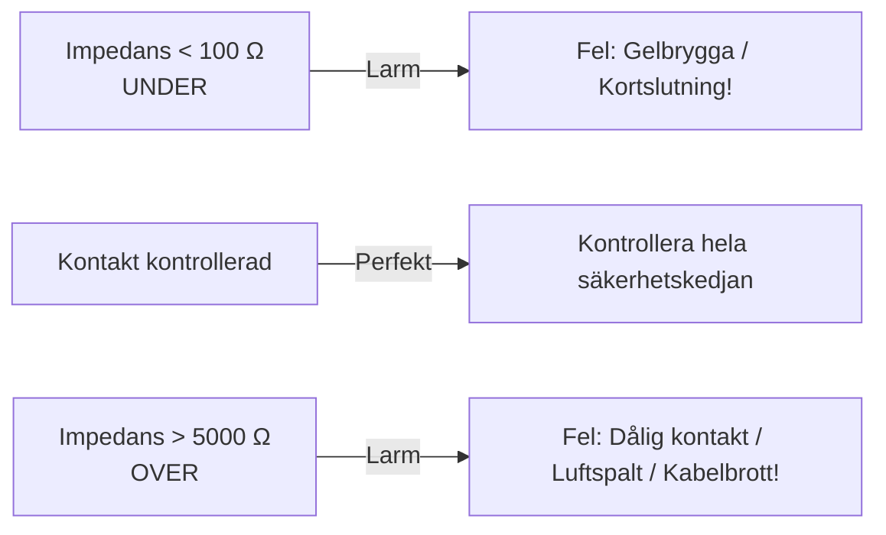

# Statisk och dynamisk impedans

Impedans är det samlade elektriska motståndet (resistans och kapacitans) som den elektriska strömmen möter när den passerar genom hud, underhudsfett, skallben, hjärnhinnor, likvor och hjärnvävnad.

På **MECTA spECTrum 5000Q** arbetar vi med två helt skilda typer av impedans: **statisk testimpedans** och **dynamisk behandlingsimpedans**.

---

## Jämförelse av impedansmått

| Egenskap | Statisk impedans (testimpedans) | Dynamisk impedans (behandlingsimpedans) |
| :--- | :--- | :--- |
| **När mäts den?** | **Före** stimulering (kontinuerligt i realtid så fort elektroderna rör huden). | **Under** själva stimuleringen (medan behandlingspulserna levereras). |
| **Hur mäts den?** | Med en mycket svag, högfrekvent mätström som patienten inte känner av. | Vid den inställda behandlingsströmmen (t.ex. **800 mA**). |
| **Intervall och tolkning** | **100-5000 Ω är apparatens spärrfönster. Hos oss är målvärdet omkring 1000 Ω, utifrån klinisk erfarenhet.** Den lokala manualen varnar även för oväntat låga värden, särskilt under 200 Ω, och dålig kontakt vid höga värden. | **100 - 300 Ω** (typiskt ca 150 - 220 Ω). |
| **Klinisk funktion** | Kontrollera att elektroderna har god kontakt och att ingen salt- eller gelbrygga finns. | Verifiera hur mycket spänning som krävdes för att driva behandlingsströmmen genom vävnaden. |
| **Avläsning** | Visas kontinuerligt som siffervärde och stapel på LCD-skärmen. | Visas på skärmen efter stimulering och skrivs ut på pappersremsan. |

---

## Statisk impedans

Så snart behandlingskabeln ansluts och stimuleringselektroderna appliceras mot patientens rengjorda hud visar LCD-displayen den statiska impedansen.

### "OVER": impedans över 5000 Ω
- **Orsaker:**
    - Hår ligger emellan elektrod och hud.
    - För torr kompress eller för lite kontaktgel.
    - Huden är fet eller svettig (otillräckligt avfettad eller torkad).
    - Behandlaren trycker för löst med handelektroderna.
    - Kabelbrott eller glappkontakt i elektrodkabeln.
- **Åtgärd:** Lyft elektroderna, torka huden torr, fukta kompressen på nytt i saltlösningen (eller applicera ny ledande gel), sära på hårstrån och tryck med ett fast, distinkt handtryck. Maskinen blockerar stimulering så länge impedansen är "OVER".

### "UNDER": impedans under 100 Ω
- **Orsak:** Saltlösning eller gel har runnit ihop mellan de två stimuleringselektroderna (**saltbrygga** eller **gelbrygga**, *salt bridge*).
- **Fara:** Strömmen kommer att ta den enklaste vägen med minst motstånd - det vill säga genom vätskan eller gelen ovanpå skalpen direkt från elektrod A till elektrod B - utan att passera genom skallbenet och hjärnan! Detta resulterar i uteblivet anfall och risk för brännskada i hårbotten!
- **Åtgärd:** Ta bort elektroderna omedelbart. Torka rent skalpen noggrant med torrt papper mellan elektrodplatserna. Använd en fuktig kompress som inte rinner, eller en måttlig mängd gel, som håller sig strikt under elektrodplattorna.

---

## Dynamisk impedans

När behandlingen utlöses och behandlingsströmmen pulserar genom vävnaden sker en så kallad **elektroporation** och kapacitiv nedbrytning i hudens yttersta lager (hornlagret). Detta medför att vävnadens motstånd faller kraftigt - från kanske 400 Ω statiskt ner till **160-220 Ω dynamiskt**.

### Tolka dynamisk impedans
1. **För hög dynamisk impedans (> 350-400 Ω):**
    - Indikerar suboptimal kontakt under pågående pulståg (t.ex. att behandlaren lättade på handtrycket under stimuleringen).
    - Kan kräva så hög spänning från maskinen (exempelvis 320 V vid 800 mA och 400 Ω) att spänningstaket nås, vilket utlöser larmet **"TREATMENT TERMINATED - VOLTAGE ERROR"**.
2. **Plötsligt sjunkande dynamisk impedans:**
    - Kan ses om saltlösning eller gel sprids under kraftigt tryck eller om svett eller fukt bildas.
3. **Reproducerbarhet:**
    - En patient har ofta en relativt konstant dynamisk impedans mellan behandlingarna (± 20 Ω). En plötslig avvikelse ska föranleda kontroll av hudkontakt, placering, kablage och mätförhållanden; den bevisar inte ett visst fel.

---

## Strömmens väg och värme

- **Bara en liten del når hjärnan:** Skallbenets impedans är ungefär 100 gånger högre än hudens. Omkring 1 % av strömmen passerar skallen in i hjärnan; omkring 99 % leds genom hud och skalp, där nästan all energi avges som värme.
- **Hjärnan värms inte:** Hjärnans temperatur stiger mindre än 0,001 °C.
- **Brännskada uppstår där kontakten är dålig:** En brännskada kan bara uppstå där elektroden möter huden, och bara om impedansen i kontaktytan är hög. En brännskada visar att impedansen var hög just där.
- **Sänk impedansen:** Ta bort det som höjer den: hudfett, smuts, smink, hudkräm, sårskorpor och hår samt rost eller beläggning på elektroderna. Saltinnehållande gel och vätska sänker impedansen.

---

## Hudförberedelse enligt apparatmanualen

1. Förbered kontaktzonerna enligt manual och elektrodleverantörens anvisning. Den lokala MECTA-manualen beskriver elektrolytlösning i kontaktzonen och konduktiv gel på elektroden, eventuellt lätt abrasion med avsedd produkt. Hos oss används i första hand kompresser fuktade i saltlösning (NaCl 250 ml med ½ matsked salt) mellan elektrod och hud, och ledande gel som alternativ; se [[02 Behandling steg för steg|Behandling steg för steg]].
2. Håll huden mellan elektrodställena fri från gel och rinnande vätska; kompresserna får inte rinna. God kontakt under elektroderna ska inte skapa en ledande brygga mellan dem.
3. Sprit används inte hos oss. Om alkohol används för att ta bort hudfett ska huden vara helt torr innan gel läggs på och innan stimulering sker nära syrgas (brandrisk). Alkoholen torkar också ut huden och kan i sig höja impedansen; det är den ledande gelen eller elektrolytlösningen efteråt som sänker den.
4. Kontrollera stabil kontakt och impedans. Ett värde inom apparatens spärrfönster bevisar inte att en salt- eller gelbrygga saknas. Avvikande lågt värde behöver också utredas.
5. Håll handelektroderna stabilt under hela stimuleringen.
