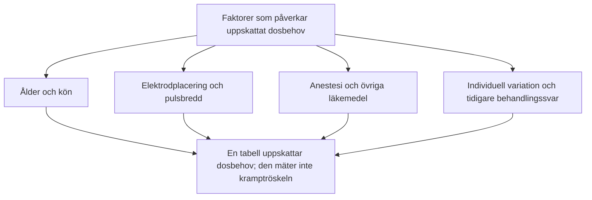

# Dostabell

I er verksamhet används en ålders- och könsbaserad dostabell. Den anger laddning i mC och ska skiljas från empirisk titrering av kramptröskeln. Nedan återges den lokala tabellen och hur den förhåller sig till individuell dosering.

---

## Lokal dostabell: ålder och kön

Tabellen överensstämmer med den synliga [ECT-dostabellen på ect.matty.se](https://ect.matty.se/?lang=sv) och MECTA-kolumnen i *ECT-behandling*, verksamhet Rättspsykiatri, dokument-ID SU9806-1988473940-61, version 5.0, s. 7. Den lokala PDF-kopian är daterad 2025-02-10 och anger giltighet till 2027-02-10.

| Ålder enligt källtabellen | Kvinnor: laddning (mC) | Män: laddning (mC) |
| :--- | :--- | :--- |
| 20 år och yngre | 180 och uppåt | 190 och uppåt |
| 30-40 år | 280-320 | 290-380 |
| 40-50 år | 320-380 | 380-420 |
| 50-60 år | 380-530 | 420-570 |
| Över 60 år | 530-650 | 570-1000 |

**Åldersgränserna behöver förtydligas i källan:** 21-29 år saknar egen rad och gränsåldrarna 40 och 50 överlappar. Tabellen återges därför utan att fylla i saknade intervall. Kalkylatorns färgkontroll gör en egen indelning: den använder 180-280 mC för kvinnor och 190-290 mC för män 18-29 år samt kombinerar angränsande intervall vid exakt 40, 50 och 60 år. Detta framgår inte av den synliga tabellen eller rutinen.

Laddningen bestämmer inte ensam pulsbredd, frekvens, duration och strömstyrka. Samma mC kan erhållas med olika parameterkombinationer. Läkarordinationen behöver därför ange elektrodplacering och avsedda inställningar. Tabellen anger inte i sig någon uppmätt kramptröskel eller multipel av tröskeln.

---

## Evidens och begränsningar

APA:s tredje upplaga beskriver att formler baserade på patient- och behandlingsfaktorer bara förklarar en del av variationen i initial kramptröskel. Ett procenttal för ”ålderns betydelse” kan inte tillämpas oförändrat på varje patient. Kön eller skallbenstjocklek förklarar inte heller ensamt ett individuellt dosbehov.

### Begränsningar vid tabellbaserad dosering

1. **För hög dos:** En tabell kan överskatta behovet, särskilt hos äldre, och ge onödig kognitiv påverkan.
2. **För låg dos:** Underskattning kan ge uteblivet anfall eller tröskelnära stimulering med otillräcklig effekt, särskilt vid RUL.
3. **Begränsad överförbarhet:** En dostabell gäller en viss apparat och behandlingsmetod. Inte heller en modell som inkluderar både ålder och kön fastställer patientens individuella tröskel.

Detta är begränsningar att följa upp när er lokala tabell används, inte ett skäl att på egen hand byta doseringsstrategi. Källunderlag: [American Psychiatric Association. *The Practice of Electroconvulsive Therapy*. 3 uppl.; copyright 2025](https://doi.org/10.1176/appi.books.9780890427118), kap. 14.7.1-14.7.3.

---

## Dostabell och titrering

| Kriterium | Empirisk titrering | Dosering enligt tabell |
| :--- | :--- | :--- |
| Vad uppskattas? | Tröskel under aktuella stimulerings- och anestesiförhållanden | Dosbehov utifrån valda patient- och behandlingsfaktorer |
| Styrka | Underlag för en definierad övertrösklig multipel | Kan minska behovet av upprepade stimuli vid start |
| Begränsning | Kan kräva flera stimuli; uppskattningen påverkas av testförhållandena | Kan över- eller underskatta tröskeln |
| Uppföljning | Kliniskt svar, kognition och anfallsregistrering | Samma uppföljning behövs; tabellen är inte en tröskelmätning |

---

## Referenser

1. American Psychiatric Association. *The Practice of Electroconvulsive Therapy*. 3 uppl.; copyright 2025. Kap. 14.7.1-14.7.4. Underlag för skillnaden mellan uppmätt kramptröskel, tabellbaserad dos och dosändring under serien. Den lokala tabellens värden kommer från SU-rutinen nedan, inte från APA.
2. Sahlgrenska Universitetssjukhuset, Verksamhet Rättspsykiatri. *ECT-behandling*. Version 5.0; 2025-02-10. Dokument-ID SU9806-1988473940-61, s. 7. Angiven giltighet till 2027-02-10. Tabellen återges även i [ECT-kalkylatorn](https://ect.matty.se/?lang=sv).

---

## Relaterade länkar
- Den empiriska titreringsmetoden: [[03 Titrering av kramptröskeln|Titrering av kramptröskeln]]
- Tabeller och steg på MECTA 5000Q: [[04 Titreringstabeller|Titreringstabeller]]
- Kognitiv riskprofil: [[01 Kognitiva biverkningar|Kognitiva biverkningar]]
- Lathund vid behandlingsbordet: [[01 Parameterinställningar|Parameterinställningar]]
