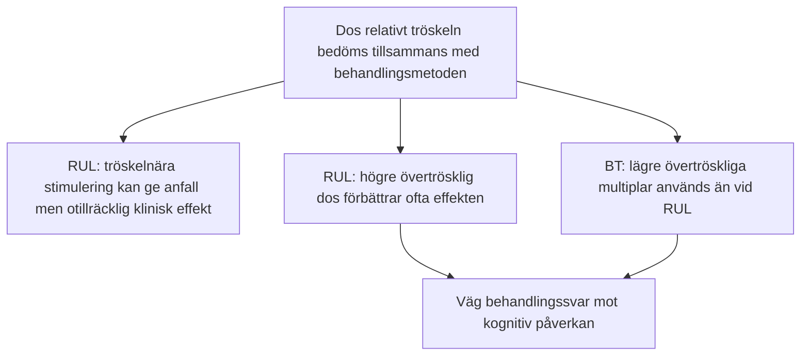
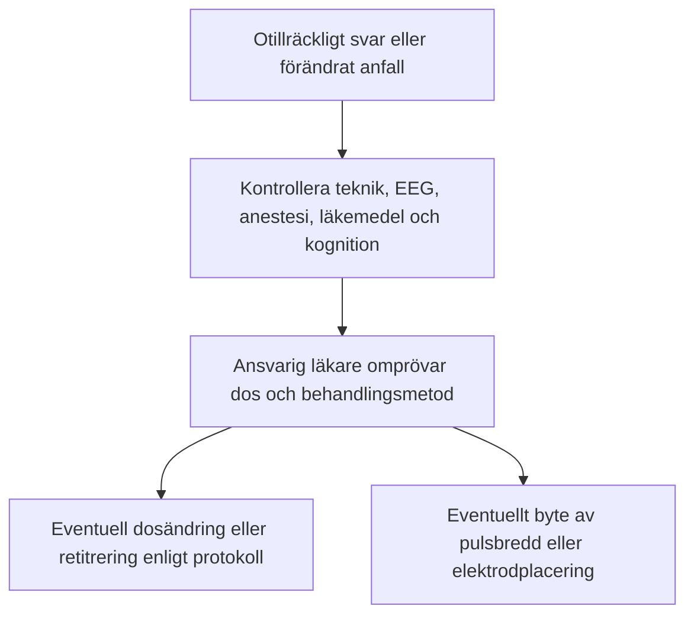

# Kramptröskel och doshöjning

En av de viktigaste upptäckterna inom modern psykiatrisk forskning (framför allt genom Harold Sackeims banbrytande studier) är att **ett epileptiskt anfall i sig inte garanterar terapeutisk effekt**. 

Dos i förhållande till tröskeln påverkar sannolikheten för effekt och biverkningar. Utfallet beror också på pulsbredd, elektrodplacering, diagnos och individuella faktorer.

---

## Dos över tröskeln: RUL och BT

Det finns en fundamental skillnad i dos-responssambandet mellan högersidig unilateral (RUL) och bitemporal (BT) stimulering:

### 1. Varför undviks tröskelnära RUL?

Kliniska studier visar lägre antidepressiv effekt vid tröskelnära RUL än vid högre övertrösklig dos. Det bevisar inte att fältstyrkan i en viss djup struktur är för låg: fältamplituden ökar inte när enbart pulstågets duration ökas.

### 2. Ordination
- APA:s tredje upplaga anger **2,5-6× initial tröskel vid RUL med kortpuls** och omkring **6× vid RUL med ultrakort puls** (används inte hos oss). Ert aktuella protokoll och den individuella ordinationen styr valet.
- Vid **BT** används lägre multiplar, ofta omkring 1,5-2,5×. Väg effekt mot kognitiva biverkningar.
- Beräkna dosen i mC och bekräfta tillåtna apparatinställningar. Ett antal tabellsteg är ingen universell multipel.

---

## När ska dosen höjas?

Kramptröskeln kan ändras under serien och stiger ofta. Förändringen är individuell; ett kortare anfall bevisar inte att tröskeln stigit eller att dosen måste höjas.

### Fynd som motiverar omprövning

- Uteblivet eller förändrat anfall efter kontroll av registrering och teknik.
- Försämrad EEG-morfologi jämfört med patientens tidigare behandlingar, bedömd med samma avledning och förstärkning.
- Otillräcklig klinisk förbättring eller platå, tillsammans med bedömning av kognitiva biverkningar.

### Doshöjning på MECTA 5000Q

En höjning från 192 till 288 mC innebär en ökning med 96 mC. Relativt ursprungsdosen blir det (288 − 192) / 192 × 100 = **50 %**. Den nya dosen är alltså 1,5 gånger den tidigare dosen. ”Ett steg” har däremot inte en universell procentsats. Byte från RUL till BT följer en samlad bedömning, inte en automatisk regel efter ett visst antal behandlingar.

> [!TIP] Tänk på pulsbredden vid mycket svårutlösta anfall
> Om adekvata anfall uteblir trots att den tillgängliga laddningen för vald pulsbredd, ström och program har nåtts, kan ansvarig läkare överväga **byte till kortpuls** (0,5-1,0 ms). Huvudapparatens kapacitet är 1152 mC (200 J), men hela kapaciteten är inte tillgänglig med fast 0,3 ms. 576 mC är kapacitetsgränsen för 100 J-reservapparaten, inte en generell gräns för huvudapparaten. Byte av pulsbredd ändrar tröskel och kognitiv risk; dosstrategin måste omprövas och godkännas av ansvarig läkare.

---

## Referenser

1. American Psychiatric Association. *The Practice of Electroconvulsive Therapy*. 3 uppl.; copyright 2025. Kap. 14.7.4 om dosjustering, kap. 15.1 om duration och stimulusintensitet samt kap. 22 om otillräckligt kliniskt svar.
2. Mankad MV, Beyer JL, Weiner RD, Krystal AD. *Clinical Manual of Electroconvulsive Therapy*. Arlington, VA: American Psychiatric Publishing; 2010. Kap. 5, s. 59-78 (övertrösklig dosering), kap. 8, s. 105-128 (EEG), och kap. 11, s. 149-158 (anfallshantering).
3. [NSW Health. ECT Handbook. Version 1.1; 2026 (aktuell nätversion: 1.2)](https://www.health.nsw.gov.au/mentalhealth/resources/Pages/electroconvulsive-therapy-handbook.aspx).
4. [Sackeim HA, et al. N Engl J Med. 1993;328:839-846](https://pubmed.ncbi.nlm.nih.gov/8441428/).

---

## Relaterade länkar
- Titreringstabell för MECTA 5000Q: [[04 Titreringstabeller|Titreringstabeller]]
- Anfallskriterier och EEG: [[04 Bedömning av anfallskvalitet|Bedömning av anfallskvalitet]]
- Hantering av missade anfall: [[05 Missat, kort eller förlängt anfall|Missat, kort eller förlängt anfall]]
- Val av elektrodplacering: [[01 Elektrodplacering|Elektrodplacering]]
