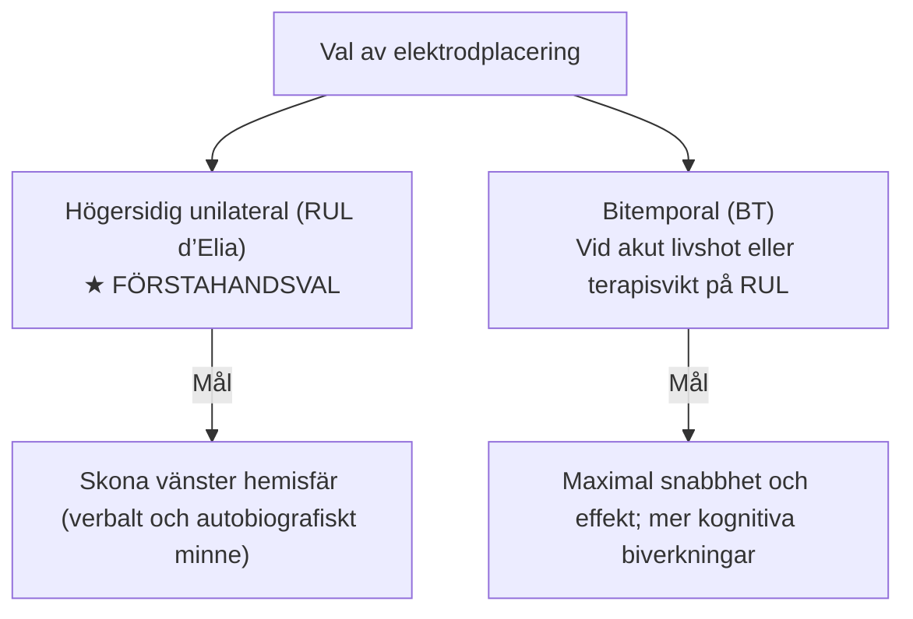
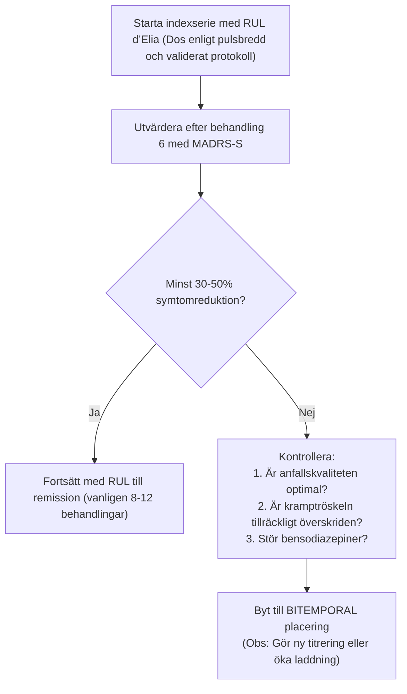

# Elektrodplacering

**Lokalt används RUL d’Elia och bitemporal placering (BT).**

Valet av elektrodplacering är en av de absolut viktigaste ordinationerna vid ECT. Placeringen styr hur det elektriska fältet sprids genom hjärnan och avgör balansen mellan **antidepressiv effekt** och **kognitiva biverkningar** (särskilt minnesstörning). Som ECT-behandlare måste du förstå logiken bakom ordinationen och behärska den anatomiska placeringen med millimeterprecision.

![[Elektrodplaceringar RUL BT.svg]]
*Figur 1: RUL d’Elia (T och V) och bitemporal placering (T på båda sidor). Schematisk illustration; elektrodmarkeringar och mått förklaras i texten.*

---

## RUL d’Elia

I svensk och internationell standardvård är **högersidig unilateral elektrodplacering (RUL)** enligt den svenske professorn **Giacomo d’Elias** metod (1970) ett vanligt förstahandsval vid depression när kognitiv skonsamhet prioriteras. Valet beror också på diagnos, brådska, tidigare svar och tillgängligt protokoll.

### Anatomiska landmärken
1. **Främre elektroden - temporalelektrod (`T`):**
    - Dra en tänkt linje mellan **yttre ögonvrån (*canthus externus*)** och **tragus** på patientens högra sida.
    - Markera **mittpunkten (`X`)** på denna linje.
    - Placera centrum av temporalelektroden (`T`) cirka **2,5-3,0 cm vinkelrätt ovanför** mittpunkten (`X`), så att elektrodens nedre kant vilar strax ovanför referenslinjen.
    - **Mottryck:** Håll ett stadigt mottryck mot huvudets vänstra sida för att säkerställa god kontakt och låg impedans mellan skalpen och den högra temporalelektroden.
2. **Bakre elektroden - vertexelektrod (`V`):**
    - Identifiera linjen mellan höger och vänster **tragus**.
    - Identifiera huvudets **mittlinje** från **nasion (näsroten)** till **inion (yttre nackknölen)**.
    - Fastställ **skärningspunkten (`X`, *vertex*)** mellan dessa två vinkelräta linjer.
    - Placera centrum av vertexelektroden (`V`) cirka **2,5-3,0 cm till höger om skärningspunkten (`X`)** över den icke-dominanta hemisfären, så att elektrodens inre kant tangerar mittlinjen.
3. **Avstånd mellan elektroderna och fysiologisk logik:**
    - Avståndet mellan elektrodkant och elektrodkant ska vara **minst 10-12 cm**!
    - Placeringen enligt d’Elia föredras framför äldre unilaterala placeringar eftersom den:
        1. **Maximerar interelektrodavståndet** så att tillräcklig elektrisk ström penetrerar hjärnbarken istället för att shuntas ytligt genom skalpen.
        2. **Ger hög strömtäthet över primära motorbarken** och dess subkortikala projektioner, vilket utlöser ett välgeneraliserat anfall.
        3. **Utnyttjar den lägre impedansen i *sutura sagittalis***, vilket underlättar för strömmen att nå hjärnvävnaden.

![[Elektrodplacering anatomiska landmarken.svg]]
*Figur 2: RUL d’Elia i höger sidovy och uppifrån. X markerar mittpunkten på linjen ögonvrå-tragus respektive referenslinjernas skärning vid vertex. T = temporalelektrod, V = vertexelektrod.*

### Egenskaper hos RUL
- **Kognitiv skonsamhet:** RUL ger ofta mindre kognitiv påverkan än BT vid lämplig dosering. Språkdominans varierar; autobiografiskt minne är distribuerat och inte enbart lokaliserat till vänster hemisfär. RUL påverkar båda hemisfärerna.
- **Krav på dosering:** För att RUL ska ge fullgod terapeutisk effekt används hög övertrösklig dos, ofta **4-6× vid kortpuls och omkring 6× vid ultrakort puls** (ultrakort puls används inte hos oss), enligt protokoll. En RUL-behandling som ges strax över tröskeln är nästintill verkningslös.

---

## Bitemporal placering (BT)

Bitemporal (bifrontotemporal bilateral) placering var den ursprungliga historiska metoden och används fortfarande i specifika situationer.

### Anatomiska landmärken
- En stimuleringselektrod (`T`) appliceras symmetriskt i det frontotemporala området på **varje sida av huvudet**.
- Placeringen på respektive sida är identisk med temporalelektroden vid RUL: centrum av elektroden (`T`) placeras cirka **2,5-3 cm vinkelrätt ovanför mittpunkten (`X`)** på linjen mellan *canthus externus* och *tragus*.

### När väljs bitemporal placering?
1. **Akut livshotande tillstånd (Prioritet 1):** Malignt neuroleptikasyndrom, letal katatoni eller akut suicidala patienter i extrem kris där man vill ha snabbast möjliga remission och accepterar kognitiva biverkningar.
2. **Terapisvikt på RUL:** Om patienten inte förbättrats efter 5-6 adekvata RUL-behandlingar vid optimal övertrösklig dosering.
3. **Krav på dosering:** BT är mycket potent även vid måttligt övertrösklig dos (**1,5 till 2,5 gånger kramptröskeln**).

---

## RUL jämfört med bitemporal

| Parameter | RUL d’Elia (unilateral) | Bitemporal (BT) |
| :--- | :--- | :--- |
| **Förstahandsval?** | **JA (Standard)** | Nej (Reserv/Akut) |
| **Effekt vid depression** | God vid adekvat dos; pulsbredd och protokoll avgör | Maximal / Snabbast |
| **Verbalt minne** | **Bäst bevarat** | Mest påverkat |
| **Retrograd amnesi** | Lägre risk än BT; kvarstående besvär kan förekomma | Tydlig, kan kvarstå längre |
| **Kramptröskel vid start** | Lägst tröskel | Högre tröskel |
| **Rekommenderad dos** | **Kortpuls ofta 4-6×; ultrakort puls omkring 6×** | **1,5 - 2,5 × Tröskeln** |

---

## Byte från RUL till bitemporal

> [!WARNING] Tänk på vid byte till bitemporal placering
> Kramptröskeln vid bitemporal placering är typiskt **50-100 % högre** än vid RUL. Du kan därför inte bara flytta elektroderna och behålla samma låga dos; kontrollera att dosen är tillräckligt tilltagen för bilateral stimulering!
