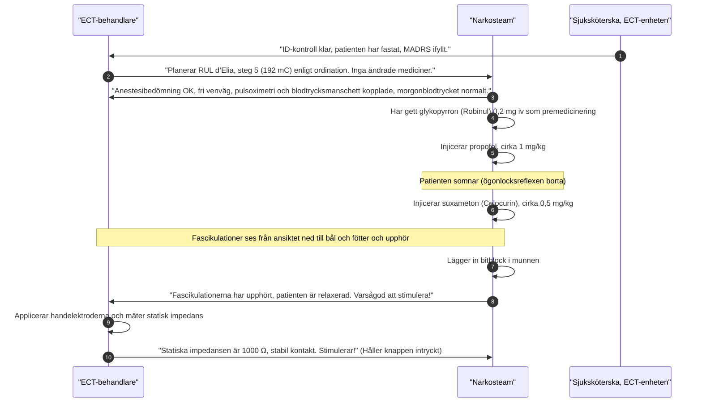

# Anestesi och teamsamarbete

ECT genomförs alltid i kort generell anestesi med tillräckligt sömndjup och muskelrelaxation. Behandlingen bygger på ett nära teamsamarbete mellan **ECT-behandlare**, **anestesiolog / anestesisjuksköterska**, **sjuksköterskorna på ECT-enheten (IVA)**, som sköter patientmottagandet, och **ordinerande läkare**. Vid varje behandling finns en ECT-behandlare (läkare eller ECT-sjuksköterska).

---

## Anestesins mål

1. **Snabb och behaglig induktion:** Patienten ska somna tryggt utan obehag, ångest eller känsla av kvävning.
2. **Fullständig muskelrelaxation:** Förhindra muskuloskeletala skador (frakturer, ledluxationer, kotkompressioner, muskelbristningar) under det generaliserade krampanfallet.
3. **Optimal syresättning och ventilation:** Förebygga hypoxi och hyperkapni genom preoxygenering och assisterad hyperventilering före stimuleringen; efter krampen inväntas spontanandning.
4. **Cirkulatorisk kontroll:** Dämpa de extrema fysiologiska svängningarna (initial vagal bradykardi och efterföljande sympatisk hypertoni/takykardi).
5. **Snabbt och mjukt uppvaknande:** Patienten ska vakna upp klart och lugnt utan uttalad dåsighet, illamående eller agitation.

---

## Tydlig kommunikation i teamet

Ett säkert genomförande förutsätter standardiserad, tydlig verbal kommunikation i behandlingsrummet:

---

## Vem bestämmer vad?

- **ECT-behandlaren ansvarar för:**
    - Avstämning av gällande ordination och medicinskt godkännande.
    - Inställning och kontroll av apparatens parametrar (pulsbredd, frekvens, duration, laddning mC).
    - Hudförberedelse, elektrodplacering och kontroll av statisk impedans.
    - Utlösande av stimuleringen på anestesins uttryckliga klartecken.
    - Bedömning av motoriskt anfall och realtidstolkning av iktalt EEG.
    - Beslut om omedelbar restimulering vid missat/kort anfall enligt kliniskt protokoll.
- **Ordinerande / ansvarig läkare ansvarar för:**
    - Psykiatrisk indikation, somatisk riskbedömning och beslut om ECT-serie.
    - Juridisk handläggning (samtycke eller LPT § 17-beslut via chefsöverläkare).
    - Ordination av elektrodplacering (RUL eller BT) och doseringsstrategi/titrering.
    - Läkemedelsordinationer (utsättning/pausning av kramphämmande farmaka).
- **Anestesisidan ansvarar för:**
    - Preoperativ anestesibedömning och godkännande för narkos.
    - Val och dosering av hypnotikum och muskelrelaxans.
    - Luftvägshantering, maskventilation, preoxygenering och hyperventilering.
    - Placering av bitblock.
    - Övervakning av vitalparametrar (blodtryck, pulsoximetri och kapnografi; EKG enligt ordination).
    - Akut hantering av laryngospasm, cirkulationskollaps eller förlängd apné.
    - Beslut om när patienten är säker att förflyttas till uppvakningsavdelningen.

---

## Exempel på teamdialog

En skicklig ECT-behandlare pratar kontinuerligt med narkosteamet:
- *"Anfallet var bara 15 sekunder motoriskt och EEG visar svaga spikar. Kan vi minska propofoldosen något till nästa gång, eller ska vi byta till tiopental?"*
- *"Patienten vaknade med kraftig huvudvärk förra gången, kan vi lägga till ketorolak (Toradol) eller paracetamol intravenöst under behandlingen?"*
- *"Patienten är mycket kardiellt skör med instabilt blodtryck. Vi vill ge en tillräckligt hög dos direkt för att slippa restimulera."*

---

## Saliv och sugberedskap

Under ECT stimuleras det parasympatiska nervsystemet kraftigt via vagusnerven (kranialnerv X), vilket kan ge en kraftigt ökad salivutsöndring från spottkörtlarna och trakeobronkiell slemsekretion:
- **Laryngospasm och obstruktion:** Om saliv och slem droppar ned mot stämbanden under ytlig anestesi finns stor risk för reflexmässig stämbandsslutning (**laryngospasm**), vilket omöjliggör ventilation och leder till snabbt sjunkande syremättnad.
- **Sugberedskap vid bordet:** En påslagen vakuumsug med grov sugkateter (*Yankauer*) ska **alltid** finnas testad och placerad omedelbart tillgänglig vid sängens huvudända.
- **Antikolinergika vid hypersalivation eller svår bradykardi:**
    - **Glykopyrron (Robinul 0,2 mg iv):** Ges enligt IVA:s rutin som premedicinering till alla patienter utan kontraindikation. Förstahandsval! Passerar *inte* blod-hjärnbarriären (kvartär amin). Dämpar saliv- och luftvägssekretion effektivt och motverkar vagal bradykardi utan att ge central kognitiv påverkan eller förvärra postiktal konfusion.
    - **Atropin (0,5 mg iv):** Används mer restriktivt då det passerar blod-hjärnbarriären (tertiär amin) och kan förstärka postiktalt delirium och minnesstörning.

---

## Referenser

1. American Psychiatric Association. *The Practice of Electroconvulsive Therapy*. 3 uppl.; copyright 2025. Kap. 3.1 om teamets sammansättning och kap. 12.1-12.2 om anestesins mål, luftväg och läkemedel.
2. Ferrier IN, Waite J, red. *The ECT Handbook*. 4 uppl. Cambridge: Cambridge University Press; 2019. Kap. 21, s. 173-182, om ECT-sjuksköterskans roll, samt kap. 23, ”Anaesthesia for Electroconvulsive Therapy”, s. 202-210.
3. Mankad MV, Beyer JL, Weiner RD, Krystal AD. *Clinical Manual of Electroconvulsive Therapy*. Arlington, VA: American Psychiatric Publishing; 2010. Kap. 6, ”Anesthetics and Other Medications”, s. 81-96. Underlag för anestesi och läkemedelsberedskap.
4. [NSW Health. ECT Handbook. Version 1.1; 2026 (aktuell nätversion: 1.2)](https://www.health.nsw.gov.au/mentalhealth/resources/Pages/electroconvulsive-therapy-handbook.aspx). Roller, restimuleringsmandat, utbildningskrav och läkemedel följer den egna verksamhetens ansvarsfördelning; antal handledda behandlingstillfällen i texten är ett exempel, inte ett formellt behörighetskrav.
5. Sahlgrenska Universitetssjukhuset, An-Op-IVA Område 3. *ECT (elektrokonvulsiv terapi), IVA Mölndal*. Rutin, senast reviderad 2025-12-05. Premedicinering med glykopyrron, doser av propofol och suxameton samt övervakning.

---

## Relaterade länkar
- Narkosmedel (propofol eller tiopental): [[03 Narkosmedel|Narkosmedel]]
- Muskelrelaxantia (suxameton): [[04 Muskelrelaxantia|Muskelrelaxantia]]
- Ventilation och hyperventilering: [[02 Ventilation och syresättning|Ventilation och syresättning]]
- Steg för steg vid bordet: [[02 Behandling steg för steg|Behandling steg för steg]]
