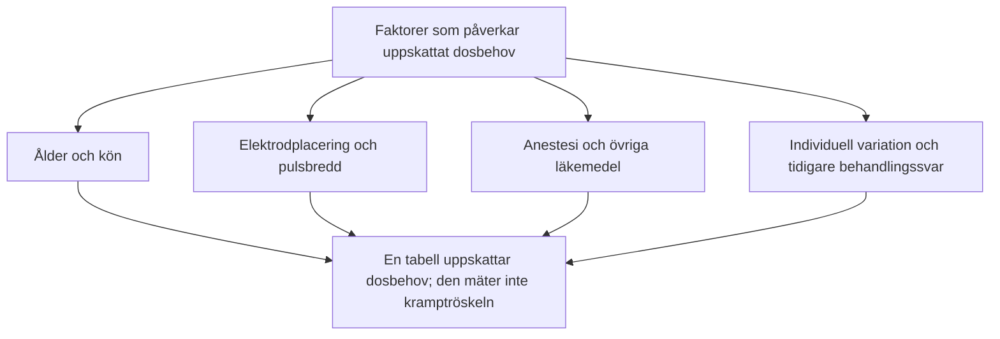

# Evidens och begränsningar

APA:s tredje upplaga beskriver att formler baserade på patient- och behandlingsfaktorer bara förklarar en del av variationen i initial kramptröskel. Ett procenttal för ”ålderns betydelse” kan inte tillämpas oförändrat på varje patient. Kön eller skallbenstjocklek förklarar inte heller ensamt ett individuellt dosbehov.

---

## Begränsningar vid tabellbaserad dosering

1. **För hög dos:** En tabell kan överskatta behovet, särskilt hos äldre, och ge onödig kognitiv påverkan.
2. **För låg dos:** Underskattning kan ge uteblivet anfall eller tröskelnära stimulering med otillräcklig effekt, särskilt vid RUL.
3. **Begränsad överförbarhet:** En dostabell gäller en viss apparat och behandlingsmetod. Inte heller en modell som inkluderar både ålder och kön fastställer patientens individuella tröskel.

Detta är begränsningar att följa upp när er lokala tabell används, inte ett skäl att på egen hand byta doseringsstrategi.

---

## Dostabell och titrering

| Kriterium | Empirisk titrering | Dosering enligt tabell |
| :--- | :--- | :--- |
| Vad uppskattas? | Tröskel under aktuella stimulerings- och anestesiförhållanden | Dosbehov utifrån valda patient- och behandlingsfaktorer |
| Styrka | Underlag för en definierad övertrösklig multipel | Kan minska behovet av upprepade stimuli vid start |
| Begränsning | Kan kräva flera stimuli; uppskattningen påverkas av testförhållandena | Kan över- eller underskatta tröskeln |
| Uppföljning | Kliniskt svar, kognition och anfallsregistrering | Samma uppföljning behövs; tabellen är inte en tröskelmätning |
