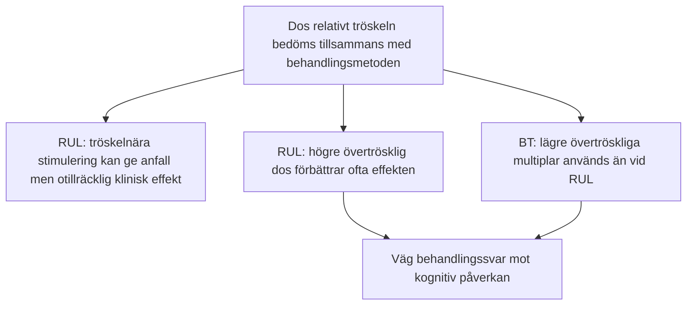

# Kramptröskel

En av de viktigaste upptäckterna inom modern psykiatrisk forskning (framför allt genom Harold Sackeims banbrytande studier) är att **ett epileptiskt anfall i sig inte garanterar terapeutisk effekt**. 

Dos i förhållande till tröskeln påverkar sannolikheten för effekt och biverkningar. Utfallet beror också på pulsbredd, elektrodplacering, diagnos och individuella faktorer.

---

## Dos över tröskeln: RUL och BT

Det finns en fundamental skillnad i dos-responssambandet mellan högersidig unilateral (RUL) och bitemporal (BT) stimulering:

### 1. Varför undviks tröskelnära RUL?

Kliniska studier visar lägre antidepressiv effekt vid tröskelnära RUL än vid högre övertrösklig dos. Det bevisar inte att fältstyrkan i en viss djup struktur är för låg: fältamplituden ökar inte när enbart pulstågets duration ökas.

### 2. Ordination
- APA:s tredje upplaga anger **2,5-6× initial tröskel vid RUL med kortpuls** och omkring **6× vid RUL med ultrakort puls** (används inte hos oss). Ert aktuella protokoll och den individuella ordinationen styr valet.
- Vid **BT** används lägre multiplar, ofta omkring 1,5-2,5×. Väg effekt mot kognitiva biverkningar.
- Beräkna dosen i mC och bekräfta tillåtna apparatinställningar. Ett antal tabellsteg är ingen universell multipel.

---

## Förändrad kramptröskel under serien

Tröskeln stiger ofta under en indexserie, men graden varierar och utvecklingen är inte likadan hos alla. Förändringar i anestesi, läkemedel och tekniska förhållanden kan också påverka anfallsutlösningen.

Ökad anfallsdämpning är en föreslagen del av ECT:s neurobiologi. Det är inte bevisat att tröskelökningen, eller ökad GABA-aktivitet i sig, förklarar den antidepressiva effekten. Swartz snabba *kindling* under ett pulståg och tröskelökning mellan behandlingar beskriver olika tidsförlopp och ska inte likställas.

Kortare anfall eller förändrat EEG kan föranleda omprövning men visar inte ensamt hur mycket tröskeln har ändrats. Väg samman kliniskt svar, kognition, anfallsmorfologi, anestesi och läkemedel. Retitrering eller dosändring beslutas enligt det lokala protokollet.
