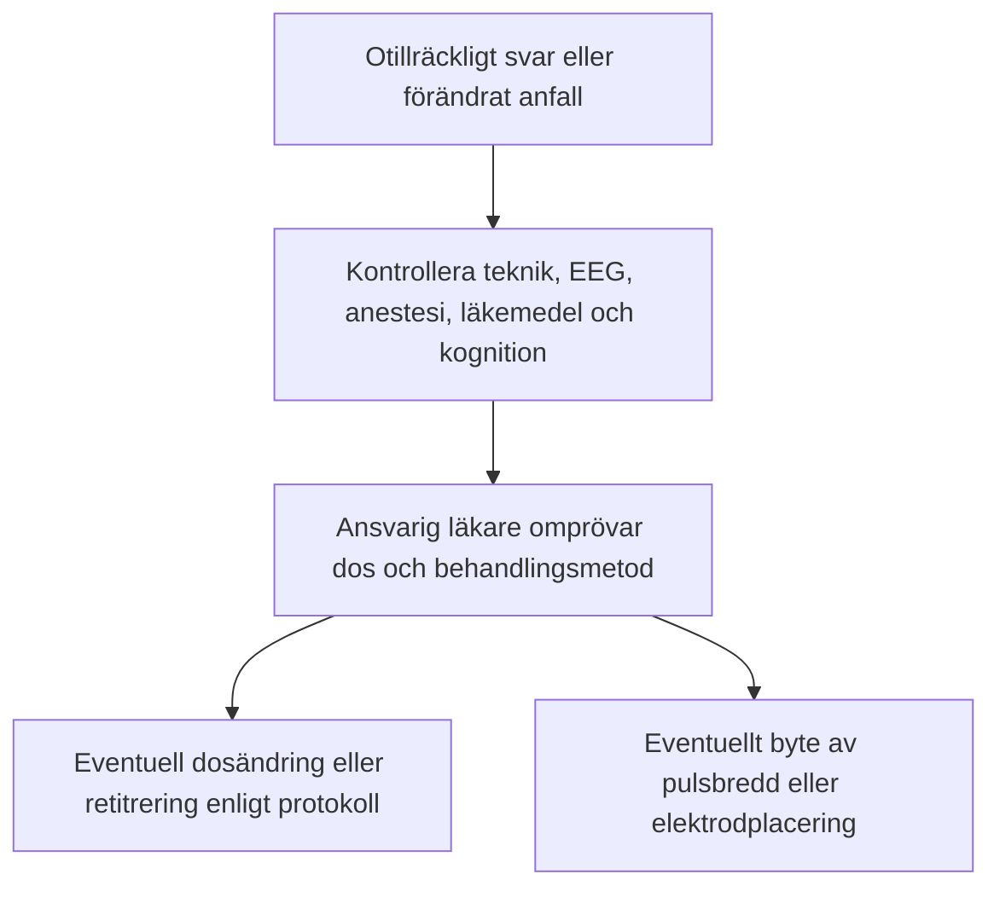
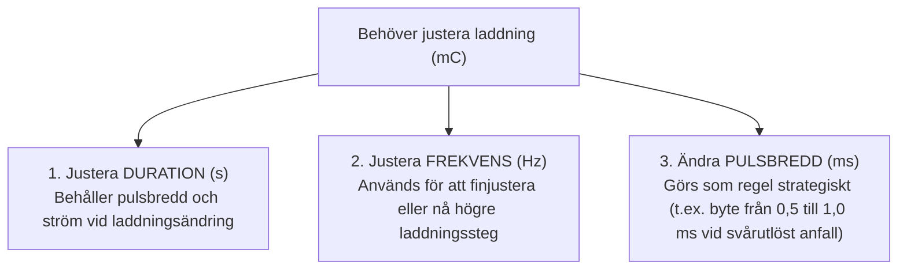

# Dosjustering

Kramptröskeln kan ändras under serien och stiger ofta. Förändringen är individuell; ett kortare anfall bevisar inte att tröskeln stigit eller att dosen måste höjas.

---

## Fynd som motiverar omprövning

- Uteblivet eller förändrat anfall efter kontroll av registrering och teknik.
- Försämrad EEG-morfologi jämfört med patientens tidigare behandlingar, bedömd med samma avledning och förstärkning.
- Otillräcklig klinisk förbättring eller platå, tillsammans med bedömning av kognitiva biverkningar.

---

## Doshöjning på MECTA 5000Q

En höjning från 192 till 288 mC innebär en ökning med 96 mC. Relativt ursprungsdosen blir det (288 − 192) / 192 × 100 = **50 %**. Den nya dosen är alltså 1,5 gånger den tidigare dosen. ”Ett steg” har däremot inte en universell procentsats. Byte från RUL till BT följer en samlad bedömning, inte en automatisk regel efter ett visst antal behandlingar.

> [!TIP] Tänk på pulsbredden vid mycket svårutlösta anfall
> Om adekvata anfall uteblir trots att den tillgängliga laddningen för vald pulsbredd, ström och program har nåtts, kan ansvarig läkare överväga **byte till kortpuls** (0,5-1,0 ms). Huvudapparatens kapacitet är 1152 mC (200 J), men hela kapaciteten är inte tillgänglig med fast 0,3 ms. 576 mC är kapacitetsgränsen för 100 J-reservapparaten, inte en generell gräns för huvudapparaten. Byte av pulsbredd ändrar tröskel och kognitiv risk; dosstrategin måste omprövas och godkännas av ansvarig läkare.

---

## Ändra dosen

När du vill öka eller minska den elektriska laddningen (Q) vid behandlingsbordet har du i första hand tre verktyg; strömstyrkan ändras bara enligt ordination:

> [!TIP] Räkna på den ordinerade ändringen
> Vid oförändrade övriga parametrar ger 2,0 → 3,0 s exakt 50 % högre laddning. Ändring av duration och frekvens behöver inte vara biologiskt likvärdiga trots samma mC. Det finns varken en universell procentsats per tabellsteg eller en generell 4-5-sekundersgräns för när frekvensen ska ändras.
