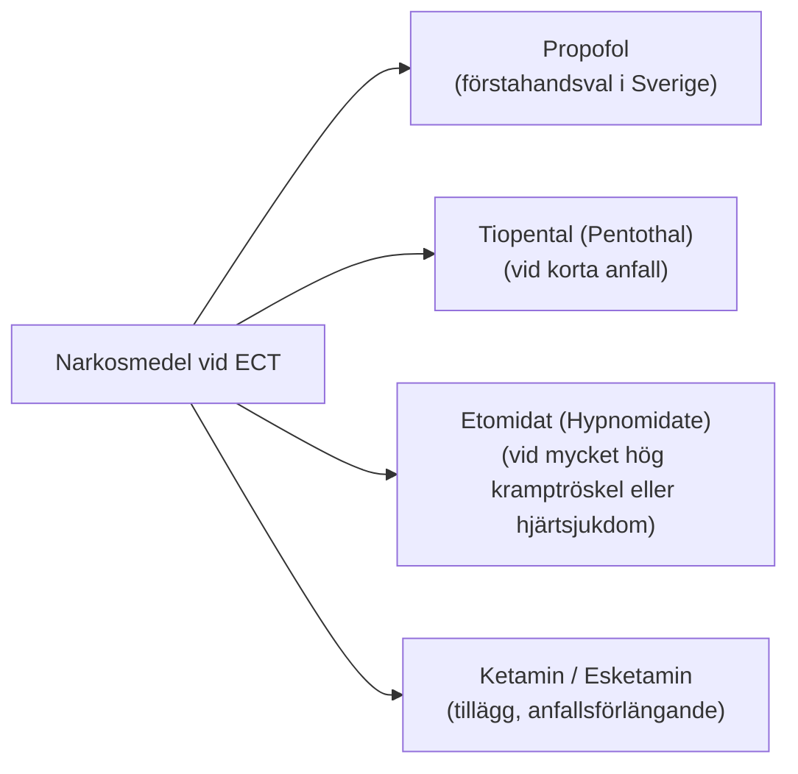
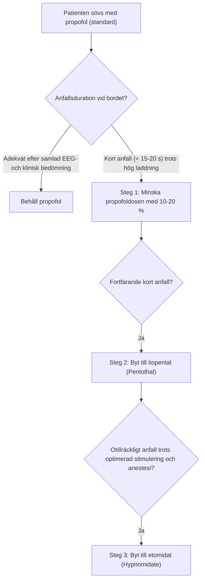

# Narkosmedel

Valet av induktionsmedel (hypnotikum) påverkar direkt patientens kramptröskel, anfallets duration och uppvaknandets kvalitet. 

I Sverige är **propofol** det dominerande förstahandsvalet, men god kännedom om alternativen är helt nödvändig när du möter patienter med höga kramptrösklar eller otillräcklig anfallskvalitet.

---

## Vanliga narkosmedel

---

### 1. Propofol
- **Dosering:** 1,0-2,0 mg/kg iv (individualiseras av anestesin till adekvat anestesidjup; ögonlocksreflex och kornealreflex är olika reflexer).
- **Fördelar:**
    - Mycket snabb induktion och behagligt, klart uppvaknande.
    - Minst illamående efter behandlingen (har egen antiemetisk effekt).
    - Antiarytmisk effekt (minskar risken för sympatikusutlösta arytmier under anfallet).
    - Mindre postiktal konfusion och huvudvärk.
- **Nackdelar:**
    - **Kraftig egen antikonvulsiv (kramphämmande) effekt!** Propofol höjer patientens kramptröskel markant och förkortar anfallsdurationen jämfört med barbiturater.
- **Klinisk regel:** Ge minsta effektiva dos! Vid för djup anestesi på grund av för hög propofoldos kan anfallet utebli helt.

---

### 2. Tiopental
- **Dosering:** 2,0-4,0 mg/kg iv.
- **Fördelar:**
    - Betydligt mindre kramphämmande än propofol.
    - Ger konsekvent **längre anfallsdurationer** och högre iktal EEG-amplitud.
    - Förstahandsval att byta till när en patient på propofol börjar få korta, abortiva eller missade anfall trots hög laddning!
- **Nackdelar:**
    - Längre halveringstid → kvardröjande effekt (*hangover*) med längre postiktal trötthet och långsammare uppvaknande.
    - Något mer illamående efter behandlingen.
    - Kontraindicerat vid akut intermittent porfyri.

---

### 3. Etomidat
- **Dosering:** 0,15-0,3 mg/kg iv.
- **Fördelar:**
    - **Minimal kramphämmande effekt:** Ger de längsta anfallen och de tydligaste iktala EEG-mönstren!
    - **Mycket god kardiovaskulär stabilitet:** Sänker inte blodtrycket eller hjärtmuskelns kontraktilitet → lämpligt för äldre patienter med svår hjärtsvikt eller svår kardiomyopati.
    - Kan övervägas av anestesiläkare vid svårutlösta anfall trots optimerad stimulering och anestesi. Tillgänglig laddning beror på program och parameterkombination; 576 mC är inte maximum för en apparat på 200 J. Se [[01 Översikt|Översikt]].
- **Nackdelar:**
    - Hög frekvens av illamående och kräkningar (ondansetron ges ofta profylaktiskt).
    - Kan orsaka spontana myoklonier före stimulering.
    - Övergående hämning av kortisolsyntesen i binjurebarken (adrenokortikal suppression via hämning av 11β-hydroxylas) - kliniskt sällan relevant vid intermittent korttidsanvändning, men bör beaktas vid svår sepsis eller Addisons sjukdom.

---

### 4. Ketamin och esketamin
- **Dosering:** Ketamin och esketamin är inte dosmässigt likvärdiga. Dosen beror på preparat och på om det ges som induktionsmedel eller tillägg; ordineras av anestesin enligt aktuell produktinformation och lokal rutin.
- **Fördelar:**
    - Egen snabbverkande antidepressiv verkan via NMDA-receptorblockad och synaptogenes.
    - Sänker inte krampanfallets längd; kan förlänga anfall.
    - Sympatomimetisk effekt (höjer blodtryck och puls → fördel vid hypotension).
- **Nackdelar:**
    - Risk för obehagliga hallucinationer, mardrömmar, dissociation och psykomotorisk oro vid uppvaknandet.
    - Olämpligt vid instabil hypertoni eller intrakraniell tryckstegring.

---

## Jämförelsetabell: Narkosmedel vid ECT

| Egenskap | Propofol | Tiopental | Etomidat | Ketamin |
| :--- | :--- | :--- | :--- | :--- |
| **Kramphämmande effekt** | **Hög** (förkortar anfall) | Måttlig | **Mycket låg** (långa anfall) | Mycket låg |
| **Anfallsduration** | Kortast | Medellång till lång | **Längst** | Lång |
| **Uppvakningskvalitet** | **Bäst (klar och snabb)** | Trötthet, dåsighet | God | Risk för dissociation |
| **Illamående efter behandlingen**| **Minst (antiemetisk effekt)** | Lågt till måttligt | **Högst** | Måttligt |
| **Cirkulatorisk stabilitet** | Blodtrycksfall vanligt | Lätt blodtrycksfall | **Mest stabil** | Höjer BT och puls |
| **Klinisk roll i Sverige** | **Förstahandsval** | **Andrahandsval vid korta anfall** | **Reserv vid hög tröskel** | Specialfall, studier |

---

## Klinisk handläggning: När byter vi medel?

