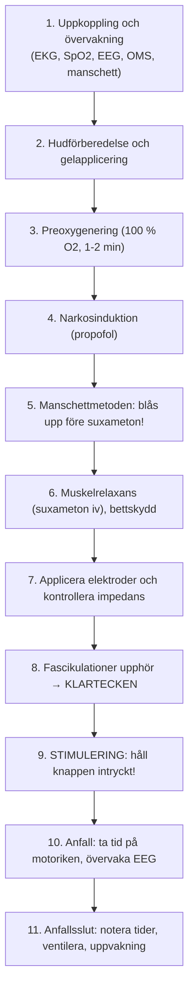

# Behandling steg för steg

Här beskrivs hela det praktiska behandlingsförloppet minut för minut. Detta är teamets gemensamma handlingsplan vid bordet.

---

## Kronologiskt behandlingsförlopp

---

### Steg 1: Uppkoppling och övervakning
- Patienten lägger sig bekvämt på behandlingsbritsen.
- Narkossjuksköterskan kopplar pulsoximetri (SpO₂), blodtrycksmanschett och EKG.
- ECT-sjuksköterskan sätter registreringselektroder för EEG:
    - 2 registreringselektroder i pannan cirka 2-3 cm ovanför ögonbrynen (Fp₁ och Fp₂) samt 1 jord- eller referenselektrod under nyckelbenet.
    - Optisk rörelsesensor (OMS) fästs på patientens stortå eller pekfinger.
- Placera den manuella isoleringsmanschetten runt motsatt fotled eller handled.

### Steg 2: Hudförberedelse för stimulering
- Rengör elektrodställena med spritkompress för att avlägsna hudfett (*sebum*) och hudflagor (*stratum corneum*).
- Torka torrt!
- Applicera ett tunt, jämnt lager ledande ECT-gel på de handhållna elektroderna (eller klistra fast de självhäftande elektroderna på de exakta anatomiska landmärkena för [[01 Elektrodplacering|Elektrodplacering]]).

### Steg 3: Preoxygenering och ventilation
- Preoxygenera med **100 % syrgas** enligt anestesins plan, vanligen under spontanandning före induktion.
- Assisterad ventilation och eventuell kontrollerad hyperventilering sker efter induktion under anestesins ansvar; se [[02 Ventilation och syresättning|Ventilation och syresättning]].

### Steg 4: Narkosinduktion
- Narkosläkaren eller narkossjuksköterskan injicerar hypnotikum långsamt iv (t.ex. propofol 1,0-1,8 mg/kg).
- Patienten uppmanas räkna baklänges eller blunda. När ögonlocksreflexen slocknat har patienten somnat.

### Steg 5: Manschettmetoden - rätt tidpunkt är avgörande!
> [!IMPORTANT] Pumpa upp manschetten INNAN suxameton ges!
> Narkosläkaren eller du pumpar upp blodtrycksmanschetten runt fotleden till **200-250 mmHg**.
> **Detta måste göras FÖRE injektionen av suxameton**, annars hinner muskelrelaxantiet nå fotens muskler och du förlorar möjligheten att observera det motoriska anfallet!

### Steg 6: Muskelrelaxation och bettskydd
- Suxameton (Celocurin) 0,8-1,0 mg/kg injiceras snabbt iv följt av spolning.
- Ett mjukt bettskydd av silikon eller gummi förs in i patientens mun för att skydda tänderna och hålla tungan på plats.
- Maskventilationen fortsätter med 100 % syrgas.

### Steg 7: Elektroder och impedans
- Du applicerar de handhållna elektroderna på patientens huvud (*caput*) med ett fast, jämnt tryck.
- **Kontrollera LCD-skärmen på MECTA 5000Q:**
    - Värdet ska ligga inom **apparatens godkända intervall**. Kontrollera kontakt och eventuell gelbrygga; ett oväntat lågt värde ska utredas även inom spärrfönstret.
    - Kontrollera att `STIMULUS STATUS`-lampan lyser med fast sken.

### Steg 8: Bekräfta anestesi och muskelrelaxation

Fascikulationer varierar och är inte ett självständigt mått på blockaddjup. Anestesin kontrollerar tillräckligt sömndjup, syresättning, ventilation och relaxation och ger uttryckligt klartecken: *”Varsågod att stimulera!”*

---

### Steg 9: Utlös stimuleringen!
- Tryck in den röda knappen **`STIMULUS CONTROL`** och **HÅLL DEN INTRYCKT**!
- Apparaten ger tre korta varningspip och därefter en sammanhängande ton under tiden strömmen passerar.
- Släpp inte upp knappen förrän tonen upphört helt!

### Steg 10: Anfallsövervakning och tidtagning
- Starta tidtagaruret (på MECTA eller ditt stoppur) i samma sekund som stimuleringen utlöses.
- **Det motoriska anfallet observeras i den isolerade foten:**
    1. **Latensfas (1-3 sekunder):** Helt stilla.
    2. **Tonisk fas (5-15 sekunder):** Foten plantarflekteras (*flexio plantaris*) i en stel kramp.
    3. **Klonisk fas (15-40 sekunder):** Rytmiska, kraftiga böj- och sträckryckningar i foten och tårna (*digiti pedis*). Frekvensen avtar gradvis.
    4. **Motoriskt anfallsslut:** När de kloniska ryckningarna upphör helt stoppar du tidtagningen → **Notera motorisk duration** (t.ex. 32 sekunder).
- **Parallellt övervakas EEG på pappersremsan:**
    - Rytmiska polyspikar med hög amplitud avtar och övergår abrupt i en **tydlig postiktal suppression** (rak linje).
    - Stoppa tidtagningen för EEG → **Notera EEG-duration** (t.ex. 48 sekunder).

### Steg 11: Avslutning och uppvaknande
- Släpp ut luften ur blodtrycksmanschetten på fotleden!
- Bettskyddet tas ut försiktigt. Svalget (*pharynx*) sugs rent vid behov.
- Narkospersonalen återupptar assisterad maskventilation med 100 % syrgas tills patientens egen andning har återkommit med god tidalvolym.
- Riv av pappersremsan från MECTA: granska dynamisk impedans, anfallets symmetri och postiktal suppression.
- När patienten öppnar ögonen och andas stabilt rullas sängen ut till uppvakningsavdelningen (*PACU*) med syrgasgrimma och transportövervakning.

---

## Referenser

1. Mankad MV, Beyer JL, Weiner RD, Krystal AD. *Clinical Manual of Electroconvulsive Therapy*. Arlington, VA: American Psychiatric Publishing; 2010. Kap. 14, ”Step-by-Step Outline of ECT Administration”, s. 169-187. Underlag för behandlingsförloppets ordningsföljd.
2. American Psychiatric Association. *The Practice of Electroconvulsive Therapy*. 3 uppl.; copyright 2025. Kap. 11-12 om förberedelse och anestesi, kap. 14-15 om stimulering och övervakning samt kap. 16 om uppvaknande.
3. Ferrier IN, Waite J, red. *The ECT Handbook*. 4 uppl. Cambridge: Cambridge University Press; 2019. Kap. 21-23, s. 173-210, och kap. 26, s. 234-246. Underlag för teamsamarbete, anestesi och anfallsmonitorering.
4. [NSW Health. ECT Handbook. Version 1.1; 2026 (aktuell nätversion: 1.2)](https://www.health.nsw.gov.au/mentalhealth/resources/Pages/electroconvulsive-therapy-handbook.aspx).
5. [MECTA. Optimized spECTrum Instruction Manual. INT, 200 J; artikelnummer 9900-1012-16](https://mectaspectrum.com/clinician/clinical-ect-materials/).
6. Äldre referens för reservapparat och funktionsbeskrivningar: [MECTA Corporation. spECTrum Instruction Manual. 100 Joules; s. 16-22](https://mectaspectrum.com/clinician/clinical-ect-materials/). Anfallstider räknas och dokumenteras enligt enhetens fastställda definition, med angiven startpunkt.

---

## Relaterade länkar
- Tolka anfallets kvalitet: [[04 Bedömning av anfallskvalitet|Bedömning av anfallskvalitet]]
- Övervakning i detalj: [[03 Anfallsövervakning|Anfallsövervakning]]
- Om anfallet uteblir: [[05 Missat, kort eller förlängt anfall|Missat, kort eller förlängt anfall]]
- Checklista före start: [[01 Förberedelser och checklista|Förberedelser och checklista]]
