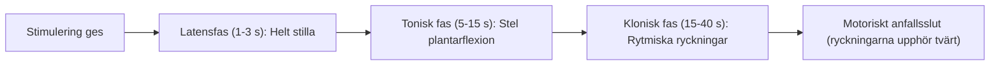
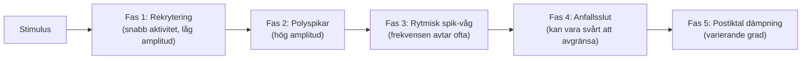

# Anfallsövervakning

För att stödja patientsäkerhet och bedöma den terapeutiska effekten måste varje utlöst anfall övervakas noggrant med både **motorisk observation** och **tvåkanaligt iktalt EEG**.

---

## 1. Motorik: manschett och OMS

Eftersom patienten är muskelrelaxerad med suxameton syns inga generaliserade kramper i bål eller armar. Motoriken övervakas därför i en **isolerad extremitet**:

- **Manschettmetoden:** En blodtrycksmanschett pumpas upp till > 200 mmHg på fotleden före injektionen av suxameton. I den isolerade foten ses anfallets toniska och kloniska faser utan att dämpas av muskelrelaxationen.
- **Optisk rörelsesensor (OMS):** MECTA spECTrum 5000Q har en fotocellsgivare som tejpas på stortån eller fingret. Rörelserna omvandlas till en kurva på LCD-skärmen och skrivs ut som en separat kurva på papperet under EEG-kanalerna.
- **Motorisk duration:** Dokumenteras tillsammans med EEG. Historiska sekundgränser är inte absoluta effektkriterier; se [[04 Bedömning av anfallskvalitet|Bedömning av anfallskvalitet]].

---

## 2. EEG under anfallet

På MECTA 5000Q registreras EEG med registreringselektroder enligt klinikens lokala rutin: två elektroder placeras i pannan cirka 2-3 cm ovanför ögonbrynen (Fp₁ och Fp₂), och en tredje elektrod (jord/referens) placeras under nyckelbenet. Alternativt kan referenselektroden placeras bakom örat.

![[EEG-elektrodplacering.svg]]
*Figur 1: EEG-elektrodplacering för anfallsövervakning: två elektroder i pannan samt en tredje elektrod under nyckelbenet.*

Ett ECT-anfall kan beskrivas med följande schematiska faser. Tider, amplituder och tydlighet varierar; alla faser är inte lika urskiljbara vid varje behandling. Fasmönstret ensamt fastställer inte klinisk effekt:

### EEG:s fem faser
1. **Stimuleringsartefakt och rekryteringsfas (0-5 sekunder):**
    - Högfrekvent elektrisk artefakt från apparatens pulståg.
    - Omedelbart efteråt ses en kortvarig desynkronisering följd av snabb aktivitet med låg amplitud (10-20 Hz) när neuronerna i hjärnbarken börjar rekryteras.
2. **Polyspikfasen (tidig iktal fas, ca 5-20 sekunder):**
    - Amplituden stiger kraftigt (> 200-500 μV).
    - Täta, oregelbundna polyfasiska spikar (**polyspikar**) som speglar den toniska fasen i hjärnbarken.
3. **Fas med rytmiska spik-vågkomplex (klonisk fas, ca 20-50 sekunder):**
    - Ett vanligt iktalt mönster; uttrycket påverkas av avledning, förstärkning, anestesi och patientfaktorer.
    - Rytmiska, bilateralt symmetriska **spik-vågkomplex** (spik följd av långsam våg) med hög amplitud och en frekvens som sjunker från ca 4 Hz ner mot 2-3 Hz.
    - Frekvensen sjunker i takt med att anfallet närmar sig sitt slut (motsvarar de allt glesare kloniska ryckningarna i foten, *pes*).
4. **Anfallsslut (*ictal termination*):**
    - I ett gott anfall upphör spik-vågaktiviteten **abrupt och samtidigt i båda hemisfärerna**.
5. **Postiktal suppression (den ”tysta” fasen):**
    - Registrerad aktivitet dämpas efter anfallet. Yt-EEG visar inte att all aktivitet i hjärnan upphört eller vilken enskild signalsubstans som orsakat dämpningen.
    - Kurvan blir nästan **helt platt (isoelektrisk)** eller övergår i mycket långsamma, flacka deltavågor (< 1-2 Hz).
    - Suppressionen är en del av helhetsbedömningen och ska inte ensam styra dos eller restimulering.

### Motorisk duration och EEG-duration

> [!NOTE] EEG och motorik kan ha olika duration
> EEG-aktivitet kan fortsätta efter att motoriken upphört. Tidsskillnaden varierar och får inte förutsättas vara 10-30 sekunder hos alla. Fortsätt EEG-övervakningen tills iktal aktivitet upphört; muskelrelaxation och observationsmetod påverkar det motoriska måttet.

---

## 3. Cirkulation och autonom respons

På MECTA 5000Q kan du även följa EKG-kanalen parallellt:
- **0-5 sekunder (vagal fas):** Sinusbradykardi genom vagusstimulering (*n. vagus*) med påverkan på sinusknutan (*nodus sinuatrialis*). Pulsen kan falla från 80 till 30-40 slag/minut, ibland med korta asystolier (1-3 sekunder). Bedöm samtidigt cirkulation och patientens tillstånd; se [[02 Akuta situationer|Akuta situationer]].
- **10-60 sekunder (sympatisk fas):** Kraftig sinustakykardi (130-170 slag/minut) och förhöjt blodtryck till följd av massiv frisättning av noradrenalin och adrenalin från binjuremärgen och sympatiska nervändslut.
- **Efter anfallet:** Pulsen sjunker gradvis tillbaka mot patientens normala vilofrekvens under 5-10 minuter på uppvakningsavdelningen.

---

## Referenser

1. Mankad MV, Beyer JL, Weiner RD, Krystal AD. *Clinical Manual of Electroconvulsive Therapy*. Arlington, VA: American Psychiatric Publishing; 2010. Kap. 7, ”Ictal Motor Response”, s. 97-104; kap. 8, ”Ictal Electroencephalographic Response”, s. 105-128; kap. 9, ”Cardiovascular Response”, s. 129-138. Underlag för motorik, EEG och autonom respons.
2. Ferrier IN, Waite J, red. *The ECT Handbook*. 4 uppl. Cambridge: Cambridge University Press; 2019. Kap. 26, ”Seizure Monitoring in ECT”, s. 234-246. Underlag för anfallsfaser och motorisk respektive EEG-baserad duration.
3. American Psychiatric Association. *The Practice of Electroconvulsive Therapy*. 3 uppl.; copyright 2025. Kap. 15.1-15.3, ”Seizure Monitoring During ECT”.
4. [NSW Health. ECT Handbook. Version 1.1; 2026 (aktuell nätversion: 1.2)](https://www.health.nsw.gov.au/mentalhealth/resources/Pages/electroconvulsive-therapy-handbook.aspx); [[04 Bedömning av anfallskvalitet|Bedömning av anfallskvalitet]]. EEG-avledningar och kanalordning ska kontrolleras mot den faktiska uppkopplingen.

---

## Relaterade länkar
- Bedömning av anfallskvalitet: [[04 Bedömning av anfallskvalitet|Bedömning av anfallskvalitet]]
- Steg för steg vid bordet: [[02 Behandling steg för steg|Behandling steg för steg]]
- Manschettmetoden och Celocurin: [[04 Muskelrelaxantia|Muskelrelaxantia]]
- Snabbguide för EEG-tolkning: [[03 EEG-tolkning|EEG-tolkning]]
