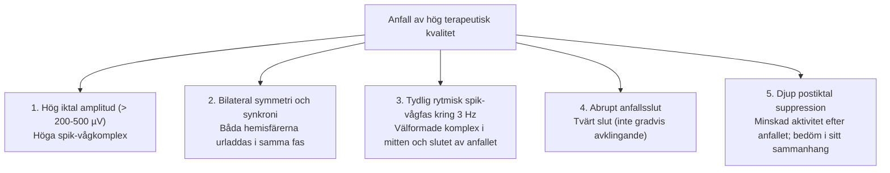

# Bedömning av anfallskvalitet

Ett av de vanligaste misstagen en ny ECT-behandlare gör är att **stirra sig blind enbart på klockan**. Att ett krampanfall varar 30 sekunder betyder inte automatiskt att det är ett terapeutiskt effektivt anfall!

EEG-morfologi och postiktal suppression kan bidra till bedömningen utöver anfallsduration. APA:s tredje upplaga beskriver ett måttligt samband mellan EEG-index och behandlingsutfall. Enskilda patienter kan förbättras även utan ett idealiskt EEG-mönster.

---

## Anfallsduration

Dokumentera motorisk och EEG-duration med en enhetlig tidsdefinition. Historiska riktvärden omkring 20-25 s motoriskt och 25-30 s på EEG är **inte absoluta gränser för terapeutisk effekt**. Ett kort anfall kan vara kliniskt användbart, och ett långt anfall garanterar inte god effekt.

Värdera EEG-morfologi, generalisering, elektrod- eller signalproblem, dos relativt tröskeln, läkemedel och kliniskt behandlingssvar tillsammans. Ett kort motoriskt anfall är inte ensamt skäl till restimulering eller doshöjning.

### Sambandet mellan dos och duration

Högre elektrisk dos ger inte nödvändigtvis längre anfall. Durationen kan minska vid högre övertrösklig dosering och under en serie, men sambandet varierar med teknik, anestesi och patient.

![[Samband dos och anfallsduration.webp|Samband dos och anfallsduration]]
*Illustrationen är schematisk. Den ska inte tolkas som en validerad universell U-kurva eller användas för att härleda rätt dos från anfallsdurationen.*

---

## Fem kvalitetsmarkörer

Vid sidan av durationen bedömer du följande fem egenskaper på EEG-remsan:

### 1. Iktal amplitud
- Amplituden påverkas av samordnad neural aktivitet men också av avledning, förstärkning och signalkvalitet.
- Högre iktal amplitud kan vara associerad med bättre utfall på gruppnivå. Den räknar inte antalet aktiva nervceller och en bestämd μV-gräns är inte ett allmänt effektkriterium.

### 2. Bilateral symmetri
- Även vid högersidig unilateral stimulering (RUL d’Elia) ska anfallet snabbt spridas via hjärnbalken så att **vänster och höger hjärnhalva urladdas symmetriskt**.
- Om anfallet enbart syns i en kanal: kontrollera först elektroder, avledningar, förstärkning och artefakter. Två kanaler kan inte ensamma fastställa hela hjärnans generalisering; dosbeslut kräver helhetsbedömning.

### 3. Abrupt anfallsslut
- Anfallsslutet kan vara abrupt men även mer gradvis och svårbedömt.
- Asymmetrisk aktivitet och långsamma vågor behöver skiljas från artefakter, anestesieffekter och kvarstående iktal aktivitet. De fastställer inte ensamt tröskelnära dosering eller en specifik hämningsbrist.

### 4. Postiktal suppression
- MECTA spECTrum 5000Q har en automatisk EEG-analys som beräknar graden av postiktal dämpning.
- Postiktal suppression kan ge kompletterande information. Det finns ingen universell, apparatoberoende gränsvärde på 80 %. Kontrollera om analysfunktionen alls finns i aktuell apparatversion.
- Efter anfallet kan EEG visa tydlig dämpning. Signalbortfall måste uteslutas, och graden av suppression visar inte specifikt att en viss GABA-mekanism fungerar optimalt.

### 5. Kardiovaskulär respons

Puls och blodtryck följs främst för patientsäkerheten. Responsen påverkas av ålder, hjärtsjukdom, anestesi och betablockerare. **En maximal puls på 130-150/min är inget behandlingsmål eller nödvändigt effektkriterium.** En liten pulsökning bevisar inte ett otillräckligt anfall.

---

## Referenser

1. American Psychiatric Association. *The Practice of Electroconvulsive Therapy*. 3 uppl.; copyright 2025. Kap. 15.1 och 15.3.3. Underlag för durationens begränsningar och EEG-markörernas värde.
2. Ferrier IN, Waite J, red. *The ECT Handbook*. 4 uppl. Cambridge: Cambridge University Press; 2019. Kap. 26, ”Seizure Monitoring in ECT”, s. 234-246. Underlag för amplitud, symmetri, anfallsslut, suppression och artefakter.
3. Mankad MV, Beyer JL, Weiner RD, Krystal AD. *Clinical Manual of Electroconvulsive Therapy*. Arlington, VA: American Psychiatric Publishing; 2010. Kap. 8, s. 105-128 (EEG-egenskaper), och kap. 9, s. 129-138 (kardiovaskulär respons).
4. [NSW Health. ECT Handbook. Version 1.1; 2026 (aktuell nätversion: 1.2)](https://www.health.nsw.gov.au/mentalhealth/resources/Pages/electroconvulsive-therapy-handbook.aspx).
5. [Queensland Health. The Administration of Electroconvulsive Therapy. 2022](https://www.health.qld.gov.au/__data/assets/pdf_file/0028/444763/guideline-administration-electroconvulsive-therapy.pdf). Kvalitetsmått är bedömningsstöd och ersätter inte kliniskt utfall.

---

## Relaterade länkar
- Anfallsmonitorering och manschettmetod: [[03 Anfallsövervakning|Anfallsövervakning]]
- Åtgärder vid korta och missade anfall: [[05 Missat, kort eller förlängt anfall|Missat, kort eller förlängt anfall]]
- Övertrösklig dosering: [[05 Kramptröskel och doshöjning|Kramptröskel och doshöjning]]
- Snabbguide för EEG-läsning: [[03 EEG-tolkning|EEG-tolkning]]
