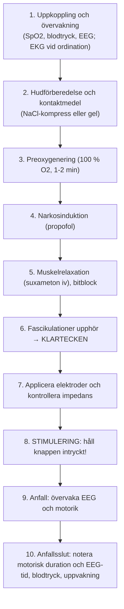

# Behandling steg för steg

Här beskrivs hela det praktiska behandlingsförloppet minut för minut. Detta är teamets gemensamma handlingsplan vid bordet.

---

## Kronologiskt behandlingsförlopp

---

### Steg 1: Uppkoppling och övervakning
- Patienten lägger sig bekvämt på behandlingsbritsen.
- Pulsoximeter och blodtrycksmanschett (i armen utan PVK) sätts på vid ankomsten och sitter kvar under hela behandlingstillfället. EKG kopplas bara enligt ordination, till exempel för arytmiövervakning.
- **Blodtrycket före behandlingen** tas på vårdavdelningen samma morgon. Är värdet inom normalgränserna behövs ingen ny mätning före induktionen.
- ECT-behandlaren sätter registreringselektroder för EEG:
    - 2 registreringselektroder i pannan cirka 2-3 cm ovanför ögonbrynen (Fp₁ och Fp₂) samt 1 jord- eller referenselektrod under nyckelbenet.

### Steg 2: Hudförberedelse för stimulering
- Huden ska vara ren och håret fritt från hårprodukter; det förbereds på vårdavdelningen.
- Sprit används inte hos oss. Den kan användas för att ta bort hudfett, men måste ha torkat helt före stimuleringen: sprit nära syrgas och elektrisk ström innebär brandrisk. Alkohol ensam kan dessutom höja impedansen; det är saltlösningen eller gelen som sänker den.
- **Kontaktmedel i första hand, saltlösning och kompresser:** Lägg små, höggradigt rena kompresser (från kartong) i en behållare med saltlösningen: en flaska NaCl 250 ml med ½ matsked salt. Kompressen ska vara fuktig men får inte rinna. Lägg den mellan varje handelektrod och huden strax före stimuleringen.
- **Alternativ, gel:** Applicera ett tunt, jämnt lager ledande ECT-gel på de handhållna elektroderna.
- Låt varken saltlösning eller gel rinna mellan elektrodställena: en fuktig yta mellan dem bildar en saltbrygga, så att strömmen går i huden i stället för genom skallen.

### Steg 3: Preoxygenering och ventilation
- Preoxygenera med **100 % syrgas** enligt anestesins plan, vanligen under spontanandning före induktion.
- När suxameton är givet, och helst först när det har effekt, assisteras andningen med hyperventilering fram till stimuleringen. Anestesin ansvarar; se [[02 Ventilation och syresättning|Ventilation och syresättning]].

### Steg 4: Narkosinduktion
- **Premedicinering:** Om inga kontraindikationer finns har patienten fått glykopyrron (Robinul) 0,2 mg iv på IVA så snart venvägen etablerades, för att minska salivationen och dämpa det parasympatiska påslaget med risk för bradyarytmi.
- Sjuksköterskan från IVA ger propofol iv, vanligen cirka **1 mg/kg**.
- Patienten uppmanas räkna baklänges eller blunda. När ögonlocksreflexen slocknat har patienten somnat.

### Steg 5: Muskelrelaxation och bitblock
- När patienten har somnat ges suxameton (Celocurin) i reducerad intubationsdos, cirka **0,5 mg/kg** iv, följt av spolning. Dosjusteringar ordineras till nästa behandling och dokumenteras i ECT-journalen.
- Manschettmetoden (en uppblåst manschett som isolerar en extremitet från muskelrelaxantiet) används inte rutinmässigt hos oss; se [[03 Anfallsövervakning#Manschettmetoden|Manschettmetoden]] om den behövs i ett enskilt fall.
- När muskelslappheten har inträtt förs ett bitblock in i patientens mun för att skydda tunga och tänder. Kontrollera att tungan inte kommer i kläm.
- Hyperventileringen fortsätter fram till stimuleringen.

### Steg 6: Bekräfta anestesi och muskelrelaxation

Fascikulationer varierar och är inte ett självständigt mått på blockaddjup. Anestesin kontrollerar tillräckligt sömndjup, syresättning, ventilation och relaxation och ger uttryckligt klartecken: *”Varsågod att stimulera!”*

### Steg 7: Elektroder och impedans, efter klartecknet
- Först när anestesin har gett klartecken applicerar du de handhållna elektroderna på patientens huvud med ett fast, jämnt tryck och mäter den statiska impedansen.
- **Kontrollera LCD-skärmen på MECTA 5000Q:**
    - Värdet ska ligga inom **apparatens godkända intervall**. Kontrollera kontakt och eventuell salt- eller gelbrygga; ett oväntat lågt värde ska utredas även inom spärrfönstret.
    - Kontrollera att `STIMULUS STATUS`-lampan lyser med fast sken.

---

### Steg 8: Utlös stimuleringen!
- Tryck in den röda knappen **`STIMULUS CONTROL`** och **HÅLL DEN INTRYCKT**!
- Apparaten ger tre korta varningspip och därefter en sammanhängande ton under tiden strömmen passerar.
- Släpp inte upp knappen förrän tonen upphört helt!

### Steg 9: Anfallsövervakning och tidtagning
- Apparaten räknar sekunderna från stimuleringen; använd dem för både motorisk duration och EEG-tid.
- **Motoriken observeras utan isolerad extremitet:**
    1. **Under stimuleringen:** Kontraktion av strömmen (käke, nacke) som upphör när pulståget tar slut; den hör inte till anfallet.
    2. **Under anfallet:** Muskelrelaxationen dämpar krampen, så ofta ses bara små toniska eller kloniska ryckningar, till exempel i tår, fingrar eller ansikte.
    3. **Motorisk duration:** När ryckningarna har upphört läser du av sekunderna på apparaten → **Notera motorisk duration**. Se [[03 Anfallsövervakning|Anfallsövervakning]].
- **Under krampfasen** rörs patienten helst inte; syrgas hålls över ansiktet.
- **Anfallets längd bedöms på motorisk kramp och EEG-tid. EEG-tiden läses av på remsan:**
    - Rytmiska polyspikar med hög amplitud avtar och övergår abrupt i en **tydlig postiktal suppression** (rak linje).
    - När postiktal suppression har nåtts och EEG planar ut läser du av sekunderna → **Notera EEG-tid** (t.ex. 48 sekunder).
- **Blodtrycket mäts omedelbart efter att EEG-aktiviteten har upphört**, tillsammans med puls och saturation, för att fånga blodtrycksstegringen efter anfallet. Anestesin behandlar vid behov.

### Steg 10: Avslutning och uppvaknande
- Invänta spontanandning med syrgas över ansiktet. Övertrycksventilation ska undvikas.
- När spontanandningen har återkommit läggs patienten i framstupa sidoläge, eller ligger kvar i ryggläge om möjligt.
- Bitblocket tas ut försiktigt. Svalget sugs rent vid behov.
- Riv av pappersremsan från MECTA: granska dynamisk impedans, anfallets symmetri och postiktal suppression.
- När patienten öppnar ögonen och andas stabilt rullas sängen ut till uppvakningsavdelningen (*PACU*) med syrgasgrimma och transportövervakning.
- På uppvakningsavdelningen tas blodtrycket direkt och igen efter 15 minuter. Är något värde utanför normalgränserna fortsätter mätningen var 15:e minut tills värdet är normalt för patienten.
