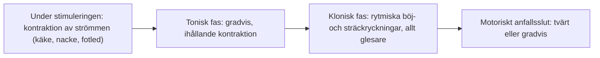
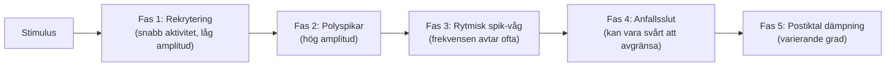

# Anfallsövervakning

För att stödja patientsäkerhet och bedöma den terapeutiska effekten måste varje utlöst anfall övervakas noggrant med både **motorisk observation** och **tvåkanaligt iktalt EEG**.

---

## Motorik

Det motoriska anfallet följs genom direkt observation och tidtagning. Det kompletterar EEG, särskilt när EEG-registreringen störs av artefakter, och ibland syns tecken på anfall i motoriken innan de syns på EEG.

- **Under stimuleringen:** Många muskelgrupper drar ihop sig: käkarna biter ihop, nacken sträcks och fotlederna flekteras. Det är en direkt effekt av strömmen, inte anfallet. Kontraktionen upphör så snart pulståget tar slut och kan inte blockeras av muskelrelaxantiet.
- **Tonisk fas:** En gradvis, ihållande kontraktion börjar direkt eller inom några sekunder efter stimuleringen; vid knappt övertröskliga anfall kan den dröja upp till 10 sekunder. Fasen varar från några sekunder till tiotals sekunder och kan vara svår att se vid god muskelrelaxation.
- **Klonisk fas:** Rytmiska böj- och sträckryckningar vars frekvens avtar; ibland syns bara enstaka ”slag” i fotleden eller handleden. Den kloniska fasen varar oftast längre än den toniska och upphör tvärt eller med gradvis avtagande intensitet.
- **Motoriskt anfallsslut:** Ryckningarna upphör inte alltid samtidigt i hela kroppen. Verksamheten ska därför ha en gemensam konvention för slutpunkten: antingen när rörelserna i den isolerade extremiteten upphör, eller när den sist upphörande motoriska aktiviteten någonstans i kroppen upphör. Hos oss används inte manschettmetoden rutinmässigt. Under muskelrelaxation ses ofta bara små ryckningar, och den motoriska durationen noteras när de går att följa; anfallets längd bedöms på motorisk kramp och EEG-tid.
- **Tolkning:** Hur kraftig motoriken blir beror främst på muskelrelaxationen och i mindre grad på stimulusintensiteten. Vid fullgod relaxation kan de synliga tecknen vara minimala, och vid knappt övertröskliga stimuli kan motoriken vara försvagad eller saknas helt. Anfallets kvalitet kan därför inte bedömas enbart på motoriken: EEG-anfallet varar vanligen 10-20 sekunder längre, och den motoriska durationen korrelerar dåligt med EEG-durationen.
- **Dokumentation:** Den motoriska durationen dokumenteras tillsammans med EEG-durationen. Optisk rörelsesensor (OMS) används inte hos oss. Historiska sekundgränser är inte absoluta effektkriterier; se [[04 Bedömning av anfallskvalitet|Bedömning av anfallskvalitet]].

### Manschettmetoden

Manschettmetoden används inte rutinmässigt hos oss, men kan användas i ett enskilt fall. Eftersom patienten är muskelrelaxerad med suxameton syns ibland inga generaliserade kramper i bål eller armar. Motoriken kan då övervakas i en **isolerad extremitet**:

- **Teknik:** En blodtrycksmanschett pumpas upp till > 200 mmHg på fotleden före injektionen av suxameton. Fotleden är att föredra framför handleden: den är en stabilare led, och manschetten stör varken infarten eller blodtrycksmätningen. I den isolerade foten ses anfallets toniska och kloniska faser utan att dämpas av muskelrelaxationen.
- **Tryckets varaktighet:** Litteraturen anger att trycket släpps så snart anfallet har kommit igång, för att begränsa tiden utan blodflöde till foten. Följ den lokala rutinen.
- **Försiktighet:** Svår osteoporos eller annan muskuloskeletal sjukdom distalt om manschetten, svår kärlinsufficiens (t.ex. vid diabetes), sicklecellanemi och andra koagulationsrubbningar. I svåra fall används inte metoden.

---

## EEG

På MECTA 5000Q registreras EEG med registreringselektroder enligt klinikens lokala rutin: två elektroder placeras i pannan cirka 2-3 cm ovanför ögonbrynen (Fp₁ och Fp₂), och en tredje elektrod (jord/referens) placeras under nyckelbenet.

![[EEG-elektrodplacering.svg]]
*Figur 1: EEG-elektrodplacering för anfallsövervakning: två elektroder i pannan samt en tredje elektrod under nyckelbenet.*

Ett ECT-anfall kan beskrivas med följande schematiska faser. Tider, amplituder och tydlighet varierar; alla faser är inte lika urskiljbara vid varje behandling. Fasmönstret ensamt fastställer inte klinisk effekt:

### EEG:s fem faser
1. **Stimuleringsartefakt och rekryteringsfas (0-5 sekunder):**
    - Högfrekvent elektrisk artefakt från apparatens pulståg.
    - Omedelbart efteråt ses en kortvarig desynkronisering följd av snabb aktivitet med låg amplitud (10-20 Hz) när neuronerna i hjärnbarken börjar rekryteras.
2. **Polyspikfasen (tidig iktal fas, ca 5-20 sekunder):**
    - Amplituden stiger kraftigt (> 200-500 μV).
    - Täta, oregelbundna polyfasiska spikar (**polyspikar**) som speglar den toniska fasen i hjärnbarken.
3. **Fas med rytmiska spik-vågkomplex (klonisk fas, ca 20-50 sekunder):**
    - Ett vanligt iktalt mönster; uttrycket påverkas av avledning, förstärkning, anestesi och patientfaktorer.
    - Rytmiska, bilateralt symmetriska **spik-vågkomplex** (spik följd av långsam våg) med hög amplitud och en frekvens som sjunker från ca 4 Hz ner mot 2-3 Hz.
    - Frekvensen sjunker i takt med att anfallet närmar sig sitt slut (motsvarar de allt glesare kloniska ryckningarna).
4. **Anfallsslut (*ictal termination*):**
    - I ett gott anfall upphör spik-vågaktiviteten **abrupt och samtidigt i båda hemisfärerna**.
5. **Postiktal suppression (den ”tysta” fasen):**
    - Registrerad aktivitet dämpas efter anfallet. Yt-EEG visar inte att all aktivitet i hjärnan upphört eller vilken enskild signalsubstans som orsakat dämpningen.
    - Kurvan blir nästan **helt platt (isoelektrisk)** eller övergår i mycket långsamma, flacka deltavågor (< 1-2 Hz).
    - Suppressionen är en del av helhetsbedömningen och ska inte ensam styra dos eller restimulering.

### Motorisk duration och EEG-duration

> [!NOTE] EEG och motorik kan ha olika duration
> EEG-aktivitet kan fortsätta efter att motoriken upphört. Tidsskillnaden varierar och får inte förutsättas vara 10-30 sekunder hos alla. EEG-durationen räknas i sekunder på apparaten tills postiktal suppression har nåtts och EEG planar ut. Fortsätt EEG-övervakningen tills iktal aktivitet upphört; muskelrelaxation och observationsmetod påverkar det motoriska måttet.

---

## Cirkulation och autonom respons

Kopplas EKG, vilket görs enligt ordination, kan du följa EKG-kanalen parallellt på MECTA 5000Q:
- **0-5 sekunder (vagal fas):** Sinusbradykardi genom vagusstimulering med påverkan på sinusknutan. Pulsen kan falla från 80 till 30-40 slag/minut, ibland med korta asystolier (1-3 sekunder). Bedöm samtidigt cirkulation och patientens tillstånd; se [[02 Akuta situationer|Akuta situationer]].
- **10-60 sekunder (sympatisk fas):** Kraftig sinustakykardi (130-170 slag/minut) och förhöjt blodtryck till följd av massiv frisättning av noradrenalin och adrenalin från binjuremärgen och sympatiska nervändslut.
- **Blodtryckskontroll:** Blodtrycket mäts före behandlingen (på vårdavdelningen samma morgon) och omedelbart efter att EEG-aktiviteten har upphört, så att blodtrycksstegringen upptäcks och vid behov behandlas av anestesin (t.ex. labetalol eller esmolol).
- **Efter anfallet:** Pulsen sjunker gradvis tillbaka mot patientens normala vilofrekvens under 5-10 minuter på uppvakningsavdelningen.
