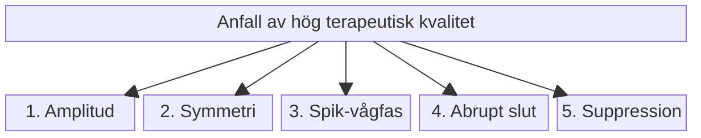

# Bedömning av anfallskvalitet

Ett av de vanligaste misstagen en ny ECT-behandlare gör är att **stirra sig blind enbart på klockan**. Att ett krampanfall varar 30 sekunder betyder inte automatiskt att det är ett terapeutiskt effektivt anfall!

EEG-morfologi och postiktal suppression kan bidra till bedömningen utöver anfallsduration. APA:s tredje upplaga beskriver ett måttligt samband mellan EEG-index och behandlingsutfall. Enskilda patienter kan förbättras även utan ett idealiskt EEG-mönster.

---

## Anfallsduration

Dokumentera motorisk och EEG-duration med en enhetlig tidsdefinition. Historiska riktvärden omkring 20-25 s motoriskt och 25-30 s på EEG är **inte absoluta gränser för terapeutisk effekt**. Ett kort anfall kan vara kliniskt användbart, och ett långt anfall garanterar inte god effekt.

Värdera EEG-morfologi, generalisering, elektrod- eller signalproblem, dos relativt tröskeln, läkemedel och kliniskt behandlingssvar tillsammans. Ett kort motoriskt anfall är inte ensamt skäl till restimulering eller doshöjning.

### Sambandet mellan dos och duration

Högre elektrisk dos ger inte nödvändigtvis längre anfall. Durationen kan minska vid högre övertrösklig dosering och under en serie, men sambandet varierar med teknik, anestesi och patient.

![[Samband dos och anfallsduration.webp|Samband dos och anfallsduration]]
*Illustrationen är schematisk. Den ska inte tolkas som en validerad universell U-kurva eller användas för att härleda rätt dos från anfallsdurationen.*

---

## Fem kvalitetsmarkörer

Vid sidan av durationen bedömer du fem egenskaper på EEG-remsan. Var och en är ett kvalitativt tecken utan eget gränsvärde; bedömningen görs som helhet.

### 1. Iktal amplitud
Högre amplitud har på gruppnivå samband med högre dos i förhållande till tröskeln och bättre utfall. Amplituden påverkas också av avledning, förstärkning och signalkvalitet; en bestämd μV-gräns är inget allmänt effektkriterium.

### 2. Bilateral symmetri
Även vid RUL ska anfallet snabbt spridas så att båda hjärnhalvorna urladdas symmetriskt och i fas. Syns anfallet bara i en kanal, eller är aktiviteten asymmetrisk, kontrollera först elektroder, avledningar, förstärkning och artefakter.

### 3. Rytmisk spik-vågfas
Mitt i anfallet övergår polyspikarna i regelbundna spik-vågkomplex, ofta omkring 3 Hz. Ett välorganiserat, rytmiskt mönster talar för ett väl utvecklat anfall. Vid högre dos i förhållande till tröskeln börjar den långsamma vågfasen tidigare.

### 4. Abrupt anfallsslut
Vid ett tydligt anfallsslut bryts den rytmiska aktiviteten tvärt och övergår direkt i suppression. Slutet kan också vara gradvis och svårt att avgränsa. Tecknet har svagare stöd än amplitud, symmetri och suppression och bedöms bara tillsammans med dem.

### 5. Postiktal suppression
Efter anfallet planar EEG ut. Djupare suppression har samband med högre dos i förhållande till tröskeln. Signalbortfall och artefakter måste uteslutas. Bedöm suppressionen visuellt på remsan; det finns ingen universell, apparatoberoende gräns på 80 %. Om apparaten har ett tillval för automatisk EEG-analys beror på version, och vad den visar behöver kontrolleras i manualen innan den används.

---

## Kardiovaskulär respons

Puls och blodtryck följs främst för patientsäkerheten. Responsen påverkas av ålder, hjärtsjukdom, anestesi och betablockerare. **En maximal puls på 130-150/min är inget behandlingsmål eller nödvändigt effektkriterium.** En liten pulsökning bevisar inte ett otillräckligt anfall.
