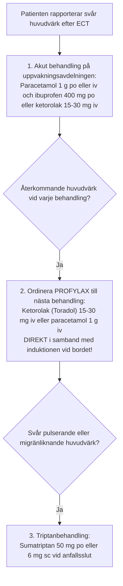

# Andra biverkningar

Vid sidan av minnesstörningar är somatiska besvär som **huvudvärk**, **muskelvärk** och **illamående** de vanligaste orsakerna till att patienter upplever obehag eller tvekar inför att fullfölja en ECT-serie. 

Här beskrivs också serotonergt syndrom, en sällsynt men potentiellt allvarlig interaktion mellan ECT och serotonerga läkemedel. Besvären kan ofta lindras med individualiserad behandling. Nytillkommen svår eller atypisk huvudvärk kräver medicinsk bedömning.

---

## 1. Postiktal huvudvärk

- **Förekomst:** Drabbar cirka **30-45 %** av patienterna efter behandlingen.
- **Mekanism:**
    1. **Vaskulär komponent:** Kraftig intrakraniell och extrakraniell vasodilatation (särskilt i tinningartären, *a. temporalis superficialis*) till följd av anfallets ökade metabolism och cerebrala blodflöde.
    2. **Muskulär komponent:** Direkt isometrisk kontraktion i tuggmuskulaturen orsakad av strömmen, med sammanbitning mot bettskyddet.

### Behandling och förebyggande åtgärder

> [!TIP] Kliniskt tips: förebyggande smärtlindring (*preemptive analgesia*)
> Att ge **ketorolak (Toradol 15-30 mg iv)** eller **paracetamol (1 g iv)** intravenöst medan patienten sover minskar frisättningen av inflammatoriska prostaglandiner och kan minska besvären. NSAID kräver bedömning av njurfunktion, blödningsrisk och övriga kontraindikationer; kombinera inte flera NSAID.

---

## 2. Muskelvärk

- **Förekomst:** Ses hos 20-30 % av patienterna, särskilt hos unga, muskulösa individer efter de första 1-2 behandlingarna.
- **Mekanism:**
    - Tvärtemot vad många tror orsakas muskelvärken oftast **inte av krampanfallet i sig**, utan av **suxameton-utlösta fascikulationer**! När suxameton depolariserar muskelcellerna uppstår mikroskopiska muskelfiberskador med frisättning av kalium och kreatinkinas (CK).
- **Åtgärder:**
    - Säkerställ att suxametondosen inte är för låg (vid för låg dos blir kramperna under anfallet kraftigare).
    - Profylax med paracetamol och NSAID (naproxen eller ibuprofen) på morgonen eller direkt efter behandlingen.
    - Besvären avtar i regel kraftigt efter behandling 2-3.

---

## 3. Illamående och kräkningar

- **Förekomst:** Cirka 5-15 % (betydligt vanligare om etomidat används än om propofol används).
- **Risker:** Aspiration av maginnehåll vid ofullständigt uppvaknande!
- **Handläggning och profylax:**
    - **Förstahandsval av anestetikum:** Använd **propofol**, som har dokumenterad egen antiemetisk effekt.
    - **Ondansetron (Zofran 4-8 mg iv):** Mycket effektiv 5-HT₃-receptorantagonist. Ges profylaktiskt vid induktionen till patienter med benägenhet för illamående.
    - **Betametason eller dexametason (4 mg iv):** Bra antiemetiskt tillägg vid svårbehandlat illamående.
    - **Metoklopramid:** Antiemetisk behandling ordineras efter individuell bedömning och aktuell produktinformation. Metoklopramid är kontraindicerat vid epilepsi och Parkinsons sjukdom och kan ge extrapyramidala reaktioner; den tidigare generella dosen 10-20 mg har tagits bort.

---

## 4. Käftsmärta och tandömhet

- **Mekanism:** Tuggmuskulaturen kontraheras maximalt av den direkta elektriska strömmen, så att patienten biter hårt mot bettskyddet.
- **Åtgärder:**
    - Kontrollera att bettskyddet är lagom tjockt och mjukt (silikon är skonsammare än hårt gummi) och placerat symmetriskt över kindtänderna (*molares* och *premolares*).
    - Kontrollera att läpparna och tungan inte kläms mellan bettskyddet och tänderna under stimuleringen!
    - Paracetamol vid behov.

---

## 5. Serotonergt syndrom

Serotonergt syndrom (serotonerg toxicitet) orsakas av för hög serotonerg aktivitet i centrala och perifera nervsystemet. Det är en klinisk diagnos med psykiska, autonoma och neuromuskulära symtom, från lindriga till livshotande.

- **Förekomst vid ECT:** Sällsynt. Kombinationen av ECT och SSRI är säker för de flesta patienter, men enstaka fallrapporter beskriver serotonergt syndrom vid ECT tillsammans med fluoxetin eller paroxetin. För SNRI saknas fallrapporter, men samma vaksamhet rekommenderas. Litium och MAO-hämmare har också serotonerga effekter. Syndromet har även rapporterats efter flera behandlingar i en serie utan ändrad medicinering och vid ketamin som induktionsmedel.
- **Läkemedel vid behandlingstillfället:** Fentanyl, tramadol, ondansetron och metoklopramid har serotonerga effekter och kan bidra hos patienter som redan står på serotonerga läkemedel. Hos patienter på MAO-hämmare ska läkemedel med kända interaktioner, bland annat opioider och indirekt verkande sympatomimetika, undvikas.
- **Debut:** Symtomen börjar oftast inom timmar efter en dosökning, ett nytt läkemedel eller en ny kombination.

### Klinisk bild

| Område | Fynd |
| :--- | :--- |
| **Psykiskt** | Oro, agitation, konfusion |
| **Autonomt** | Takykardi, blodtrycksstegring, svettning, feber, mydriasis, diarré, ökade tarmljud |
| **Neuromuskulärt** | Klonus (spontan, inducerbar eller okulär), hyperreflexi, tremor, muskelrigiditet (*hypertonia*), mest uttalat i benen |

Hunterkriterierna (*Hunter Serotonin Toxicity Criteria*) stöder diagnosen hos en patient som har fått ett serotonergt läkemedel, om något av följande föreligger:
1. Spontan klonus.
2. Inducerbar klonus och agitation eller svettning.
3. Okulär klonus och agitation eller svettning.
4. Tremor och hyperreflexi.
5. Muskelrigiditet, temperatur över 38 °C och okulär eller inducerbar klonus.

### Differentialdiagnoser efter ECT

Symtomen överlappar med tillstånd som är vanligare vid ECT. Bedöm därför alltid luftväg, cirkulation och kvarstående anfallsaktivitet först.
- **Postiktal agitation och delirium:** Klonus och hyperreflexi talar för serotonergt syndrom; se [[02 Postiktal delirium|Postiktal delirium]].
- **Malignt neuroleptikasyndrom:** Utvecklas oftast under dagar, med bradykinesi och blyrörsrigiditet men utan klonus.
- **Malign hypertermi:** Utlöses av suxameton eller inhalationsanestetika, med stigande koldioxid, rigiditet och hypertermi; se [[04 Muskelrelaxantia|Muskelrelaxantia]].
- **Antikolinerg toxicitet:** Torr, varm hud, avsaknad av tarmljud och normala reflexer.
- **Icke-konvulsivt status epilepticus och malign katatoni:** Kräver EEG och medicinsk bedömning.

### Handläggning

1. Kontakta ansvarig läkare och anestesin. Sätt ut eller pausa misstänkta serotonerga läkemedel och undvik nya.
2. Ge understödjande behandling: syrgas, intravenös vätska, kontinuerlig hjärt- och temperaturövervakning. Bensodiazepin kan ges mot agitation; undvik fysisk fixering.
3. Vid måttliga till svåra symtom kan en serotoninantagonist (cyproheptadin) övervägas i samråd med t.ex. Giftinformationscentralen. Svår hypertermi med rigiditet kräver intensivvård med sedering, intubation och icke-depolariserande muskelrelaxans; febernedsättande läkemedel hjälper inte.
4. Skjut upp nästa ECT tills symtomen har gått över. Läkemedelslistan och kombinationen med ECT omprövas av ansvarig läkare innan serien fortsätter. Dokumentera händelsen och kommunicera den till narkosläkaren. Se även [[05 Läkemedel och interaktioner|Läkemedel och interaktioner]].

---

## Referenser

1. American Psychiatric Association. *The Practice of Electroconvulsive Therapy*. 3 uppl.; copyright 2025. Kap. 19.3, ”Headache, Muscle Soreness, and Nausea”, samt kap. 12.1.3 om skydd av tänder och munhåla.
2. Ferrier IN, Waite J, red. *The ECT Handbook*. 4 uppl. Cambridge: Cambridge University Press; 2019. Kap. 14, ”Non-cognitive Adverse Effects of ECT”, s. 121-128, och kap. 24, ”Dental Issues Related to ECT”, s. 211-217.
3. Mankad MV, Beyer JL, Weiner RD, Krystal AD. *Clinical Manual of Electroconvulsive Therapy*. Arlington, VA: American Psychiatric Publishing; 2010. Kap. 10, ”Adverse Effects”, s. 139-148. Underlag för somatiska symtom efter behandlingen.
4. [NSW Health. ECT Handbook. Version 1.1; 2026 (aktuell nätversion: 1.2)](https://www.health.nsw.gov.au/mentalhealth/resources/Pages/electroconvulsive-therapy-handbook.aspx).
5. [FASS, Primperan injektionsvätska](https://fass.se/health/product/19720825000020/fass-text) före dosordination. Angivna övriga läkemedelsdoser är orienterande och inte individuella ordinationer.
6. Anderson IM. Interactions between ECT and Prescribed Medication. I: Ferrier IN, Waite J, red. *The ECT Handbook*. 4 uppl. Cambridge: Cambridge University Press; 2019. Kap. 25, s. 218-233, särskilt tabell 25.2 och s. 226-227 om antidepressiva, litium och serotonergt syndrom.
7. Sahlgrenska Universitetssjukhuset, avdelning 240. *Läkemedelsinteraktioner hos patienter som genomgår ECT*. Granskad 2022-04-06. Serotonergt syndrom som sällsynt biverkan av ECT i kombination med SSRI och som möjlig effekt av litium.
8. Boyer EW, Shannon M. The serotonin syndrome. *N Engl J Med*. 2005;352(11):1112-1120. Klinisk bild, utlösande läkemedel, differentialdiagnoser och behandling. [PubMed](https://pubmed.ncbi.nlm.nih.gov/15784664/).
9. Dunkley EJ, Isbister GK, Sibbritt D, Dawson AH, Whyte IM. The Hunter Serotonin Toxicity Criteria: simple and accurate diagnostic decision rules for serotonin toxicity. *QJM*. 2003;96(9):635-642. [PubMed](https://pubmed.ncbi.nlm.nih.gov/12925718/).
10. Okamoto N, Sakamoto K, Yamada M. Transient serotonin syndrome by concurrent use of electroconvulsive therapy and selective serotonin reuptake inhibitor: a case report and review of the literature. *Case Rep Psychiatry*. 2012;2012:215214. [PubMed](https://pubmed.ncbi.nlm.nih.gov/23213590/).
11. Klysner R, Bjerg BB, Hansen MS. Transient serotonin toxicity evoked by combination of electroconvulsive therapy and fluoxetine. *Case Rep Psychiatry*. 2014;2014:162502. [PubMed](https://pubmed.ncbi.nlm.nih.gov/24982810/).
12. Khan S, Wennberg B, Witkowska M, Rattin J, Khisty R. An Unexpected Presentation of Serotonin Syndrome in a Patient Receiving ECT. *Case Rep Psychiatry*. 2024;2024:6938553. Debut efter åttonde behandlingen utan ändrad medicinering. [PubMed](https://pubmed.ncbi.nlm.nih.gov/39219838/).
13. Deka A, Joseph E, Sharma N, Berhanu T, Kaplan J. Recurrent Serotonin Syndrome After Ketamine-assisted Electroconvulsive Therapy: A Case Report and Review of the Literature. *J Psychiatr Pract*. 2024;30(3):234-241. [PubMed](https://pubmed.ncbi.nlm.nih.gov/38819248/).

---

## Relaterade länkar
- Preoperativt tandstatus: [[03 Somatisk bedömning|Somatisk bedömning]]
- Narkosmedel och illamående: [[03 Narkosmedel|Narkosmedel]]
- Muskelrelaxation och suxameton: [[04 Muskelrelaxantia|Muskelrelaxantia]]
- Serotonerga läkemedel: [[05 Läkemedel och interaktioner|Läkemedel och interaktioner]]
- Steg för steg vid bordet: [[02 Behandling steg för steg|Behandling steg för steg]]
