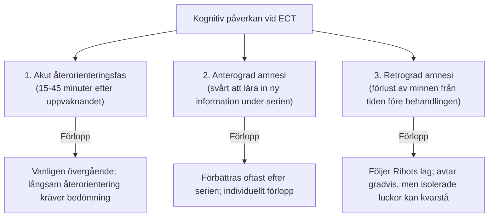
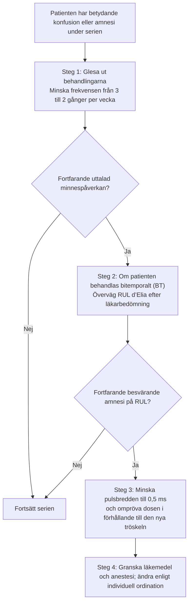

# Kognitiva biverkningar

Minnesstörningar är den biverkan som patienter och allmänhet oroar sig mest för, och det är den viktigaste faktorn som begränsar hur högt ECT kan doseras. 

Som ECT-behandlare måste du ha djup kunskap om minnesstörningens neurobiologi, hur den mäts, och framför allt hur du minimerar den genom rätt metodval.

---

## Typer av kognitiv påverkan

### 1. Återorientering
- Tiden från det att patienten vaknar ur narkosen tills hen vet sitt namn, var hen befinner sig, dag och födelsedatum.
- Dokumentera återorienteringen med samma startpunkt och frågor vid varje behandling. Förloppet påverkas av både ECT, anestesi och patientens tillstånd.
- Förlängd eller tilltagande desorientering behöver bedömas men bevisar inte ensam för hög laddning. Beakta bland annat delirium, läkemedel och avvikande uppvaknande.

### 2. Svårigheter att lära in nytt
- Patienten glömmer vad som sades på avdelningen tidigare under dagen eller vad hen åt till frukost under den period som behandlingsserien pågår.
- **Mekanism:** Hippocampus och andra minnesnätverk kan påverkas under behandlingen. Förändringar i synaptisk plasticitet är en föreslagen mekanism; en generell, påvisad blockering av långtidspotentiering (LTP) hos varje behandlad patient kan inte anges som förklaring.
- **Prognos:** På gruppnivå återhämtas nyinlärning ofta inom veckor efter serien och kan förbättras när depressionen lindras. Det garanterar inte full återhämtning inom en viss tid för varje individ. Följ kvarstående besvär och utred vid behov.

### 3. Förlust av tidigare minnen
- Svårighet att återkalla händelser som inträffat *före* behandlingen.
- **Ribots lag:** Minnesförlusten har en **temporal gradient** - minnen från veckorna och månaderna precis före ECT är känsligast, men även mer avlägsna minnen kan påverkas och förloppet varierar mellan patienter.
- **Autobiografiskt minne:** Vissa patienter kan få kvarstående och ibland omfattande minnesluckor för specifika episoder (t.ex. resor eller familjehändelser) som inträffade under månaderna före och under behandlingsperioden.

---

## Faktorer som påverkar minnet

APA:s kapitel 20 och *The ECT Handbook*, kapitel 13, beskriver flera behandlingsfaktorer som påverkar kognitiv risk. Sambanden gäller gruppnivå och innebär inte att en viss teknik är riskfri:

| Parameter | Förknippat med större kognitiv påverkan | Möjlig riskminskning efter individuell bedömning |
| :--- | :--- | :--- |
| **Elektrodplacering** | **Bitemporal (BT)** (stimulerar hippocampus och den inre delen av tinningloben på båda sidor) | **Högersidig unilateral (RUL d’Elia)** (kan minska kognitiv påverkan vid lämplig dosering; vänster hemisfär är inte opåverkad) |
| **Pulsbredd** | Längre kortpulser; sinusvåg har större påverkan och används inte | RUL med ultrakort puls kan minska påverkan, med möjlig avvägning mot effekt |
| **Elektrisk laddning** | Kraftig överdosering (> 3×ST vid bilateral ECT) | Anpassad dosering (1,5-2×ST vid BT, pulsbreddsanpassad multipel vid RUL) |
| **Behandlingsfrekvens**| 3 gånger per vecka | **2 gånger per vecka** (mer tid för neuronal återhämtning) |
| **Läkemedel** | Litium eller andra preparat med egen kognitiv eller sederande effekt | Individuell läkemedelsgenomgång; ingen generell utsättning enbart utifrån tabellen |

> [!TIP] Pulsbredd och minne
> Kortare pulsbredd, särskilt RUL med ultrakort puls, kan minska kognitiva biverkningar men kan innebära en avvägning mot effekt eller snabbhet. Ultrakort puls används inte hos oss; forskning om ultrakort puls och om optimal pulsbredd pågår, se [[03 Parameterinställningar#Val av pulsbredd|Val av pulsbredd]]. Det förklaras inte av att all ström efter en fast kronaxi är bortkastad. Se [[03 Parameterinställningar|Parameterinställningar]].

---

## Bedömning av minnet

I enlighet med Svenska psykiatriska föreningens riktlinjer och Kvalitetsregistret ECT ska minnet bedömas strukturerat:
1. **Objektiv kognitiv screening:**
    - **MoCA (Montreal Cognitive Assessment)** eller **MMSE** före start, mitt under serien och efter avslutad serie.
2. **Subjektiva minnesfrågor (CPRS-minnesfråga eller CPQ):**
    - Fråga patienten varje behandlingsvecka: *"Upplever du att ditt minne blivit sämre sedan vi startade behandlingen?"*
    - Värdera om minnesstörningen beror på depressionen i sig (depressiv pseudodemens vid svår melankoli försvinner när patienten tillfrisknar) eller är en specifik ECT-biverkan.

---

## Åtgärder vid minnesbesvär

Om patienten eller personalen rapporterar besvärande konfusion eller minnesförlust mellan behandlingarna:

