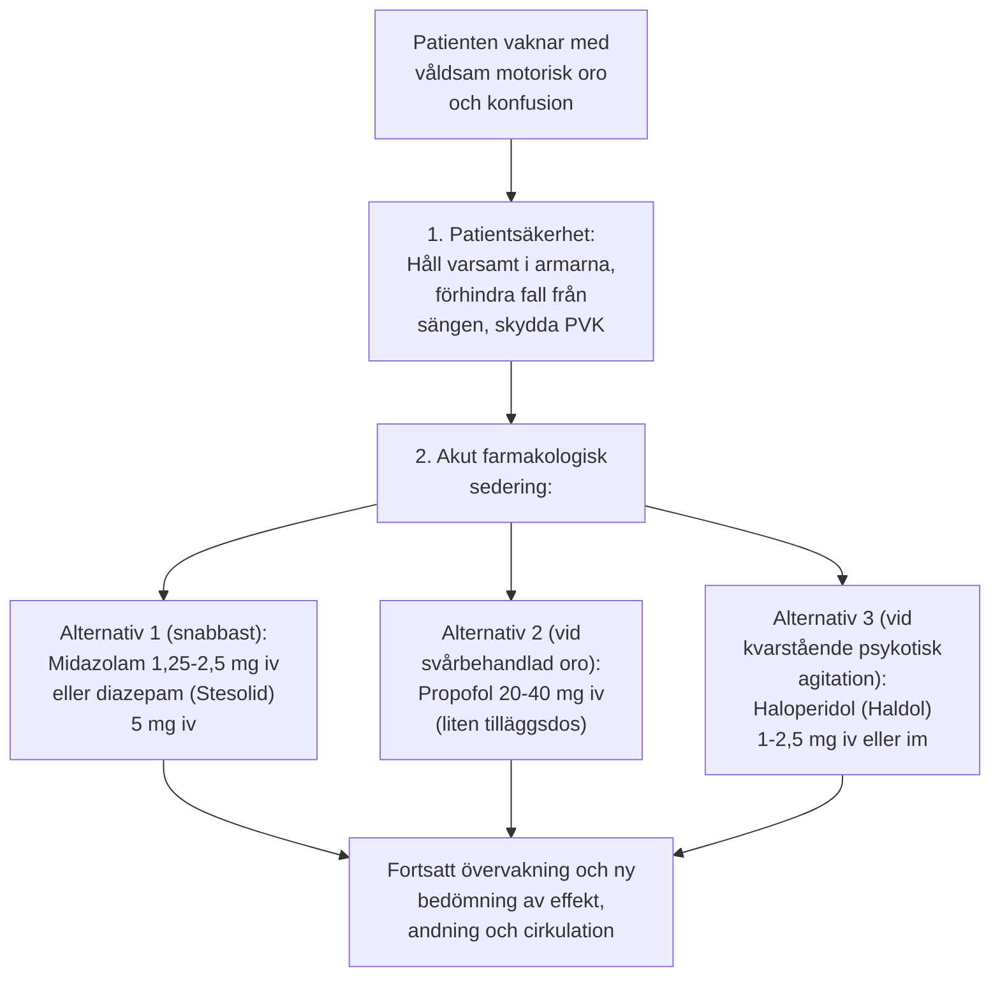

# Postiktal delirium

Postiktal oro och konfusion spänner från lätt desorientering på uppvakningsavdelningen till kraftig motorisk oro och våldsam agitation (*postictal excitement*, *emergence delirium*). 

Att kunna hantera detta lugnt och systematiskt är en grundläggande trygghet för hela behandlingsteamet.

---

> [!IMPORTANT] Bedöm orsaken först
> Kontrollera luftväg, syresättning, ventilation, cirkulation, glukos och smärta. Överväg kvarstående anfallsaktivitet vid avvikande uppvaknande. Skydda patienten, minska stimuli och tillkalla anestesin innan eventuell sedering.

---

## Akut postiktal agitation

- **Förekomst:** Drabbar cirka 5-10 % av patienterna, oftare unga män eller patienter med hög ångestnivå före behandlingen.
- **Tidpunkt:** Debuterar vanligen 5-15 minuter efter anfallets slut, precis när patienten börjar vakna ur propofolnarkosen.
- **Klinisk bild:**
    - Patienten slår vilt omkring sig, sätter sig upp i sängen, rycker i infarter och övervakningskablar.
    - Fullständig desorientering, skräckslagen blick, ropar på hjälp eller uppvisar paranoid aggressivitet.
    - Patienten går i detta skede inte att lugna med samtal.

### Förebygg nästa episod

Om en patient har haft en episod av postiktal agitation ska teamet **överväga en individuell förebyggande plan inför nästa behandling**:

1. **Profylaktisk midazolam direkt efter anfallsslut:**
    - Så snart anfallet på EEG har upphört injicerar narkosläkaren **midazolam 1,25-2,5 mg iv**.
    - Patienten sover därmed igenom den känsliga övergången mellan anfall och fullt uppvaknande och vaknar lugn och orienterad 20 minuter senare.
2. **Dexmedetomidin (Dexdor):**
    - Central alfa-2-adrenerg agonist som kan förebygga agitation i utvalda fall; beakta bradykardi, hypotoni och sedering. Användning kräver anestesibedömning och övervakning.
3. **Betablockad (labetalol):**
    - Om agitationen drivs av en kraftig postiktal katekolaminfrisättning med takykardi och hypertoni kan en liten dos labetalol dämpa den perifera sympatikusaktiveringen.

---

## Kvarstående förvirring och delirium

Till skillnad från den akuta agitationen innebär interiktal konfusion att patienten blir **tilltagande förvirrad över dygnet mellan behandlingarna**.

### Riskfaktorer
- Hög ålder.
- Underliggande kognitiv svikt (vaskulär demens, Alzheimers sjukdom, tidigare stroke).
- Bitemporal elektrodplacering med hög övertrösklig dos.
- **Samtidig behandling med litium!**

### Handläggning vid kvarstående delirium
1. **Pausa ECT-behandlingen:** Bedöm behov av uppehåll individuellt och utred orsaken till deliriet; ett fast uppehåll på 3-5 dagar ersätter inte medicinsk bedömning.
2. **Sätt ut litium omedelbart:** Kontrollera S-litium och njurfunktion.
3. **Byt till RUL d’Elia:** Om patienten tidigare behandlats bitemporalt.
4. **Minska behandlingsfrekvensen:** Gå över från 3 till 2 eller 1 behandling per vecka.
5. **Symtomlindring vid delirium:** Vid uttalad desorientering kan låg dos haloperidol (0,5-1 mg) eller olanzapin (2,5 mg) ges till natten.
