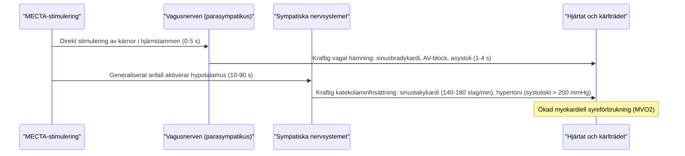

# Cirkulation och arytmier

Under ett ECT-anfall utsätts hjärta och kärl för en av de kraftigaste fysiologiska påfrestningarna inom planerad sjukvård. Att förstå den **tvåfasiga autonoma responsen** är avgörande för att bedöma arytmier och förebygga komplikationer hos hjärtsjuka patienter.

---

## Cirkulationens två faser

### Fas 1: Vagal reaktion (0-5 s)

- **Vad sker?**
  Den elektriska strömmen stimulerar vaguskärnorna i hjärnstammen direkt när den passerar.
- **Klinisk bild:**
    - Omedelbar sinusbradykardi genom vagusstimulering med påverkan på sinusknutan. Pulsen kan sjunka från 80 till under 30 slag/minut.
    - Kortvarig asystoli (1-4 sekunder) eller AV-block är mycket vanligt strax innan de kloniska kramperna startar.
    - Ökad salivutsöndring och ökad slemsekretion i bronkerna.
- **Risksituation: Subkonvulsiv stimulering!**
  Om stimuleringen inte utlöser något epileptiskt anfall uteblir den sekundära sympatiska aktiveringen. Då kvarstår en ren vagal stimulering med risk för **förlängd asystoli och uttalat blodtrycksfall**.
- **Behandling och förebyggande:**
    - **Glykopyrron (Robinul 0,2 mg iv)** eller **atropin (0,5 mg iv)** ges enligt IVA:s rutin som premedicinering till alla patienter utan kontraindikation, så snart venvägen är etablerad; hos hjärtsjuka övervägs indikationen. Robinul föredras eftersom det inte passerar blod-hjärnbarriären och därmed inte orsakar central antikolinerg förvirring!

### Fas 2: Sympatikuspåslag (10-90 s)

- **Vad sker?**
  Det generaliserade cerebrala anfallet aktiverar hypotalamus och det sympatiska nervsystemet. Binjuremärgen frisätter stora mängder adrenalin och noradrenalin i cirkulationen.
- **Klinisk bild:**
    - Markant **sinustakykardi** (ofta 140-180 slag/minut).
    - Kraftig **blodtrycksstegring** (systoliskt tryck stiger ofta med 50-100 mmHg och kan tillfälligt överstiga 200-220 mmHg).
    - Perifer vasokonstriktion.
    - Ökad syreförbrukning i hjärtmuskeln (MVO₂).
- **Risker:**
    - Myokardischemi hos patienter med känd eller tyst kranskärlssjukdom (syns som ST-sänkningar på EKG).
    - Ventrikulära extraslag (VES), bigemini eller korta skov av ventrikeltakykardi (VT).
    - Risk för ruptur av obehandlade cerebrala aneurysm eller aortaaneurysm.

---

## Läkemedel för blodtryck och puls

Hos högriskpatienter (tidigare hjärtinfarkt, angina pectoris, aneurysm, svår hypertoni) dämpar narkosläkaren aktivt den sympatiska toppen:

1. **Labetalol (Trandate):**
    - Kombinerad alfa- och betareceptorblockerare (5-20 mg iv).
    - Sänker blodtryck och hjärtfrekvens. Val, dos och tidpunkt individualiseras; betablockad kan påverka anfallsdurationen.
2. **Esmolol (Brevibloc):**
    - Mycket kortverkande kardioselektiv beta-1-receptorblockerare (0,5-1,0 mg/kg iv).
    - Lämpligt för att dämpa takykardin under anfallet; klingar av snabbt efteråt.
3. **Nitroglycerin eller nitroprussid:**
    - Snabbverkande kärlvidgande läkemedel vid kraftig systolisk tryckstegring (> 220 mmHg).

---

## Pacemaker och ICD

ECT kan genomföras med pacemaker eller ICD efter en dokumenterad plan med anestesin och vid behov pacemaker- eller ICD-mottagningen.

- Identifiera enhetstyp, pacemakerberoende, aktuella inställningar och magnetrespons.
- Bedöm behov av omprogrammering, inklusive asynkron stimulering (*pacing*) hos utvalda pacemakerberoende patienter. Muskelaktivitet och elektromagnetisk störning kan påverka avkänningen (*sensing*).
- ICD:ns takykardibehandling behöver vanligen tillfälligt stängas av. Om detta görs med magnet eller programmerare beror på enheten och den individuella planen; magnet är inte en universell lösning.
- Ha utrustning för extern defibrillering och pacing samt övervakning tillgänglig. Säkerställ att ordinarie funktion och ICD-terapier återställs efteråt.
