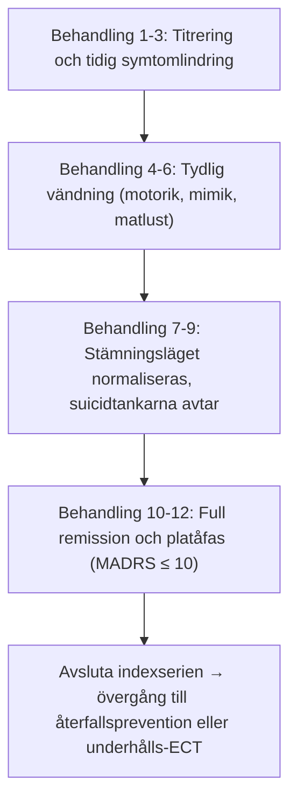

# Behandlingsförlopp och serielängd

En indexserie med ECT ges inte med ett förutbestämt antal behandlingar, utan styrs helt av patientens **kliniska respons och biverkningsprofil**.

---

## Behandlingsfrekvens: 2 eller 3 per vecka

I Sverige ges ECT oftast **tre gånger i veckan** (måndag, onsdag, fredag) till inneliggande patienter med svår melankoli eller akut suicidrisk, eller **två gånger i veckan** (t.ex. tisdag och fredag) till patienter i öppenvård eller vid hög kognitiv känslighet.

| Egenskap | 3 gånger per vecka (mån, ons, fre) | 2 gånger per vecka (tis, fre) |
| :--- | :--- | :--- |
| **Tid till remission** | **Något snabbare initial symtomlindring** (viktigt vid akut suicidrisk eller katatoni) | Någon vecka längre kalendertid till full remission |
| **Kognitiva biverkningar** | **Högre risk** för ackumulerad konfusion och amnesi | **Tydligt skonsammare för minnet** |
| **Totalt antal behandlingar** | Samma totala antal krävs för full remission (cirka 8-10 behandlingar) | Samma totala antal krävs (cirka 8-10 behandlingar) |
| **Klinisk användning** | Slutenvård, akut svår melankoli, psykos, katatoni | Patienter i öppenvård, äldre med nedsatt minnesfunktion |

> [!TIP] Klinisk regel för frekvens
> Om en patient som behandlas 3 gånger i veckan börjar utveckla påtaglig konfusion, desorientering eller minnesluckor mellan behandlingarna: **sänk omedelbart frekvensen till 2 gånger i veckan**! Detta ger hjärnan mer tid för återhämtning utan att äventyra den antidepressiva effekten.

---

## Antal behandlingar

Genomsnittet för en akut indexserie vid egentlig depression är **8 till 12 behandlingar**.

### Serielängd per diagnos
- **Katatoni:** Mycket snabbt svar! Ofta ses snabb remission redan efter **2 till 4 behandlingar**.
- **Svår egentlig depression, psykotisk depression:** Kräver vanligtvis **6 till 10 behandlingar**.
- **Behandlingsresistent depression (utebliven effekt av flera läkemedel):** Kräver ofta något längre serier, **10 till 14 behandlingar**.
- **Akut mani:** Svarar ofta snabbt, vanligtvis **4 till 8 behandlingar**.
- **Schizofreni (akut exacerbation):** Kräver längre serier i kombination med antipsykotika, **10 till 16 behandlingar**.

---

## När avslutas serien?

Behandlingen ska varken avslutas för tidigt (vilket ger hög risk för omedelbart återfall) eller pågå för länge i onödan.

### 1. Remission
- Patienten uppnår stabil **remission**, definierat som **MADRS-S ≤ 10 poäng** med klinisk bedömning och angiven skaldefinition. CGI-I = 1 anger mycket stor förbättring men fastställer inte remission.
- **Konsolidering (platåregeln):** Behov av ytterligare behandling efter uppnådd remission bedöms individuellt. Ge inte automatiskt 1-2 extra behandlingar utan att väga nytta mot biverkningar och planerad fortsättningsbehandling.

### 2. Terapisvikt eller platå
- Om patienten inte förbättrats alls efter **6 fullgoda behandlingar**:
    - Säkerställ att laddningen varit tillräckligt övertrösklig.
    - Överväg att byta elektrodplacering från RUL till **bitemporal (BT)**!
- Vid utebliven förbättring efter omkring 8-12 fullgoda behandlingar behövs en strukturerad omprövning av specialist. Tolv behandlingar är ingen absolut stoppgräns för alla diagnoser och förlopp.

### 3. Oacceptabla biverkningar
- Uttalat, långdraget postiktalt delirium som inte går över trots glesare behandlingar och dosreduktion, eller svår somatisk komplikation.

---

## Referenser

1. American Psychiatric Association. *The Practice of Electroconvulsive Therapy*. 3 uppl.; copyright 2025. Kap. 18.1-18.2, ”Frequency and Number of Treatments”, kap. 17 om utvärdering och kap. 22 om uteblivet behandlingssvar.
2. Mankad MV, Beyer JL, Weiner RD, Krystal AD. *Clinical Manual of Electroconvulsive Therapy*. Arlington, VA: American Psychiatric Publishing; 2010. Kap. 12, ”Index ECT”, s. 159-162. Underlag för behandlingsfrekvens och beslut om serielängd.
3. Ferrier IN, Waite J, red. *The ECT Handbook*. 4 uppl. Cambridge: Cambridge University Press; 2019. Kap. 3, s. 24-31, om behandling av depression, och kap. 22, s. 183-201, om praktiskt genomförande.
4. [NSW Health. ECT Handbook. Version 1.1; 2026 (aktuell nätversion: 1.2)](https://www.health.nsw.gov.au/mentalhealth/resources/Pages/electroconvulsive-therapy-handbook.aspx); [[02 Klinisk utvärdering|Klinisk utvärdering]]. Tidsförlopp och antal i tabellerna är ungefärliga, inte löften eller automatiska behandlingsmål.

---

## Relaterade länkar
- Klinisk utvärdering med MADRS-S: [[02 Klinisk utvärdering|Klinisk utvärdering]]
- Fortsättnings- och underhållsbehandling: [[03 Underhålls-ECT|Underhålls-ECT]]
- Svenska Kvalitetsregistret för ECT: [[04 Kvalitetsregistret för ECT|Kvalitetsregistret för ECT]]
- Övertrösklig dosering: [[05 Kramptröskel och doshöjning|Kramptröskel och doshöjning]]
