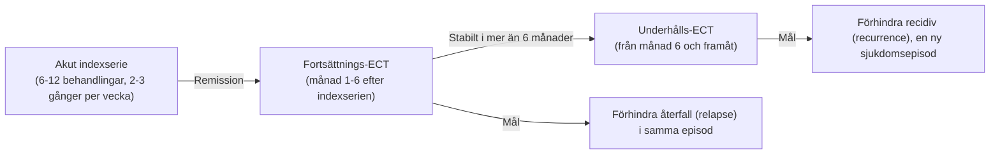

# Underhålls-ECT

Att nå remission av en svår depressionsepisod med en akut indexserie är en stor framgång, men utan tillräcklig återfallsförebyggande behandling är risken för tidigt återfall hög (uppemot **50-60 % återfall inom 6 månader** hos svårt sjuka patienter).

För patienter med hög återfallsrisk eller behandlingsresistens är **fortsättnings-ECT** och **underhålls-ECT** en etablerad och säker strategi som kan vara livsavgörande.

---

## Begrepp

---

## Indikationer för underhålls-ECT

1. **Hög återfallsfrekvens:** Patienten har tidigare drabbats av snabbt återfall efter avslutad indexserie trots optimal farmakoterapi.
2. **Behandlingsresistens mot profylaktiska läkemedel:** Patienten svarar inte på eller tolererar inte underhållsbehandling med litium eller antidepressiva (t.ex. svåra biverkningar).
3. **Svår katatoni eller bipolär sjukdom med snabba cykler (*rapid cycling*).**
4. **Patientens eget välgrundade önskemål:** Patienten känner sig tryggast med intermittent underhållsbehandling.

---

## Glesa ut behandlingarna

Efter en avslutad indexserie trappas behandlingsfrekvensen ned successivt för att pröva att förbättringen håller:

| Behandlingsfas | Tidsperiod | Behandlingsintervall | Kommentar |
| :--- | :--- | :--- | :--- |
| **Övergångsfas** | Vecka 1-2 | **1 behandling per vecka** | Kontrollera att remissionen håller. |
| **Utglesningsfas 1** | Vecka 3-6 | **1 behandling varannan vecka** (var 14:e dag) | Mycket vanlig nivå i öppenvård. |
| **Utglesningsfas 2** | Vecka 7-12 | **1 behandling var 3:e till 4:e vecka** | Många patienter stabiliseras här. |
| **Fortsättnings-ECT, därefter underhålls-ECT**| Månad 4 och framåt; underhålls-ECT efter 6 månader | **Individuellt intervall (vanligen var 3:e-6:e vecka)** | Anpassas efter patientens ”kritiska fönster”. |

> [!TIP] Det ”kritiska fönstret”
> Varje patient som får underhålls-ECT har ofta ett individuellt återfallsfönster. Om en patient börjar bli nedstämd, tyst och få sömnproblem exakt 25 dagar efter sin förra behandling, ska behandlingsintervallet ligga på **var 3:e vecka (21 dagar)**, precis innan symtomen hinner bryta igenom!

---

## Kramptröskel och dos vid underhålls-ECT

Kramptröskeln kan ändras när behandlingsintervallet ändras. En tröskel eller dos som uppskattades under indexserien behöver därför omprövas vid fortsatt behandling. Tröskeln återgår inte förutsägbart till ett visst utgångsvärde efter tre eller fyra veckor hos alla patienter.

Följ kliniskt svar, anfallsmorfologi och kognition. Eventuell retitrering eller dosändring ska följa ordination och lokalt protokoll; dosen ska inte automatiskt sänkas med ett visst antal tabellsteg. Se [American Psychiatric Association. *The Practice of Electroconvulsive Therapy*. 3 uppl.; copyright 2025](https://doi.org/10.1176/appi.books.9780890427118), kap. 23.

---

## Samtidig läkemedelsbehandling

Kombination med återfallsförebyggande läkemedel kan vara motiverad. **CORE-studien jämförde fortsättnings-ECT med litium och nortriptylin**; den bevisade inte att kombinationen av underhålls-ECT, antidepressivum och litium alltid är bäst.

Val av farmakoterapi och eventuellt litium individualiseras. Se [[04 Läkemedel och interaktioner|Läkemedel och interaktioner]] för koncentrationskontroll, kognitiv risk och eventuell paus.

---

## Referenser

1. American Psychiatric Association. *The Practice of Electroconvulsive Therapy*. 3 uppl.; copyright 2025. Kap. 23.2 om återfallsförebyggande läkemedel och 23.3 om fortsatt ECT. Underlag för indikation, intervall, dosbedömning och kombinationsbehandling.
2. Mankad MV, Beyer JL, Weiner RD, Krystal AD. *Clinical Manual of Electroconvulsive Therapy*. Arlington, VA: American Psychiatric Publishing; 2010. Kap. 13, ”Maintenance ECT”, s. 163-168. Underlag för fortsatt behandling och individualisering av intervall.
3. [NSW Health. ECT Handbook. Version 1.1; 2026 (aktuell nätversion: 1.2)](https://www.health.nsw.gov.au/mentalhealth/resources/Pages/electroconvulsive-therapy-handbook.aspx), kap. 12. Schemat är ett exempel; intervallet anpassas till symtom och biverkningar.

---

## Relaterade länkar
- Behandlingsförlopp och serielängd: [[01 Behandlingsförlopp och serielängd|Behandlingsförlopp och serielängd]]
- Symtomutvärdering: [[02 Klinisk utvärdering|Klinisk utvärdering]]
- Svenska Kvalitetsregistret för ECT: [[04 Kvalitetsregistret för ECT|Kvalitetsregistret för ECT]]
- Lathund ordination: [[01 Parameterinställningar|Parameterinställningar]]
