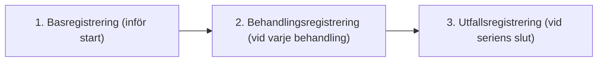

# Kvalitetsregistret för ECT

**Kvalitetsregister ECT** följer behandling och utfall i svensk vård. Registret är sedan november 2025 anslutet till Registercentrum Norr. Täckningsgrad ska anges med årtal och definition, inte som en tidlös andel av alla behandlingar.

Registret gör det möjligt att följa upp behandlingseffekt, patientsäkerhet och metodutveckling på nationell nivå.

---

## Vilka variabler registreras?

Som ECT-behandlare är det du (ofta i samarbete med ECT-sjuksköterskan) som matar in data i registret. Inmatningen sker i tre steg:

### 1. Data före behandlingsstart
- **Diagnos:** Enligt ICD-10 (t.ex. F32.3 svår depressiv episod med psykotiska symtom, F31 bipolär sjukdom, F20 schizofreni, F06.1 organiskt katatont syndrom).
- **Indikation och brådskandegrad:** Vital indikation, svår psykomotorisk hämning eller matvägran, hög suicidrisk, terapisvikt.
- **Vårdform:** HSL (frivillig vård) eller LPT eller LRV (tvångsvård).
- **Skattning före start:** poäng på MADRS eller MADRS-S samt CGI-S (svårighetsgrad).
- **Kognition före start:** MoCA eller MMSE och standardiserad subjektiv minnesfråga.

### 2. Data vid varje behandling
- **Apparatur:** **MECTA spECTrum 5000Q** (andra kliniker i landet kan även registrera *Thymatron System IV*, se [[02 Appendix - Thymatron System IV|Appendix: Thymatron System IV]]).
- **Elektrodplacering:** Dokumentera använd placering; lokalt RUL d’Elia eller bitemporalt (BT).
- **Elektriska parametrar:** Pulsbredd (ms), frekvens (Hz), duration (s), ström (mA) och total laddning (Q i mC).
- **Statisk och dynamisk impedans (Ω).**
- **Narkosmedel och doser:** Propofol, tiopental, suxameton.
- **Anfallsduration:** Motorisk duration (sekunder, manschettmetoden) och EEG-duration (sekunder).
- **Eventuella komplikationer:** Larm, förlängt anfall, asystoli, postiktal agitation.

### 3. Data efter avslutad serie
- **Ny skattning:** MADRS-S och CGI-I (förbättringsskala 1-7).
- **Minnesutvärdering:** Har minnet försämrats, förblivit oförändrat eller förbättrats jämfört med före behandlingsstart?
- **Planerad uppföljning:** Farmakoterapi, fortsättnings-ECT eller underhålls-ECT.

---

## Nationella resultat och registerversion

[Aktuella årsrapporter finns hos Registercentrum Norr](https://ect.rcnorr.se/rapporter/arsrapporter/). Vid granskningen fanns **årsrapport 2025, version 1 utan data från patientregistret**.

De tidigare odaterade talen om 60-75 % remission och < 0,1 % allvarliga eller långvariga komplikationer saknade preciserat underlag och har tagits bort. Ange rapportår, diagnosgrupp, nämnare, bortfall och exakt definition av respons och remission innan ett resultat används.

Listan ovan är en översikt över relevanta kliniska data, inte en verifierad aktuell fältspecifikation. Allt som dokumenteras per behandling förs inte nödvändigtvis över som ett separat registerfält. Använd aktuell formulärmanual och lokal registreringsrutin.

---

## Referenser

1. [Kvalitetsregister ECT, årsrapport 2025 version 1](https://ect.rcnorr.se/wp-content/uploads/2026/08/Kvalitetsregister-ECT-Arsrapport-2025_version-1.pdf), särskilt registerbeskrivningen och begränsningen av versionens data.

Registervariabler, svenska resultat och versionsbegränsningar hämtas från registerhållarens dokumentation nedan. Generella ECT-böcker används inte som källa till dessa svenska registeruppgifter.

---

## Relaterade länkar
- Skattningsskalor: [[02 Klinisk utvärdering|Klinisk utvärdering]]
- Långsiktig säkerhet och mortalitet: [[05 Långsiktig säkerhet|Långsiktig säkerhet]]
- Preoperativ bedömning: [[03 Somatisk bedömning|Somatisk bedömning]]
- Behandlingsförlopp och serielängd: [[01 Behandlingsförlopp och serielängd|Behandlingsförlopp och serielängd]]
