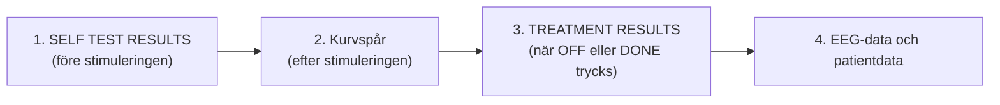
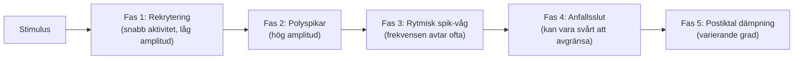

# EEG-tolkning

När du står vid MECTA spECTrum 5000Q matar termoskrivaren ut en pappersremsa i realtid. Här är en bildguide för att granska kurvorna och bedöma anfallet.

---

## EEG-utskriftens delar

Pappersremsan från termoskrivaren (*CHART RECORDER*) på MECTA spECTrum 5000Q är en del av behandlingsdokumentationen. Skrivaren matar 25 mm papper per sekund. Vid varje stimulering skrivs delarna ut i den här ordningen:

Ordningen upprepas för varje stimulering tills DONE trycks på pekskärmen eller skrivarens OFF-knapp trycks in. Då skrivs också en rad för patientens namn.

![[MECTA 5000Q pappersremsa struktur.webp|MECTA 5000Q pappersremsa struktur]]
*Figur 1: Exempel på utskrift direkt efter stimuleringen. Från vänster till höger: SELF TEST RESULTS, ett EEG-spår med tid sedan stimuleringens slut (^00:02), TREATMENT RESULTS, datum och klockslag, patientfält samt en rad för patientens namn. Källa: MECTA Corporation, spECTrum Instruction Manual (100 J), s. 57; fälten kan skilja sig i 200 J-huvudapparatens programversion.*

Hos oss räknas EEG-durationen i sekunder på apparaten tills postiktal suppression har nåtts och EEG planar ut. Manschettmetoden används inte rutinmässigt; den motoriska durationen noteras när ryckningarna går att följa. Maximal puls och kvalitetsindex analyseras inte, och optisk rörelsesensor (OMS) används inte.

### 1. SELF TEST RESULTS
Skrivs ut när STIMULUS CONTROL trycks in, strax före kurvspåren:
- **CHARGE och ENERGY:** Laddning i millicoulomb (mC) och beräknad energi i joule vid en antagen impedans på 220 ohm.
- **IMPEDANCE:** Statisk impedans mellan stimuleringselektroderna strax före stimuleringen. Värdet ska ligga inom apparatens godkända intervall; kontrollera kontakt och eventuell salt- eller gelbrygga.
- **PULSE WIDTH, FREQUENCY, DURATION och CURRENT:** De fyra rattarnas inställning (pulsbredd i ms, frekvens i Hz, pulstågets duration i sekunder och strömstyrka i mA).

### 2. Kurvspår
- **Antal och ordning:** Ett eller två spår skrivs ut, beroende på vad som har valts i menyn CHART TRACE. Där väljs också ordningen.
- **Övre raden:** Kanalens typ, avledningsnummer och känslighet i mV/mm, t.ex. `EEG #1 0.100 mV/mm`.
- **Förstärkning:** Det övre (eller enda) spåret har alltid GAIN 1. Spårens storlek på papperet styrs bara av rattarna GAIN 1 och GAIN 2 på frontpanelen, inte av förstärkningen på pekskärmen.
- **Nedre raden, tid:** När utskriften startar automatiskt efter stimuleringen räknas tiden från stimuleringens slut. Efter ett pulståg på 6 sekunder betyder 00:12 alltså 18 sekunder efter stimuleringens början. Startas utskriften manuellt med ON visas i stället klockslag.
- **TIMER:** Varje tryck på TIMER på pekskärmen markeras på remsan med klockslag, t.ex. för att ta tid på en händelse.
- **EEG-kanaler hos oss:** EEG från pannan (Fp₁ och Fp₂) med referens till elektroden under nyckelbenet. Inga elektroder fästs på mastoidutskottet. EKG kan skrivas ut vid behov, t.ex. vid arytmi.

### 3. TREATMENT RESULTS
Skrivs ut efter kurvspåret när OFF på skrivaren eller DONE på pekskärmen trycks in:
- **CHARGE och ENERGY:** Levererad laddning och energi.
- **STAT. IMPED.:** Statisk impedans före stimuleringen.
- **DYN. IMPED.:** Dynamisk impedans genom skalp, skallben och hjärnvävnad *under själva pulståget* (normalt 150-350 Ω), betydligt lägre än den statiska impedansen.
- **Parametrar och patientuppgifter:** Pulsbredd, frekvens, duration och ström, datum och klockslag samt fält för patient-ID, ålder och behandlingsnummer.

Om en ny stimulering ges innan TREATMENT RESULTS har skrivits ut, skrivs föregående resultat ut före nästa SELF TEST RESULTS. Det är användbart vid titrering och restimulering. Stängs apparaten av med POWER innan resultaten har skrivits ut går de förlorade.

---

## EEG:s anfallsfaser

Faserna är en pedagogisk modell. De angivna tidsintervallen är orienterande exempel och ska inte användas som fasta kriterier för effekt eller anfallsslut. EEG-morfologin påverkas bland annat av avledning, förstärkning, ålder, anestesi och läkemedel.

![[EEG-anfall faser Sachdev.webp|EEG-anfall faser Sachdev]]
*Figur 2: Schematisk översikt över anfallets typiska morfologi från stimulering till postiktal suppression (efter Mankad m.fl., Clinical Manual of Electroconvulsive Therapy).*

---

### Fas 1: Stimuleringsartefakt och rekrytering (0-5 s)
- Svarta, vertikala streck som fyller papperet under stimuleringen (apparatens pulser).
- Följs omedelbart av 1-2 sekunders desynkronisering och snabb aktivitet med låg amplitud (10-20 Hz) när neuronerna i hjärnbarken börjar rekryteras.

### Fas 2: Polyspikar (5-15 s)
- Tät, snabb vågaktivitet med kraftigt stigande amplitud (> 200-500 μV).
- Speglar den omfattande depolariseringen i hjärnbarken och motsvarar den perifera toniska sträckkrampen i patientens muskler.

### Fas 3: Rytmiska spik-vågkomplex (15-40 s)
- Rytmiska spikar och långsamma vågor är vanliga under anfallet. Morfologin bidrar till bedömningen men garanterar inte terapeutisk effekt.
- Jämför kanalernas utveckling med hänsyn till den faktiska avledningen. Kanalerna behöver inte vara spegelbilder för att ett anfall ska ha generaliserats.
- Komplexens frekvens sjunker gradvis i takt med att hjärnans hämning tilltar.

### Fas 4: Anfallsslut (ca 35-50 s)
- Slutet kan vara tydligt eller mer gradvis; kontrollera båda kanalerna och uteslut artefakter.
- Bedöm kvarstående långsam eller asymmetrisk aktivitet med hänsyn till artefakter och baslinje.

### Fas 5: Postiktal suppression (> 45 s)
- Kurvan blir omedelbart nästan **helt platt (isoelektrisk)** eller visar en mycket låg, långsam deltarytm.
- Postiktal suppression kan vara en stödmarkör tillsammans med övrigt EEG och kliniskt svar. Den är inte ett direkt mått på GABA, adenosin eller CSD, och ett visst djup fastställer inte behandlingsnyttan.

---

### Klinisk EEG-remsa från behandling

![[Figurer/EEG-anfall faser RCPsych.webp|Klinisk EEG-registrering under ECT]]
*Figur 3: Klinisk EEG-registrering under ECT. Källa: Semple DM, Devlin RA. ”Seizure Monitoring in ECT”. I: Ferrier IN, Waite J, red. The ECT Handbook. 4 uppl. 2019; kap. 26, figur 26.7, s. 240. [Bokens nätutgåva](https://doi.org/10.1017/9781911623175).*

Bokstäverna följer bokens figur; fasnumreringen där skiljer sig från kompendiets förenklade indelning ovan:

1. **Elektrodekrementell fas:** Den korta fasen med låg amplitud (*electrodecremental phase*) som kan följa direkt efter stimuleringen. Enligt bokens figurförklaring syns ingen sådan aktivitet i detta exempel.

2. **Rekryteringsfas:** Snabb EEG-aktivitet med låg amplitud övergår mot polyspikar. Någon synlig motorisk kramp ses ännu inte.

3. **Polyspikaktivitet:** Amplituden ökar samtidigt som frekvensen sjunker.

4. **Theta- och deltaaktivitet:** Polyspikar och långsamma vågor blir mer regelbundna under den kloniska fasen.

5. **Tydliga spik-vågkomplex:** Aktiviteten har bromsats till deltaområdet, med cirka 2-3 Hz kring 25 sekunder.

6. **Anfallsslut:** Spik-vågmönstret avtar gradvis.

7. **Postiktal suppression:** EEG-aktiviteten har låg amplitud och låg frekvens.

8. **Rörelseartefakt:** Utslaget orsakas av att anestesipersonalen lägger tillbaka syrgasmasken.

Återgången till utgångsläget visas inte i figuren. Alla faser behöver inte framträda i varje behandlingsregistrering.

---

## Avvikelser och artefakter

| Vad ser du på papperet? | Vad betyder det? | Åtgärd |
| :--- | :--- | :--- |
| **Taggigt, ”hårigt” brus i hela kurvan** | **Muskelartefakt (EMG):** Patienten är ofullständigt relaxerad; pann- och ansiktsmusklerna spänns. | Kontrollera signal och relaxation med anestesin; dos ändras efter individuell bedömning. |
| **Konstant 50 Hz sinusformad vibration** | **Nätbrumsartefakt:** Dålig hudkontakt under en av EEG-elektroderna i pannan eller under referenselektroden under nyckelbenet. | Rengör huden noggrannare; tryck fast elektroden. |
| **Bara ett rakt streck från början** | ***Leads off*:** En kabel har lossnat eller `GAIN`-ratten står på noll. | Kontrollera avledningar; tryck `RESTORE` på pekskärmen; vrid upp `GAIN 1`. |
| **Asymmetri (höga spikar på höger, platt på vänster)** | Kan bero på avledningsfel, artefakt eller asymmetriskt anfall. | Kontrollera elektroder, signal och förstärkning före klinisk dosbedömning. |
| **Långsamt, segt anfall som aldrig bryts tvärt** | **Tröskelnära anfall:** Svag cerebral hämning; anfallet klingar av långsamt utan suppression. | Värdera signal, anestesi, läkemedel och kliniskt svar med ansvarig läkare; ingen automatisk doshöjning. |

---

## Referenser

1. Ferrier IN, Waite J, red. *The ECT Handbook*. 4 uppl. Cambridge: Cambridge University Press; 2019. Kap. 26, ”Seizure Monitoring in ECT”, s. 234-246; figur 26.7, s. 240, är källa till den kliniska EEG-remsan och förklaringarna A-H.
2. Mankad MV, Beyer JL, Weiner RD, Krystal AD. *Clinical Manual of Electroconvulsive Therapy*. Arlington, VA: American Psychiatric Publishing; 2010. Kap. 7-8, s. 97-128. Underlag för motorik, EEG-faser, anfallsslut och artefakter.
3. American Psychiatric Association. *The Practice of Electroconvulsive Therapy*. 3 uppl.; copyright 2025. Kap. 15.1-15.3. Underlag för tolkning av EEG och begränsningarna hos enskilda kvalitetsmått.
4. [MECTA. Optimized spECTrum Instruction Manual. INT, 200 J; artikelnummer 9900-1012-16](https://mectaspectrum.com/clinician/clinical-ect-materials/).
5. Äldre referens för reservapparat och funktionsbeskrivningar: [MECTA Corporation. spECTrum Instruction Manual. 100 Joules; s. 16-22 och 56-58](https://mectaspectrum.com/clinician/clinical-ect-materials/); [[04 Bedömning av anfallskvalitet|Bedömning av anfallskvalitet]]. Kanalordning, analysfunktioner och utskriftslayout är beroende av version och tillval. Befintliga schematiska bilder är inte verifierade som exakta skärmbilder från aktuell enhet.

---

## Relaterade länkar
- Anfallskriterier och kvalitet: [[04 Bedömning av anfallskvalitet|Bedömning av anfallskvalitet]]
- Övervakning vid bordet: [[03 Anfallsövervakning|Anfallsövervakning]]
- MECTA maskinöversikt: [[01 Översikt|Översikt]]
- Ordinationslathund: [[01 Parameterinställningar|Parameterinställningar]]
