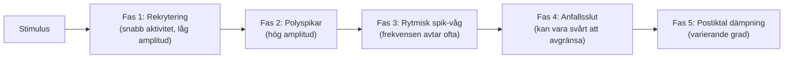

# EEG-tolkning

När du står vid MECTA spECTrum 5000Q matar termoskrivaren ut en pappersremsa i realtid. Här är en bildguide för att granska kurvorna och bedöma anfallet.

---

## EEG-utskriftens delar

Pappersremsan som matas ut från termoskrivaren på MECTA spECTrum 5000Q är en bestående journalhandling, både kliniskt och juridiskt. Följande är en pedagogisk struktur. Faktiska kanalantal, kanalordning och rapportfält beror på tillval, uppkoppling och programversion:

```mermaid
flowchart LR
    subgraph H["1. Sidhuvud: före stimulering"]
        direction TB
        H1["Patient-ID, datum och tid"]
        H2["Rattar: PW, Freq, Dur, mA"]
        H3["Statisk impedans (Ω)"]
        H4["Preiktalt EEG, utgångsläge (5-10 s)"]
    end

    subgraph K["2. Iktala spår: registrering"]
        direction TB
        K0["Sekundmarkörer (00:01, 00:02...)"]
        K1["Spår 1: EEG vänster panna (Fp1)"]
        K2["Spår 2: EEG höger panna (Fp2)"]
        K3["Spår 3: OMS (rörelsesensor på tå)"]
        K4["Spår 4: EKG (eller EMG)"]
    end

    subgraph S["3. Slutrapport: postiktalt"]
        direction TB
        S1["Motorisk duration (s)"]
        S2["EEG-duration (s)"]
        S3["Dynamisk impedans (Ω)"]
        S4["Maximal puls (Peak HR)"]
        S5["Suppression Index (%)"]
    end

    H --> K --> S
```

![[MECTA 5000Q pappersremsa struktur.png]]
*Figur 1: Pappersremsans uppbyggnad från MECTA spECTrum 5000Q. Remsan visar från vänster till höger: sidhuvud med apparatparametrar och statisk impedans, de 4 fysiologiska kanalspåren med stimuleringsartefakt, iktala vågformer och sekundmarkeringar, samt den automatiska slutrapporten med durationer och dynamisk impedans.*

### 1. Sidhuvud och inställningar
Skrivs ut i samma ögonblick som stimuleringen startar, före pulståget:
- **Patient- och behandlingsdata:** Datum, klockslag, patientens ID och behandlingsnummer.
- **Ordinerade stimuleringsparametrar:** Dokumenterar exakt vad de fyra rattarna stod på:
    - `PW` (*pulse width*): Pulsbredd i millisekunder (t.ex. 0,3 ms ultrakort puls eller 0,5-1,0 ms kortpuls).
    - `FREQ` (*frequency*): Frekvens i Hz (t.ex. 40-80 Hz).
    - `DUR` (*duration*): Pulstågets längd i sekunder (t.ex. 2,0 s).
    - `CURR` (*current*): Strömstyrka (konstant 800 mA).
    - `CHARGE`: Total levererad laddning i millicoulomb (Q, t.ex. 160 mC) och beräknad energi i joule.
- **Statisk impedans (Ω):** Impedans uppmätt mellan stimuleringselektroderna på patientens hjässa före stimuleringen. Ska ligga mellan 100-5000 Ω (idealiskt apparatens godkända intervall, med kontroll av kontakt och eventuell gelbrygga för handhållna elektroder).
- **Pappershastighet:** Läs av faktisk inställning och tidsmarkering. En EKG-hastighet på 25 mm/s får inte antas vara standard för denna EEG-skrivare.
- **EEG före stimulering:** 5-10 sekunders registrering före stimulering för att bekräfta stabil baslinje, avsaknad av elektrodartefakter samt anestesieffekt.

### 2. Anfallsregistrering
MECTA 5000Q (”Quad”) har kapacitet för upp till 4 samtidiga fysiologiska spår:
- **Tidsmarkeringar (övre eller nedre marginalen):** Sekundmarkörer med tidsstämplar (00:01, 00:02, 00:03...) som löper längs remsan för exakt tidmätning.
- **Kanal 1 (överst):** EEG från pannregionen (Fp₁) med referens till elektroden under nyckelbenet.
- **Kanal 2:** EEG från pannregionen (Fp₂) med referens till elektroden under nyckelbenet. Alternativt registreras bipolär fronto-frontal spänning (Fp₁-Fp₂) beroende på kabelkoppling. Inga elektroder fästs på mastoidutskottet.
- **Kanal 3 (OMS):** Optisk rörelsesensor tejpad på stortån eller fingret distalt om manschetten. Registrerar muskelrörelser under den kloniska fasen som långsamma vågor; tystnar omedelbart när motoriken upphör.
- **Kanal 4 (EKG eller EMG):** EKG för övervakning i realtid av hjärtats (*cor*) rytm (initial vagal bradykardi följt av sympatisk takykardi).

![[MECTA-OMS-remsa.png]]
*Figur 2: Klinisk pappersregistrering på MECTA med EEG och optisk rörelsesensor (OMS) (efter Mankad m.fl., Clinical Manual of Electroconvulsive Therapy). (A) Anfallsstart; (B) motoriskt anfallsslut på OMS (pil); och (C) EEG-anfallets slut (pil), vilket illustrerar att EEG normalt fortsätter 10-20 sekunder efter att foten stillnat.*

### 3. Slutrapport
När anfallet klingat av och skrivaren stoppas skrivs en automatisk sammanfattning ut:
- **Motor Duration (s):** Anfallets motoriska duration, registrerad med OMS eller manuellt stopp.
- **EEG Duration (s):** Total iktal EEG-tid fram till anfallsslut.
- **Dynamisk impedans (Ω):** Den verkliga impedansen genom skalp, skallben och hjärnvävnad *under själva pulståget* (normalt 150-350 Ω). Mycket lägre än den statiska impedansen!
- **Peak HR (slag/min):** Patientens maximala puls under sympatikusaktiveringen.
- **Kvalitetsindex:** Kontrollera vilka analysfunktioner den aktuella apparaten och programversionen har. Beteckningarna SEI och PSI från Thymatron får inte utan verifiering tillskrivas MECTA.

---

## EEG:s anfallsfaser

Faserna är en pedagogisk modell. De angivna tidsintervallen är orienterande exempel och ska inte användas som fasta kriterier för effekt eller anfallsslut. EEG-morfologin påverkas bland annat av avledning, förstärkning, ålder, anestesi och läkemedel.

![[EEG-anfall faser Sachdev.png]]
*Figur 3: Schematisk översikt över anfallets typiska morfologi från stimulering till postiktal suppression (efter Mankad m.fl., Clinical Manual of Electroconvulsive Therapy).*

---

### Fas 1: Stimuleringsartefakt och rekrytering (0-5 s)
- Svarta, vertikala streck som fyller papperet under stimuleringen (apparatens pulser).
- Följs omedelbart av 1-2 sekunders desynkronisering och snabb aktivitet med låg amplitud (10-20 Hz) när neuronerna i hjärnbarken börjar rekryteras.

### Fas 2: Polyspikar (5-15 s)
- Tät, snabb vågaktivitet med kraftigt stigande amplitud (> 200-500 μV).
- Speglar den omfattande depolariseringen i hjärnbarken och motsvarar den perifera toniska sträckkrampen i patientens muskler.

### Fas 3: Rytmiska spik-vågkomplex (15-40 s)
- Rytmiska spikar och långsamma vågor är vanliga under anfallet. Morfologin bidrar till bedömningen men garanterar inte terapeutisk effekt.
- Jämför kanalernas utveckling med hänsyn till den faktiska avledningen. Kanalerna behöver inte vara spegelbilder för att ett anfall ska ha generaliserats.
- Komplexens frekvens sjunker gradvis i takt med att hjärnans hämning tilltar (motsvarar de kloniska ryckningarna i foten, *pes*, på OMS-spåret).

### Fas 4: Anfallsslut (ca 35-50 s)
- Slutet kan vara tydligt eller mer gradvis; kontrollera båda kanalerna och uteslut artefakter.
- Bedöm kvarstående långsam eller asymmetrisk aktivitet med hänsyn till artefakter och baslinje.

### Fas 5: Postiktal suppression (> 45 s)
- Kurvan blir omedelbart nästan **helt platt (isoelektrisk)** eller visar en mycket låg, långsam deltarytm.
- Postiktal suppression kan vara en stödmarkör tillsammans med övrigt EEG och kliniskt svar. Den är inte ett direkt mått på GABA, adenosin eller CSD, och ett visst djup fastställer inte behandlingsnyttan.

---

### Klinisk EEG-remsa från behandling

![[Figurer/EEG-anfall faser RCPsych.png|Klinisk EEG-registrering under ECT]]
*Figur 4: Klinisk EEG-registrering under ECT. Källa: Semple DM, Devlin RA. ”Seizure Monitoring in ECT”. I: Ferrier IN, Waite J, red. The ECT Handbook. 4 uppl. 2019; kap. 26, figur 26.7, s. 240. [Bokens nätutgåva](https://doi.org/10.1017/9781911623175).*

Bokstäverna följer bokens figur; fasnumreringen där skiljer sig från kompendiets förenklade indelning ovan:

1. **Elektrodekrementell fas:** Den korta fasen med låg amplitud (*electrodecremental phase*) som kan följa direkt efter stimuleringen. Enligt bokens figurförklaring syns ingen sådan aktivitet i detta exempel.

2. **Rekryteringsfas:** Snabb EEG-aktivitet med låg amplitud övergår mot polyspikar. Någon synlig motorisk kramp ses ännu inte.

3. **Polyspikaktivitet:** Amplituden ökar samtidigt som frekvensen sjunker.

4. **Theta- och deltaaktivitet:** Polyspikar och långsamma vågor blir mer regelbundna under den kloniska fasen.

5. **Tydliga spik-vågkomplex:** Aktiviteten har bromsats till deltaområdet, med cirka 2-3 Hz kring 25 sekunder.

6. **Anfallsslut:** Spik-vågmönstret avtar gradvis.

7. **Postiktal suppression:** EEG-aktiviteten har låg amplitud och låg frekvens.

8. **Rörelseartefakt:** Utslaget orsakas av att anestesipersonalen lägger tillbaka syrgasmasken.

Återgången till utgångsläget visas inte i figuren. Alla faser behöver inte framträda i varje behandlingsregistrering.

---

## Avvikelser och artefakter

![[EEG artefakter RCPsych.png]]
*Figur 5: Vanliga artefakter vid iktal EEG-övervakning (The ECT Handbook). Från överst till underst: (a) muskelartefakt (högfrekvent brus på grund av otillräcklig relaxation), (b) 50 Hz nätbrum (dålig hudkontakt, hög impedans), (c) lös elektrod (leads off, tvära språng i baslinjen), (d) rörelseartefakt, svajande baslinje.*

| Vad ser du på papperet? | Vad betyder det? | Åtgärd |
| :--- | :--- | :--- |
| **Taggigt, ”hårigt” brus i hela kurvan** | **Muskelartefakt (EMG):** Patienten är ofullständigt relaxerad; pann- och ansiktsmusklerna spänns. | Kontrollera signal och relaxation med anestesin; dos ändras efter individuell bedömning. |
| **Konstant 50 Hz sinusformad vibration** | **Nätbrumsartefakt:** Dålig hudkontakt under en av EEG-elektroderna i pannan eller bakom örat. | Sprita huden noggrannare; tryck fast elektroden. |
| **Bara ett rakt streck från början** | ***Leads off*:** En kabel har lossnat eller `GAIN`-ratten står på noll. | Kontrollera avledningar; tryck `RESTORE` på pekskärmen; vrid upp `GAIN 1`. |
| **Asymmetri (höga spikar på höger, platt på vänster)** | Kan bero på avledningsfel, artefakt eller asymmetriskt anfall. | Kontrollera elektroder, signal och förstärkning före klinisk dosbedömning. |
| **Långsamt, segt anfall som aldrig bryts tvärt** | **Tröskelnära anfall:** Svag cerebral hämning; anfallet klingar av långsamt utan suppression. | Värdera signal, anestesi, läkemedel och kliniskt svar med ansvarig läkare; ingen automatisk doshöjning. |

---

### Värdering av anfallsslut och suppression

![[EEG anfallsslut och suppression RCPsych.png]]
*Figur 6: Jämförelse av anfallsslut (The ECT Handbook). Överst (a): God anfallskvalitet med tydligt, abrupt anfallsslut följt av omedelbar djup isoelektrisk suppression. Nederst (b): Låg anfallskvalitet (tröskelnära) med utdraget, asynkront anfallsslut och svag postiktal suppression.*

---

## Referenser

1. Ferrier IN, Waite J, red. *The ECT Handbook*. 4 uppl. Cambridge: Cambridge University Press; 2019. Kap. 26, ”Seizure Monitoring in ECT”, s. 234-246; figur 26.7, s. 240, är källa till den kliniska EEG-remsan och förklaringarna A-H.
2. Mankad MV, Beyer JL, Weiner RD, Krystal AD. *Clinical Manual of Electroconvulsive Therapy*. Arlington, VA: American Psychiatric Publishing; 2010. Kap. 7-8, s. 97-128. Underlag för motorik, EEG-faser, anfallsslut och artefakter.
3. American Psychiatric Association. *The Practice of Electroconvulsive Therapy*. 3 uppl.; copyright 2025. Kap. 15.1-15.3. Underlag för tolkning av EEG och begränsningarna hos enskilda kvalitetsmått.
4. [MECTA. Optimized spECTrum Instruction Manual. INT, 200 J; artikelnummer 9900-1012-16](https://mectaspectrum.com/clinician/clinical-ect-materials/).
5. Äldre referens för reservapparat och funktionsbeskrivningar: [MECTA Corporation. spECTrum Instruction Manual. 100 Joules; s. 16-22](https://mectaspectrum.com/clinician/clinical-ect-materials/); [[04 Bedömning av anfallskvalitet|Bedömning av anfallskvalitet]]. Kanalordning, analysfunktioner och utskriftslayout är versions-/tillvalsberoende. Befintliga schematiska bilder är inte verifierade som exakta skärmbilder från aktuell enhet.

---

## Relaterade länkar
- Anfallskriterier och kvalitet: [[04 Bedömning av anfallskvalitet|Bedömning av anfallskvalitet]]
- Övervakning vid bordet: [[03 Anfallsövervakning|Anfallsövervakning]]
- MECTA maskinöversikt: [[01 Översikt|Översikt]]
- Ordinationslathund: [[01 Parameterinställningar|Parameterinställningar]]
