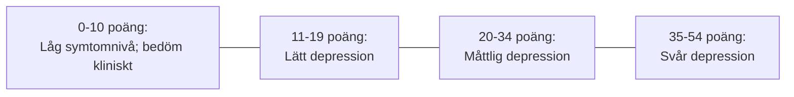
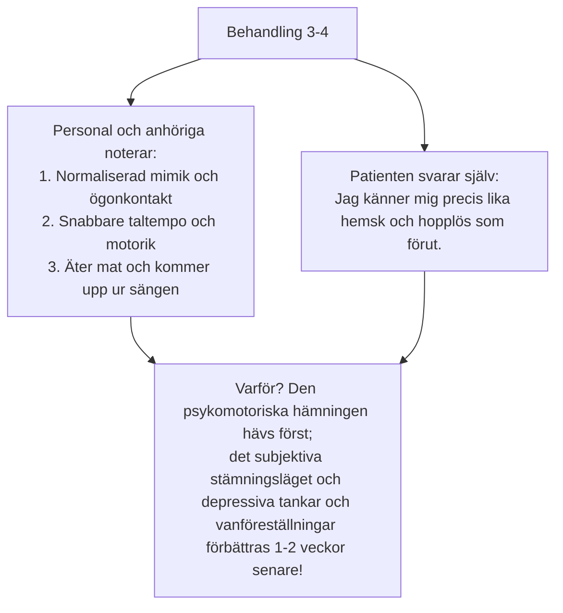

# Klinisk utvärdering

En förutsättning för evidensbaserad ECT är systematisk, kvantitativ uppföljning av patientens stämningsläge och kognition. 

I svensk psykiatri och i **Kvalitetsregistret ECT** är **MADRS-S** (*Montgomery-Åsberg Depression Rating Scale - Self-rating*) och **CGI** (*Clinical Global Impression*) standardiserade grundinstrument.

---

## MADRS-S: poäng och tolkning

MADRS-S omfattar 9 delområden med poäng 0-6 (totalt 0-54 poäng):
1. Sinnesstämning
2. Oroskänslor
3. Sömn
4. Matlust
5. Koncentrationsförmåga
6. Initiativförmåga
7. Känslomässigt engagemang
8. Pessimism
9. Livslust (suicidtankar)

### Utfallsmått
- **Remission (behandlingsmålet!):** MADRS-S **≤ 10 poäng** (i vissa studier ≤ 12 poäng). Gränsen ska anges för den använda skalan och sammanhanget; låg poäng ensam visar inte full återhämtning eller frånvaro av suicidrisk. Blanda inte ihop MADRS (0-60) och MADRS-S (0-54).
- **Respons (kliniskt svar):** Minst **50 % reduktion** av den totala MADRS-poängen jämfört med utgångsvärdet före behandling 1.
- **Partiell respons:** 25-49 % symtomreduktion.
- **Utebliven respons (terapisvikt):** < 25 % symtomreduktion efter fullgod serie.

---

## CGI

CGI skattas av ansvarig läkare, ECT-behandlare eller omvårdnadspersonal:

### 1. CGI-S: svårighetsgrad
Skattas före behandlingsstart och efter avslutad serie:

1. Normal, inte alls psykiskt sjuk
2. Gränsfall
3. Lindrigt sjuk
4. Måttligt sjuk
5. Påtagligt sjuk
6. Svårt sjuk (typisk inneliggande melankoli)
7. Bland de allra svårast sjuka patienterna

### 2. CGI-I: förbättring
Skattas under seriens gång jämfört med utgångsläget:

1. **Mycket stor förbättring (*very much improved*)** → Stor förbättring från utgångsläget; kan föreligga trots kvarstående symtom och är inte liktydigt med remission.
2. **Stor förbättring (*much improved*)** → Klinisk förbättring; inte identiskt med en viss procentuell skalreduktion.
3. **Liten förbättring (*minimally improved*)**
4. **Ingen förändring (*no change*)**
5. **Försämrad (skalsteg 5-7)**

---

## När skattning och bedömning skiljer sig

Ett mycket vanligt kliniskt fenomen under de första 3-5 behandlingarna är att **omgivningen ser en tydlig förbättring långt innan patienten själv känner den**:

> [!TIP] Kliniskt och pedagogiskt råd till teamet
> Bli inte modfälld om patienten själv skattar högt på MADRS-S vid behandling 4 trots att personalen rapporterar att patienten är uppe och pratar. Fråga specifikt efter motorik, aptit och sömn. Den subjektiva förbättringen av stämningsläget kommer som regel vid behandling 6-8!
