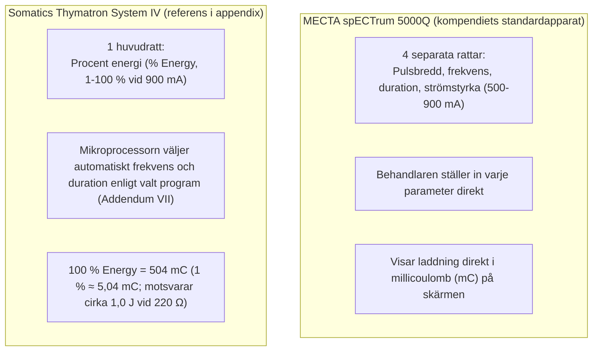

# Appendix: Thymatron System IV

> [!IMPORTANT] Kompendiets huvudapparatur är MECTA spECTrum 5000Q
> Hela detta kompendium (kapitel `01`-`09`) utgår **uteslutande från MECTA spECTrum 5000Q** som behandlingsapparat vid behandlingsbordet.
> 
> Eftersom **Somatics Thymatron System IV** förekommer på andra sjukhus i Sverige och registreras i [[04 Kvalitetsregistret för ECT|Kvalitetsregistret för ECT]], samlas här teknisk referensinformation och tabellbilder från **Addendum VII**. De är inte en konverteringsguide till en kliniskt likvärdig MECTA-ordination.

---

## MECTA 5000Q och Thymatron System IV

| Funktion, egenskap | MECTA spECTrum 5000Q | Somatics Thymatron System IV |
| :--- | :--- | :--- |
| **Strömstyrka (I)** | 500-900 mA i Full Spectrum; fast 800 mA i optimerade program | **900 mA (0,9 A)** konstant |
| **Dosinställning** | Fyra separata rattar (PW, F, D, I) | En ratt (`% Energy`, 1-100 %; samt modell med dubbel dos upp till $200\ \% = 1008\text{ mC}$) |
| **Maximal laddning (standard och dubbel)** | **1152 mC** för 200 J-huvudapparaten; **576 mC** för eventuell 100 J-reservapparat. Programgränser tillkommer | **504 mC** (100 %) respektive **1008 mC** (200 %, *Double Dose*) |
| **Statiskt impedanstest** | **Kontinuerligt aktivt** så snart elektroderna har hudkontakt (100-5000 Ω) | Kräver knapptryck på `IMPEDANCE TEST` (100-3000 Ω) |
| **Stimuleringsknapp** | Håll `STIMULUS CONTROL` **intryckt under hela pulståget** tills tonen tystnar | Tryck på `TREAT` (hålls intryckt under stimuleringen) |
| **Automatiska EEG-index** | Analysfunktionerna beror på version och tillval; ingen generell 80 %-gräns | **PSI** (*Postictal Suppression Index*; inte ensamt effektkriterium) och **SEI** (*Seizure Energy Index*) |

---

## 1. Laddning och energi vid 220 Ω

På Thymatron System IV är sambandet mellan `% Energy`-ratten och den levererade elektriska laddningen (Q i millicoulomb) **helt linjärt** oavsett vilket av de fem stimuleringsprogrammen som är inställt:
$$Q\ (\text{mC}) = \text{\% Energy} \times 5{,}04\text{ mC}$$
Vid en antagen dynamisk patientimpedans på 220 Ω motsvarar varje procentenhet nästan exakt **1,0 joule** ($100\ \% = 99{,}8\text{ J}$ vid 220 Ω).

### Tabell A: Laddning och energi, 1-22 %

| % Energy | 1 | 2 | 3 | 4 | 5 | 6 | 7 | 8 | 9 | 10 | 11 | 12 | 13 | 14 | 15 | 16 | 17 | 18 | 19 | 20 | 21 | 22 |
| :--- | :---: | :---: | :---: | :---: | :---: | :---: | :---: | :---: | :---: | :---: | :---: | :---: | :---: | :---: | :---: | :---: | :---: | :---: | :---: | :---: | :---: | :---: |
| **Laddning (mC)** | 5,0 | 10,1 | 15,1 | 20,2 | 25,2 | 30,2 | 35,3 | 40,3 | 45,4 | 50,4 | 55,4 | 60,4 | 65,5 | 70,6 | 75,6 | 80,6 | 85,7 | 90,7 | 95,8 | 101 | 106 | 110,9 |
| **Energi (J) vid 220 Ω** | 1,0 | 2,0 | 3,0 | 4,0 | 5,0 | 6,0 | 7,0 | 8,0 | 9,0 | 10,0 | 11,0 | 12,0 | 13,0 | 14,0 | 15,0 | 16,0 | 17,0 | 18,0 | 19,0 | 20,0 | 21,0 | 22,0 |

### Tabell B: Laddning och energi, 23-100 %

| % Energy | 23 | 24 | 25 | 26 | 27 | 28 | 29 | 30 | 35 | 40 | 45 | 50 | 55 | 60 | 65 | 70 | 75 | 80 | 85 | 90 | 95 | 100 |
| :--- | :---: | :---: | :---: | :---: | :---: | :---: | :---: | :---: | :---: | :---: | :---: | :---: | :---: | :---: | :---: | :---: | :---: | :---: | :---: | :---: | :---: | :---: |
| **Laddning (mC)** | 116 | 121 | 126 | 131 | 136 | 141 | 146 | 151 | 176,4 | 202 | 227 | 252 | 277 | 302 | 328 | 353 | 378 | 403 | 428 | 454 | 479 | 504 |
| **Energi (J) vid 220 Ω** | 23,0 | 24,0 | 25,0 | 25,9 | 26,9 | 27,9 | 28,9 | 29,9 | 34,9 | 39,9 | 44,9 | 49,9 | 54,9 | 59,9 | 64,9 | 69,9 | 74,9 | 79,8 | 84,8 | 89,8 | 94,8 | 99,8 |

### Samma laddning, olika behandlingsparametrar

Omräkning av Thymatrons procenttal till mC kan beskriva laddningen. Den fastställer inte en kliniskt likvärdig MECTA-ordination, eftersom bland annat strömstyrka, pulsbredd, frekvens och elektrodplacering påverkar utfallet.

Den tidigare tabellen över ”motsvarande” MECTA-inställningar har tagits bort: flera rader skilde sig betydligt i laddning och gav ostyrkta kliniska dosbeteckningar. Vid apparatbyte krävs läkarbedömning, fullständiga tidigare parametrar och eventuellt ny tröskelbestämning.

---

## 2. Stimuleringsprogram (Addendum VII)

På Thymatron System IV avgör det inställda programmet hur mikroprocessorn kombinerar **pulsbredd (ms)**, **frekvens (Hz)**, **antal pulser (*pulse number*)** och **duration (s)** för varje steg på `% Energy`-ratten:

### Program 1: DGX (1,0 ms)
- **Princip:** Håller pulsbredden fast vid **1,0 ms** över hela skalan (1-100 %).
- **Frekvenssteg:**
    - `1-25 % Energy`: **30 Hz** (duration 0,08 s → 2,32 s; 6 → 140 pulser).
    - `26-50 % Energy`: Hoppar upp till **50 Hz** (duration sjunker först till 1,45 s vid 26 % och ökar till 2,79 s vid 50 %; 146 → 280 pulser).
    - `55-100 % Energy`: Hoppar upp till **70 Hz** (duration 2,19 s → 3,99 s; 308 → 560 pulser).

### Program 2: LOWEST CHARGE RATE
- **Princip:** Prioriterar ultrakort pulsbredd (**0,25 ms**) och lägsta möjliga laddningshastighet upp till 50 % energi, men **växlar automatiskt till 0,5 ms vid 55-100 %** för att inte behöva driva upp frekvensen över 70 Hz.
- **Steg:**
    - `1-5 %`: 0,25 ms, **10 Hz**, duration 1,05 → 5,55 s (22 → 112 pulser).
    - `6-10 %`: 0,25 ms, **20 Hz**, duration 3,33 → 5,58 s (134 → 224 pulser).
    - `11-20 %`: 0,25 ms, **30 Hz**, duration 4,08 → 7,45 s (246 → 448 pulser).
    - `21-25 %`: 0,25 ms, **40 Hz**, duration 5,86 → 6,99 s (470 → 560 pulser).
    - `26-35 %`: 0,25 ms, **50 Hz**, duration 5,81 → 7,83 s (582 → 784 pulser).
    - `40 %`: 0,25 ms, **60 Hz**, duration 7,46 s (896 pulser).
    - `45-50 %`: 0,25 ms, **70 Hz**, duration 7,19 → 7,99 s (1008 → 1120 pulser).
    - `55 %` (**obs: växlar till 0,5 ms!**): 0,5 ms, **40 Hz**, duration 7,69 s (616 pulser).
    - `60-70 %`: 0,5 ms, **50 Hz**, duration 6,71 → 7,83 s (672 → 784 pulser).
    - `75-85 %`: 0,5 ms, **60 Hz**, duration 6,99 → 7,93 s (840 → 952 pulser).
    - `90-100 %`: 0,5 ms, **70 Hz**, duration 7,19 → 7,99 s (1008 → 1120 pulser).

![[Thymatron Addendum VII DGX och Lowest Charge Rate.webp|Thymatron Addendum VII DGX och Lowest Charge Rate]]
*Figur 1: Originalsida 1 ur Addendum VII (Thymatron System IV): Detaljerade stimulustabeller för programmet **DGX** (1,0 ms) samt programmet **LOWEST CHARGE RATE (0,25)** (0,25 ms upp till 50 %, därefter 0,5 ms).*

---

### Program 3: LOW 0,25 CHARGE RATE
- **Princip:** Till skillnad från *Lowest Charge Rate* behåller detta program **0,25 ms pulsbredd över hela skalan 1-100 %**.
- **Steg:**
    - `1-50 % Energy`: Identiskt med *Lowest Charge Rate* ovan (0,25 ms, frekvens 10 → 70 Hz, duration upp till 7,99 s vid 50 %).
    - `55-100 % Energy`: För att behålla 0,25 ms inom den maximala tiden 8,0 s höjs frekvensen kraftigt:
        - `55 %`: **80 Hz**, 0,25 ms, 1232 pulser, 7,69 s.
        - `60 %`: **90 Hz**, 0,25 ms, 1344 pulser, 7,46 s.
        - `65-70 %`: **100 Hz**, 0,25 ms, 1456 → 1568 pulser, 7,28 → 7,84 s.
        - `75 %`: **110 Hz**, 0,25 ms, 1680 pulser, 7,63 s.
        - `80-85 %`: **120 Hz**, 0,25 ms, 1792 → 1904 pulser, 7,46 → 7,93 s.
        - `90 %`: **130 Hz**, 0,25 ms, 2016 pulser, 7,75 s.
        - `95-100 %`: **140 Hz**, 0,25 ms, 2128 → 2240 pulser, 7,60 → 8,00 s.

### Program 4: LOW 0,50 CHARGE RATE
- **Princip:** Ett program med fast pulsbredd på 0,5 ms; användningens omfattning i Sverige är inte verifierad här. Låser pulsbredden vid **0,5 ms** (nära kronaxin för centrala axon hos människa) och prioriterar **lång pulstågsduration** och **låg frekvens** för att undvika stimulering under neuronens refraktärperiod.
- **Steg:**
    - `1-10 %`: 0,5 ms, **10 Hz**, duration 0,50 → 5,55 s (11 → 112 pulser).
    - `11-25 %`: 0,5 ms, **20 Hz**, duration 3,05 → 6,98 s (123 → 280 pulser).
    - `26-40 %`: 0,5 ms, **30 Hz**, duration 4,83 → 7,45 s (291 → 448 pulser).
    - `45-55 %`: 0,5 ms, **40 Hz**, duration 6,29 → 7,69 s (504 → 616 pulser).
    - `60-70 %`: 0,5 ms, **50 Hz**, duration 6,71 → 7,83 s (672 → 784 pulser).
    - `75-85 %`: 0,5 ms, **60 Hz**, duration 6,99 → 7,93 s (840 → 952 pulser).
    - `90-100 %`: 0,5 ms, **70 Hz**, duration 7,19 → 7,99 s (1008 → 1120 pulser).

![[Thymatron Addendum VII Low 025 och Low 050.webp|Thymatron Addendum VII Low 025 och Low 050]]
*Figur 2: Originalsida 2 ur Addendum VII (Thymatron System IV): Detaljerade stimulustabeller för programmet **LOW 0,25 CHARGE RATE** (0,25 ms upp till 100 %) samt programmet **LOW 0,50 CHARGE RATE** (0,5 ms upp till 100 %).*

---

### Program 5: INTERMITTENT (1,0 ms)
- **Princip:** Använder samma pulsbredd (**1,0 ms**), frekvens (30 / 50 / 70 Hz) och exakt samma antal pulser som **DGX-programmet**, men skjuter in pauser mellan pulsskurarna så att den totala pulstågsdurationen blir nästan **dubbelt så lång** (t.ex. 7,89 s i stället för 3,99 s vid 100 % energi).

![[Thymatron Addendum VII Intermittent och Laddningstabell.webp|Thymatron Addendum VII Intermittent och Laddningstabell]]
*Figur 3: Originalsida 3 ur Addendum VII (Thymatron System IV): Detaljerad tabell för programmet **INTERMITTENT** samt tabellen **Charge and Energy at the % Energy Settings of Stimulus Dose Dial** (mC och joule vid 220 Ω).*

---

## Referenser

1. [Somatics LLC. Thymatron System IV User Manual. Rev. 22](https://www.thymatron.com/downloads/System_IV_Instruction_Manual_Rev22.pdf). 14 % × 5.04 mC = 70.56 mC, avrundat 70.6 mC. Övriga programtabeller behöver stämmas av mot den använda apparatens programversion före klinisk användning.

Apparatens egen manual är huvudkälla för program, procenttal och tabeller i detta appendix; generella ECT-böcker anger inte dessa apparatspecifika värden.

---

## Relaterade länkar
- Vår huvudapparat i kompendiet: [[01 Översikt|Översikt]]
- De fyra rattarna på MECTA 5000Q: [[03 Parameterinställningar|Parameterinställningar]]
- Titreringstabeller för MECTA 5000Q: [[04 Titreringstabeller|Titreringstabeller]]
- Källgenomgång och manualer: [[01 Källor och referenser|Källor och referenser]]
